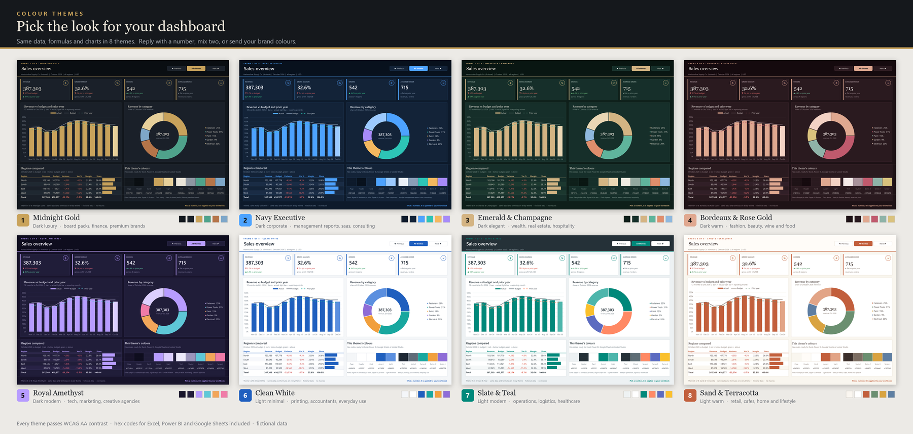
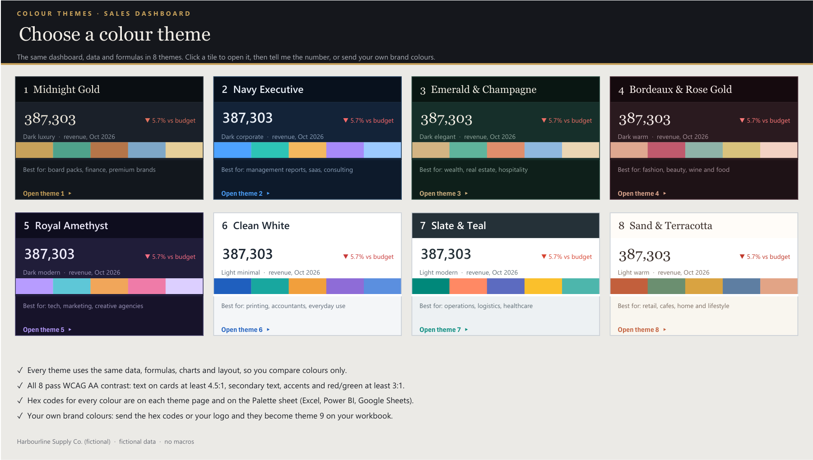
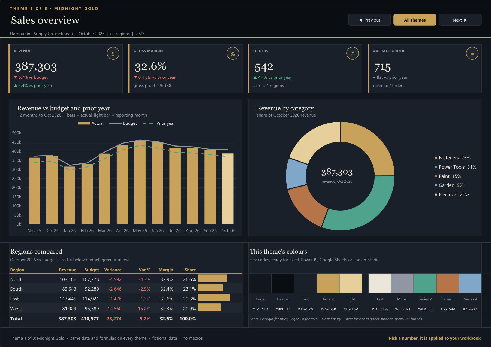
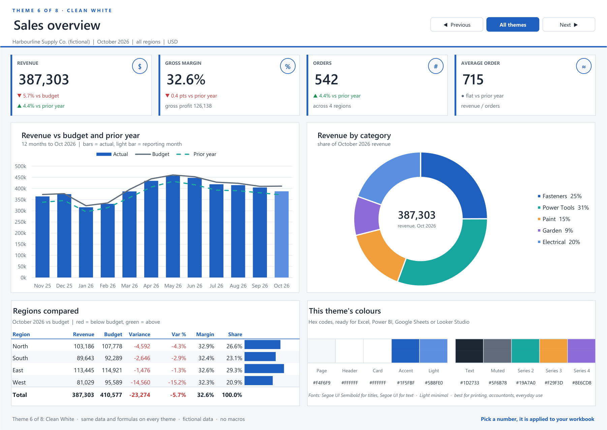
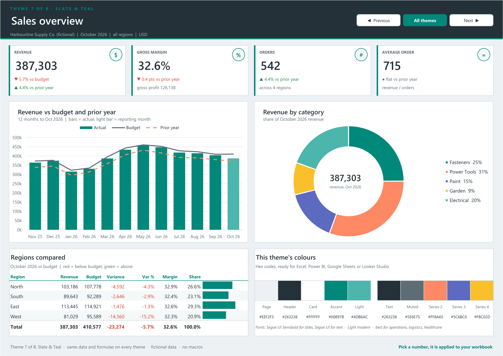
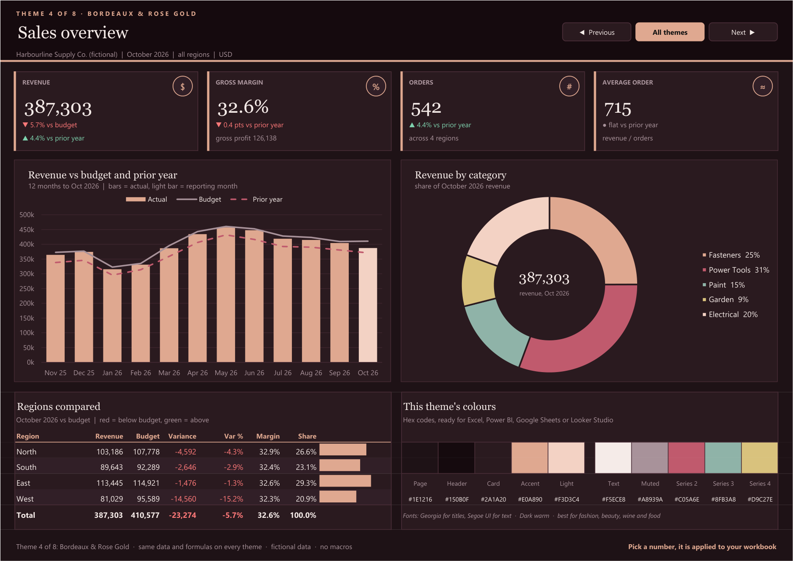
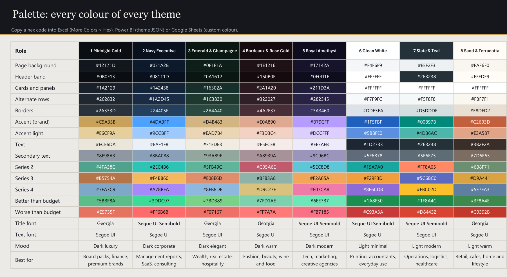

# E0 · Colour theme gallery: one Excel dashboard in 8 themes, the client picks

**The same sales dashboard, data and formulas drawn in 8 ready-made colour themes (5 dark, 3 light).**
Send it with a proposal or at the start of a job: the client clicks through the themes, replies with a number,
and the workbook they ordered is delivered in that look. No guessing about taste, no redesign round later.



▶ **[Demo video (62 s, MP4)](docs/demo.mp4)**: the Themes page, then all 8 dashboards one after another, the hex codes and the Palette sheet. Real screen recording, captions added.

## The themes

| # | Theme | Mood | Best for | Accent |
|---|---|---|---|---|
| 1 | Midnight Gold | Dark luxury | Board packs, finance, premium brands | `#C9A35B` |
| 2 | Navy Executive | Dark corporate | Management reports, SaaS, consulting | `#4DA3FF` |
| 3 | Emerald & Champagne | Dark elegant | Wealth, real estate, hospitality | `#D4B483` |
| 4 | Bordeaux & Rose Gold | Dark warm | Fashion, beauty, wine and food | `#E0A890` |
| 5 | Royal Amethyst | Dark modern | Tech, marketing, creative agencies | `#B79CFF` |
| 6 | Clean White | Light minimal | Printing, accountants, everyday use | `#1F5FBF` |
| 7 | Slate & Teal | Light modern | Operations, logistics, healthcare | `#00897B` |
| 8 | Sand & Terracotta | Light warm | Retail, cafes, home and lifestyle | `#C2603D` |

Mixing is fine ("theme 6 with the accent of theme 1"), and a client's own brand colours become theme 9: one
more entry in `scripts/themes.py`, rebuilt and checked like the other eight.



## What each theme page shows

Header band with brand line, title and Previous / All themes / Next buttons · 4 KPI cards with an icon and ▲▼
notes vs budget and prior year (red/green by conditional formatting) · revenue vs budget and prior year, 12 months
(reporting month highlighted) · category doughnut with the total in the centre · region table with red/green
variances and share bars · the theme's own 10 swatches with hex codes and font pairing.

October 2026 (fictional *Harbourline Supply Co.*): revenue 387,303, −5.7% vs budget, +4.4% vs prior year; margin
32.6%; West is 15.2% below budget, the other regions within 4.3%.









Screenshots of the other four: [2 Navy Executive](docs/theme-2-navy-executive.png),
[3 Emerald & Champagne](docs/theme-3-emerald-champagne.png), [5 Royal Amethyst](docs/theme-5-royal-amethyst.png),
[8 Sand & Terracotta](docs/theme-8-sand-terracotta.png).

## Palette sheet

All 14 colour roles of every theme (page, header, cards, alternate rows, borders, accent, accent light, text,
secondary text, three more chart series, better / worse than budget) plus the font pairing, each cell painted in
the colour it names, ready to copy into Excel, a Power BI theme file or Google Sheets.



## Behind the pages

| Sheet | What it holds |
|---|---|
| **Calc** | Every number the pages show as a plain `SUMIFS` on the Sales table, so all 8 themes always agree |
| **Data** | The Sales table: 24 months × 4 regions × 5 categories (revenue, budget, cost, orders) |
| **How to use** | How to browse, how to reply with a choice, how to ask for your brand colours |

No macros, no add-ins: opens in Excel 2016 or newer and in Excel for the web.

## Proof: 91 automated checks

`test/verify.py` reads the saved file without Excel and checks it against Python and against `themes.py`:

- every KPI, ▲▼ note and region-table cell on all 8 pages = a Python recomputation from `data/sales.csv`;
  the 12-month chart data and the category split too; no `#REF!` / `#N/A` anywhere
- every theme page is painted in its own colours: header, page, rule, cards, stripes, title/label fonts, the
  10 swatches and their hex codes, the red/green conditional formats
- both charts of every page are drawn in the theme's colours (read from the chart XML)
- WCAG AA contrast **measured on the painted cells**: text and secondary text on cards ≥ 4.5:1, accent and
  red/green ≥ 3:1, for all 8 themes
- Previous / All themes / Next buttons and the 8 tiles link to the right sheets; the Palette sheet's 112 cells
  match their hex codes

```
python test/verify.py      ->  91/91 checks passed
```

## Rebuild

```
python scripts/make_data.py                         # data/sales.csv (fictional, seeded)
python scripts/build_workbook.py                    # Theme-Gallery.xlsx via Excel COM
python scripts/shots.py                             # docs/*.png (Excel's own PDF renderer)
python scripts/make_catalog.py 91/91                # docs/theme-catalog.png + thumbnail.png
python test/verify.py
```

All names, companies and amounts are fictional. MIT licence.
