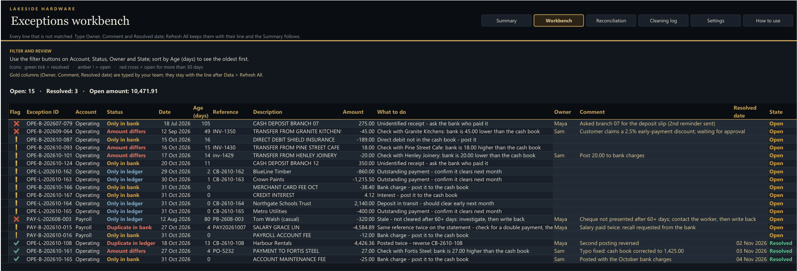
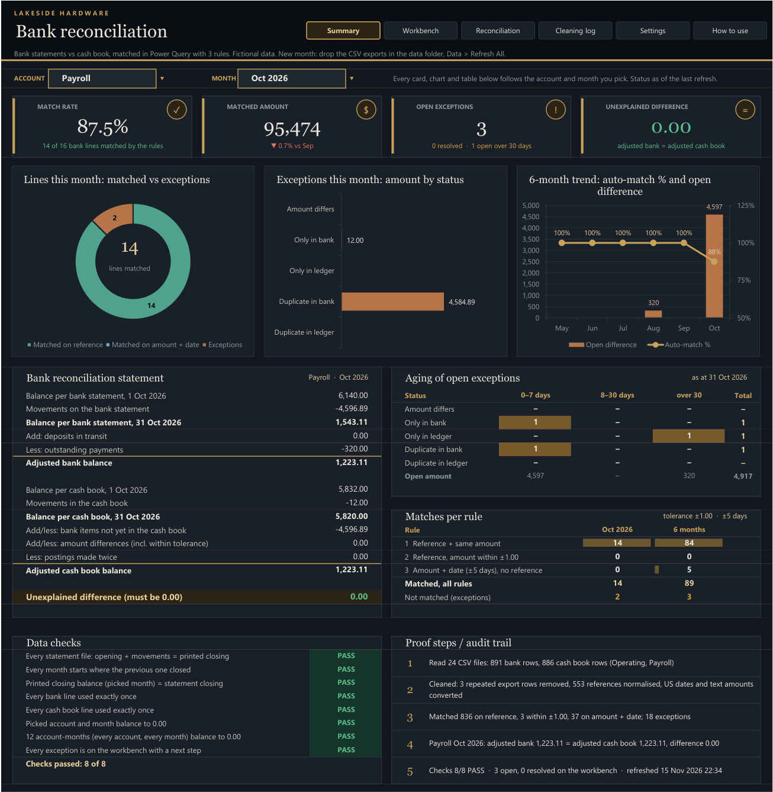
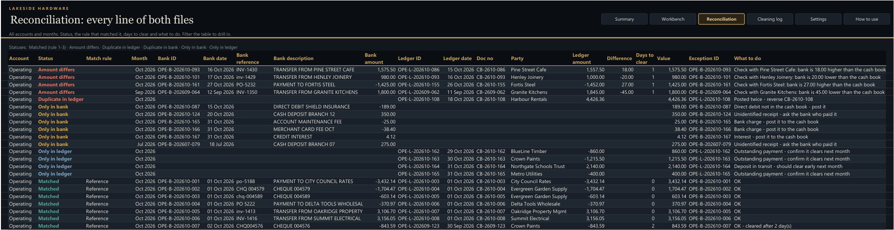
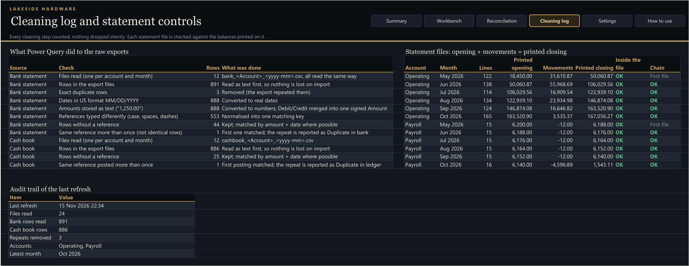

# E1 · Bank reconciliation in Excel: messy exports in, a balanced reconciliation out

**Bank statement CSVs + cash book CSVs (2 accounts × 6 months) → Power Query cleans and matches them with 3 rules →
every difference explained, owned and aged, and a reconciliation statement that must end at 0.00.**
No macros. Next month: drop in the new files, press **Refresh All**.

▶ **[Demo video (68 s, MP4)](docs/demo.mp4)**: raw CSV → Refresh All → dashboard → pick an account → resolve an
exception on the workbench → Refresh: the Summary follows. Real screen recording, captions added.

## The problem this solves

A small business (here the fictional *Lakeside Hardware Ltd*) reconciles two bank accounts by hand every month:
exports side by side, ticking lines, hunting for the last few dollars. The exports never line up neatly:

- amounts stored as text (`"1,250.00"`), dates in US format, debit and credit in separate columns
- the same reference typed four ways (`INV-1023`, `INV1023`, `inv-1023 `, ` INV 1023`), or no reference at all
- the bank export repeats a row now and then; the cash book has a receipt posted twice; the bank paid a salary twice
- bank charges, interest and direct debits the cash book only posts days later; cheques that clear next month
- customers who paid a little less (fee deducted), a few cents of FX rounding, a typo in the cash book

## What the workbook does

| Sheet | What you get |
|---|---|
| **Summary** | Account + month pickers; 4 icon KPI cards (match rate, matched amount, open exceptions, unexplained difference); donut matched vs exceptions; exception amount by status; 6-month trend of auto-match % and open difference; **aging heat grid** (0–7 / 8–30 / over 30 days); **matches per rule**; the **bank reconciliation statement** (adjusted bank = adjusted cash book); 8 PASS/FAIL data checks; a **proof steps / audit trail** box |
| **Exceptions workbench** | Every unmatched line with a next step, status icons, filter buttons and three columns your team types in: **Owner, Comment, Resolved date**. A self-referencing query keeps them with their line on every Refresh, and resolved items drop out of the open counts, the aging and the trend |
| **Reconciliation** | Every line of every file: status, matching rule, days to clear, what to do |
| **Cleaning log** | Every cleaning step counted; each statement file checked (opening + movements = printed closing, each month starts where the last closed); audit trail of the last refresh |
| **Settings** | Data folder, **amount tolerance (±1.00)** and **days tolerance (±5)**, bank accounts with opening balances |

**Matching rules** (Power Query, per account, across months, so a cheque written 30 Sep that clears 2 Oct is matched):
1. same reference + same amount;
2. same reference, amount within the tolerance (FX / rounding);
3. no usable reference: amount within the tolerance and dates within the days tolerance, closest pair first, each line used once
   (bank charges posted next month, customers who forgot the invoice number).

Statuses that need a person: **Amount differs · Duplicate in ledger · Duplicate in bank · Only in bank · Only in ledger**.

## Result (Operating account, October 2026)

| | |
|---|---|
| Bank lines matched by the 3 rules | **157 of 165 (95.2%)**: 154 on reference, 1 within ±1.00, 2 on amount + date |
| Lines that need a person (October) | **13**, each with a next step; on the workbench **12 open, 3 resolved**, 2 open for more than 30 days |
| Reconciliation statement | adjusted bank **166,720.77** = adjusted cash book **166,720.77** |
| Unexplained difference | **0.00**, and 0.00 for **all 12 account-months** (2 accounts × May–Oct) |
| Whole history (24 files, 891 bank rows, 886 cash book rows) | 836 matched on reference, 3 within tolerance, 37 on amount + date, 18 exceptions |

## Proof the numbers are right

[`test/verify.py`](test/verify.py) does the whole reconciliation again in plain Python ([`test/recon_py.py`](test/recon_py.py)),
straight from the 24 CSV files, and compares it with **(a)** the answer planted when the data was generated and **(b)** the
workbook: every pair of lines and its rule, every statement line, KPI card, chart series, trend point, aging cell, rule
count, data check and workbench note, for four account/month picks and for all 12 account-months. Then it copies the
workbook to another folder and refreshes it there: typed notes survive, a newly resolved item flows into the Summary,
and tighter tolerances (±0.50, ±1 day) give exactly the Python result. Result: **149/149 checks pass**.

## Use it with your own data

1. Export each bank statement and cash book as CSV into the `data` folder: `bank_<Account>_<yyyy-mm>.csv`, `cashbook_<Account>_<yyyy-mm>.csv`.
2. On **Settings**, list the accounts with their opening balances; adjust the tolerances if you like.
3. **Data → Refresh All**. Pick the account and month on the Summary; work through the **Exceptions workbench**.

Different column names or a different bank format: only the `*_Clean` queries change; matching, Summary and workbench stay the same.
Works in Excel 2016+ / Microsoft 365 for Windows (Power Query is built in).

## Files

| Path | What |
|---|---|
| `Two-Source-Reconciliation.xlsx` | The workbook (no macros) |
| `data/` | 24 fictional CSV exports (2 accounts × 6 months × bank + cash book) |
| `scripts/make_data.py` | Generates the fictional data with every case planted on purpose (and the demo workbench notes) |
| `scripts/build_workbook.py`, `scripts/summary_sheet.py`, `scripts/lux.py` | Build the workbook with real Excel (Power Query M code is readable in the script) |
| `test/verify.py`, `test/recon_py.py`, `test/expected.json` | Independent check |
| `scripts/shots.py`, `scripts/make_thumb.py` | Screenshots and thumbnail in `docs/` |

All names, companies and amounts are fictional.
