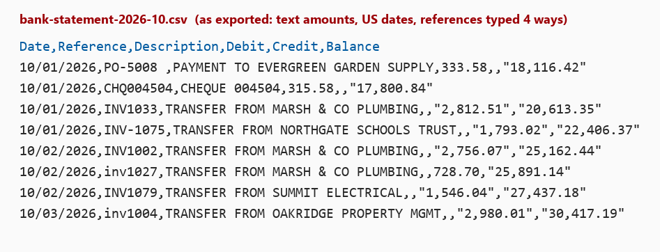
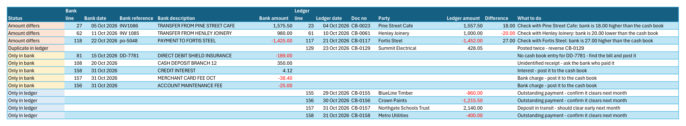

# E1 · Bank reconciliation in Excel: two messy exports in, a balanced reconciliation out

**Bank statement CSV + cash book CSV → Power Query cleans and matches them → every difference explained, with a next step, and a reconciliation statement that must end at 0.00.**
No macros. Next month: drop in the new files, press **Refresh All**.

▶ **[Demo video (49 s, MP4)](docs/demo.mp4)**: raw CSV → Refresh All → matched, explained, balanced to 0.00. Real screen recording, captions added.

## The problem this solves

A small business (here the fictional *Lakeside Hardware Ltd*) reconciles its bank account by hand every month:
two exports side by side, ticking lines, hunting for the last few dollars. The exports never line up neatly:

- amounts stored as text (`"1,250.00"`), dates in US format, debit and credit in separate columns
- the same reference typed four ways (`INV-1023`, `INV1023`, `inv-1023 `, ` INV 1023`)
- the bank export repeats a row now and then; the cash book has a receipt posted twice
- bank charges, interest and a direct debit nobody booked; cheques and deposits that have not cleared yet
- customers who paid a little less (fee deducted) or more, and a typo in the cash book

## What the workbook does

| Step | Where | What happens |
|---|---|---|
| 1 | Power Query `Bank_Raw`, `Ledger_Raw` | Reads both CSVs **as text** from the folder on the Settings sheet (nothing is lost on import) |
| 2 | `Bank_Clean`, `Ledger_Clean` | Drops repeated export rows, converts dates and amounts, merges Debit/Credit into one signed amount, builds one matching key from the reference |
| 3 | `Recon` | Full outer merge on the key → **Matched · Amount differs · Duplicate in ledger · Duplicate in bank · Only in bank · Only in ledger**, days to clear, and a plain-English **What to do** for every line |
| 4 | Summary sheet | KPI cards, result by status, chart, **bank reconciliation statement** (adjusted bank = adjusted cash book) and four PASS/FAIL data checks |
| 5 | `Cleaning_Log`, `Bank_Controls` | Counts every cleaning step, and checks that the closing balance printed on the statement equals opening + movements |

## Result for October 2026

| | |
|---|---|
| Bank lines matched automatically | **150 of 158 (94.9%)**, including 39 that cleared 1–3 days after the cash book date |
| Lines that need a person | **13**, each with a next step (below) |
| To post in the cash book | **−301.33** (fees, interest, differences, a double posting) |
| Unexplained difference | **0.00** |

## Proof the numbers are right

[`test/verify.py`](test/verify.py) does the whole reconciliation again in plain Python, straight from the two CSV files,
and compares it with **(a)** the answer planted when the data was generated and **(b)** every status, count and total in the
workbook. Result: **31/31 checks pass**. It also re-opens the workbook from a different folder and refreshes it, to prove
the client can run it on their own PC.

## Use it with your own data

1. Export your bank statement and cash book (or ledger) as CSV into the `data` folder next to the workbook.
2. On **Settings**, type the two file names and the opening balances.
3. **Data → Refresh All**. Read the Summary; work through the **Discrepancies** tab.

Different column names or a different bank format: only the two `*_Clean` queries change; the matching and the
Summary stay the same. Works in Excel 2016+ / Microsoft 365 for Windows (Power Query is built in).

## Files

| Path | What |
|---|---|
| `Two-Source-Reconciliation.xlsx` | The workbook (no macros) |
| `data/` | The two fictional CSV exports |
| `scripts/make_data.py` | Generates the fictional data with every exception case planted on purpose |
| `scripts/build_workbook.py`, `scripts/summary_sheet.py` | Build the workbook with real Excel (Power Query M code is readable in the script) |
| `test/verify.py`, `test/expected.json` | Independent check |
| `scripts/shots.ps1`, `scripts/make_thumb.py` | Screenshots in `docs/` |

All names, companies and amounts are fictional.
