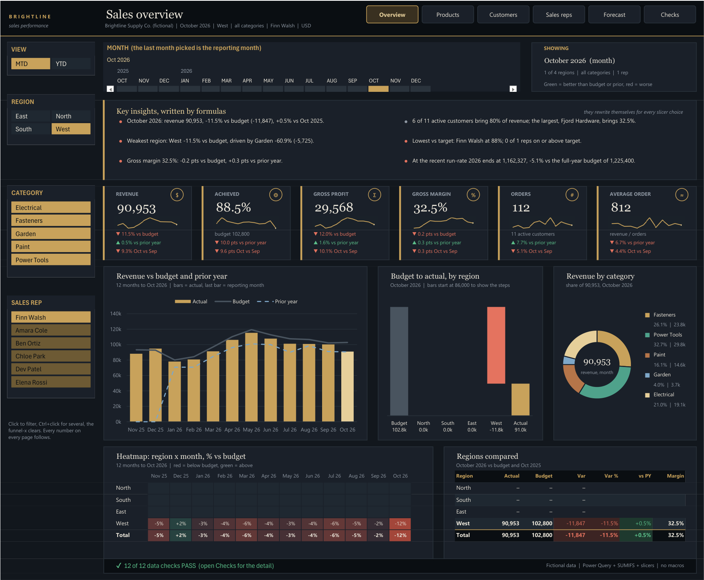
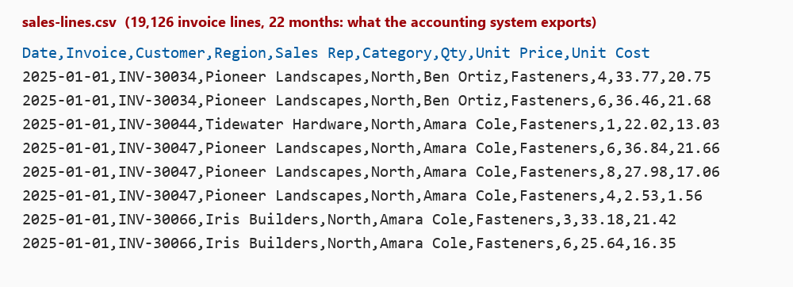
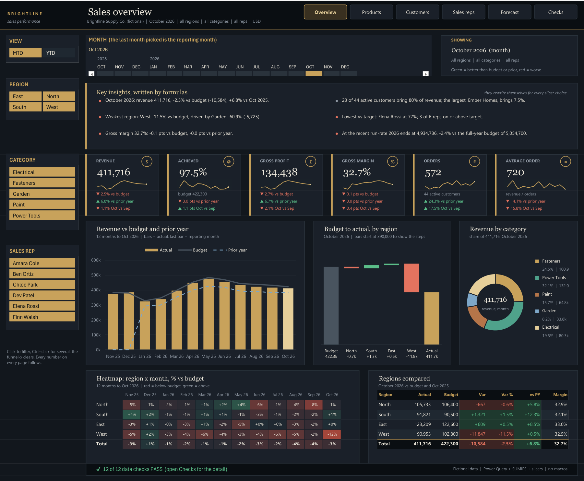
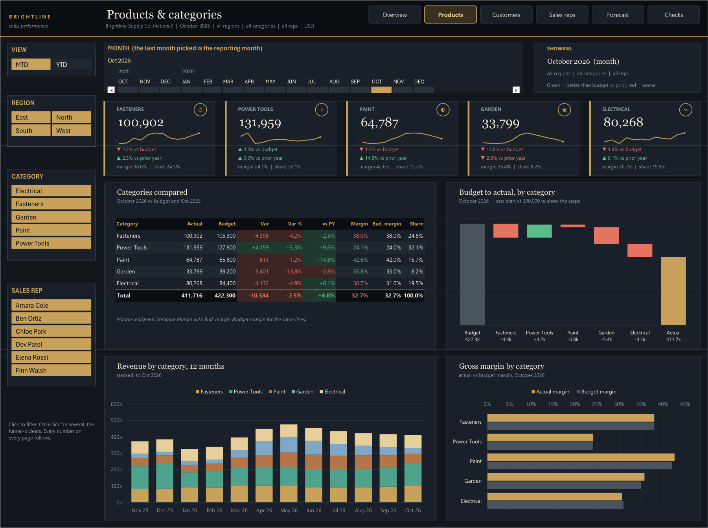
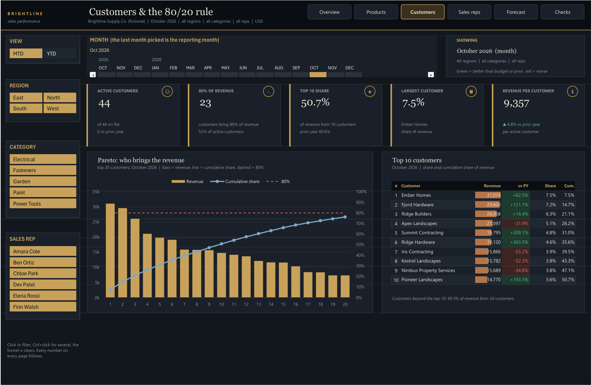
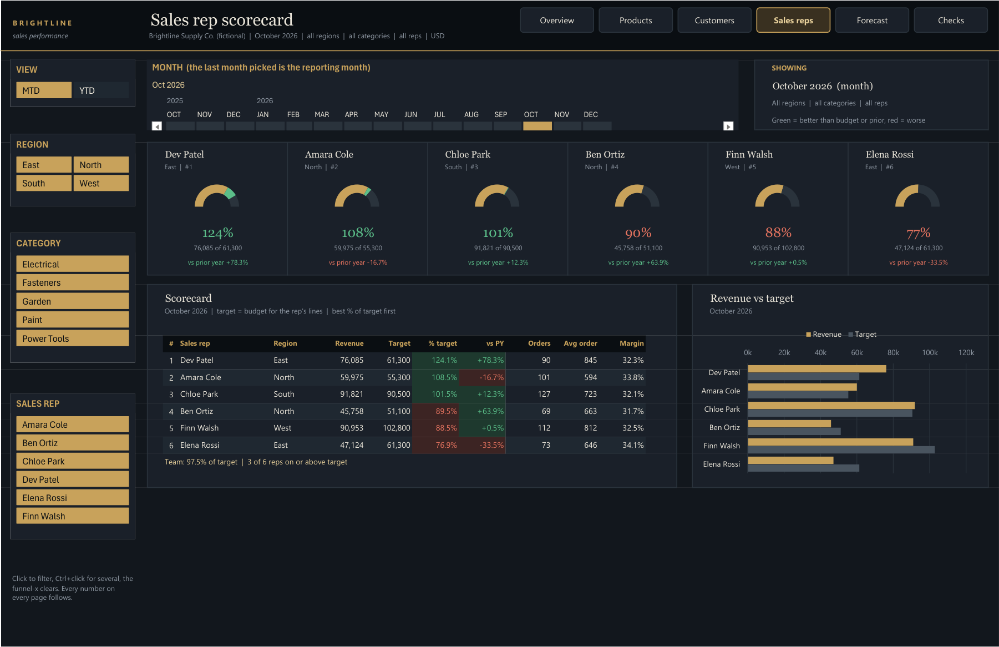
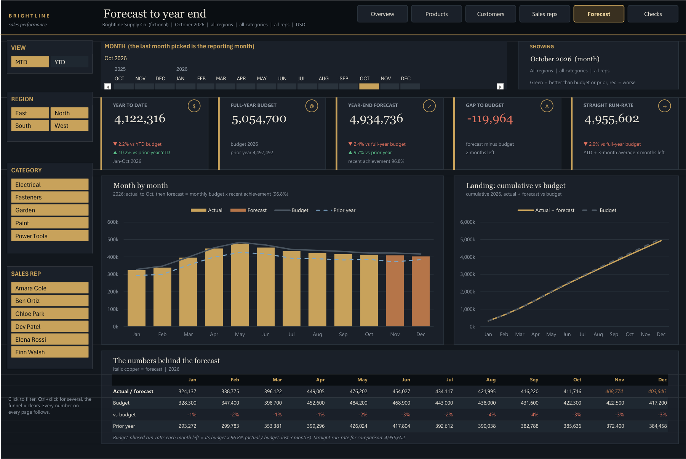
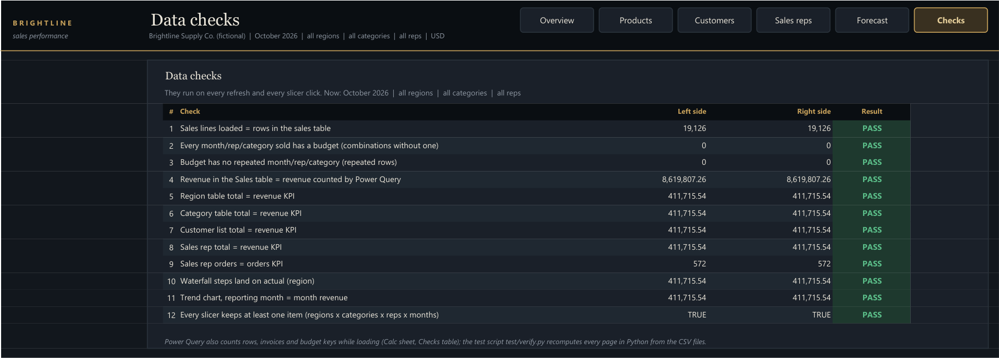
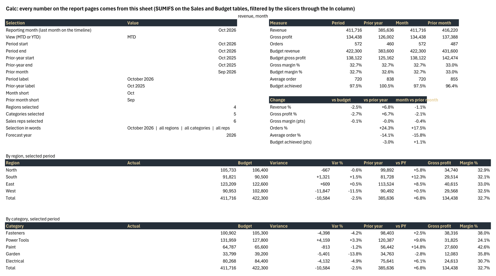

# E2 · Sales dashboard in Excel: budget vs actual vs prior year, six linked pages

**22 months of invoice lines + a full-year budget → Power Query loads them → six dark-gold report pages driven by
slicers and a timeline, with key insights written by formulas.**
No macros, no pivot to refresh by hand. Next month: drop in the new export, press **Refresh All**.

▶ **[Demo video (77 s, MP4)](docs/demo.mp4)**: click a region, switch MTD/YTD, pick a month on the timeline, walk through the six pages. Real screen recording, captions added.

## The problem this solves

A wholesaler (here the fictional *Brightline Supply Co.*) gets one big export from its accounting system every
month and a budget from finance. Someone spends a day each month pasting both into a spreadsheet, building
pivots and charts, and still cannot answer the manager's follow-up questions ("and only West?", "year to date?",
"where do we land in December?") without starting over.

## What the workbook does

| Page | What it shows |
|---|---|
| **Overview** | Key insights banner (6 sentences written by formulas, green/red) · 6 KPI cards with icon, sparkline and ▲▼ vs budget, prior year and prior month · revenue vs budget vs prior year (12 months) · waterfall budget → actual by region · category donut with the total in the centre · heatmap region × month (% vs budget) · region table with red/green cells · data-check status |
| **Products** | One card per category with sparkline · category table (actual, budget, variance, vs prior year, margin vs budget margin, share) · waterfall by category · 12-month stacked revenue · margin vs budget margin |
| **Customers** | Active customers, how many bring 80% of revenue, top-10 share, largest customer · Pareto chart (top 20 + cumulative line + 80% line) · top 10 table with share, cumulative share and vs prior year |
| **Sales reps** | Six gauges (% of target) · scorecard ranked by % of target (revenue, target, vs PY, orders, average order, margin) · revenue vs target chart |
| **Forecast** | Year to date vs budget and prior year · year-end forecast (each month left = its budget × last 3 months' achievement) · straight run-rate for comparison · month-by-month chart and cumulative landing vs budget · the numbers behind it |
| **Checks** | 12 data checks (rows loaded, budget coverage, totals tie out across every page, waterfall lands on actual, slicers not empty) |

Every report page has the same **slicers** on the left (View MTD/YTD, Region, Category, Sales rep) and a **Month
timeline** on top; they are shared, so a click on one page filters all six. Gold navigation buttons link the pages.

Behind the pages:

| Sheet | What it holds |
|---|---|
| **Calc** | Every number the pages show, as plain `SUMIFS` on the two Excel Tables, so any figure can be traced (KPI matrix, 12-month trend, region/category tables, waterfalls, Pareto ranking, rep scorecard, forecast, insight sentences) |
| **Slicer engine** | Each slicer filters a one-field PivotTable; the Sales and Budget tables get an `In` column (1/0) that reads what those PivotTables show. This keeps the slicers *and* traceable formulas |
| **Sales data**, **Budget data** | The two Power Query tables (typed dates and numbers, revenue, cost, margin, one order flag per invoice) |
| **Settings**, **How to use** | Data folder and file names; daily and monthly steps for the client |

## What it shows for October 2026

| | All regions, month | West, month | All regions, YTD (Jan–Oct) |
|---|---|---|---|
| Revenue | 411,716 | 90,953 | 4,122,316 |
| vs budget | −2.5% | **−11.5%** | −2.2% |
| vs prior year | +6.8% | +0.5% | +10.2% |
| Gross margin | 32.7% | 32.5% | 33.1% |

Click **West** and the insight banner explains it: *"Weakest region: West −11.5% vs budget, driven by Garden −60.9%
(−5,725)."* The other three regions are within 2% of budget. 23 of 44 customers bring 80% of revenue; Dev Patel is
at 124% of target, Elena Rossi at 77%; at the recent run-rate 2026 lands at 4,934,736, 2.4% under the full-year budget.

## Proof the numbers are right

[`test/verify.py`](test/verify.py) recomputes every page in plain Python straight from the two CSV files, then opens
the workbook in Excel, clicks the real slicers and timeline through six selections (month and YTD views, one region,
two categories, two reps, an early month with no prior year) and compares the KPI matrix and every change, the
12-month trend and heatmap, region and category tables, both waterfalls, the Pareto ranking, the rep scorecard and
gauges, the forecast, the six insight sentences word for word, and the card notes. It also checks the planted story,
the navigation buttons, slicers and sparklines on every page, that all data checks say PASS, and that no formula needs
a Microsoft 365-only function. Result: **195/195 checks pass**.

## Use it with your own data

1. Export invoice lines (date, invoice, customer, region, sales rep, category, qty, unit price, unit cost) and the
   budget (month, region, sales rep, category, budget revenue, budget margin %) as CSV into the `data` folder.
2. **Data → Refresh All**. New months appear on the timeline automatically.
3. Open **Checks**: all twelve must say PASS.

Different column names: only the `Sales` and `Budget` queries change; Calc and the pages stay the same.
Works in Excel 2016+ / Microsoft 365 for Windows (slicers, timeline and sparklines are standard Excel; no macros).

## Files

| Path | What |
|---|---|
| `Sales-Dashboard.xlsx` | The workbook (no macros) |
| `data/` | Fictional sales lines (19,126 rows, 10,669 invoices, Jan 2025–Oct 2026) and budget (720 rows, to Dec 2026) |
| `scripts/make_data.py` | Generates the fictional data, with seasonality, growth, rep targets and the West/Garden miss planted on purpose |
| `scripts/build_workbook.py` | Builds the workbook with real Excel (Power Query M code and every formula are readable in the script) |
| `test/verify.py`, `test/story.json` | Independent check |
| `scripts/shots.py`, `scripts/make_thumb.py` | Screenshots and thumbnail in `docs/` |

All names, companies and amounts are fictional.
