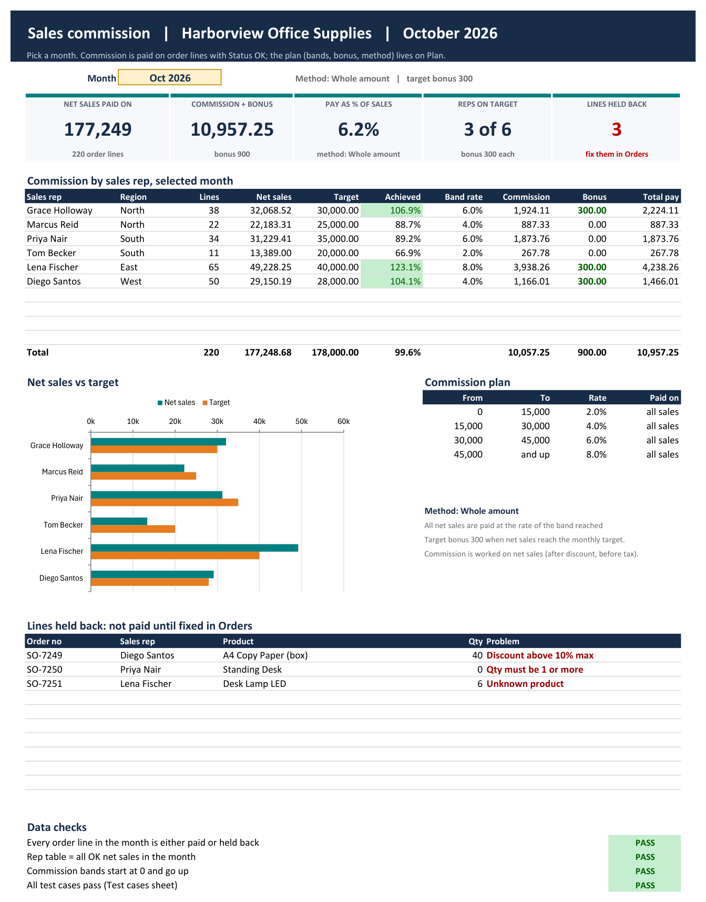
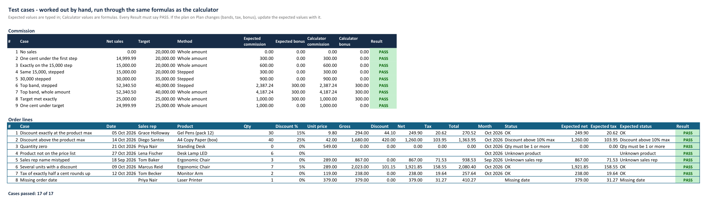
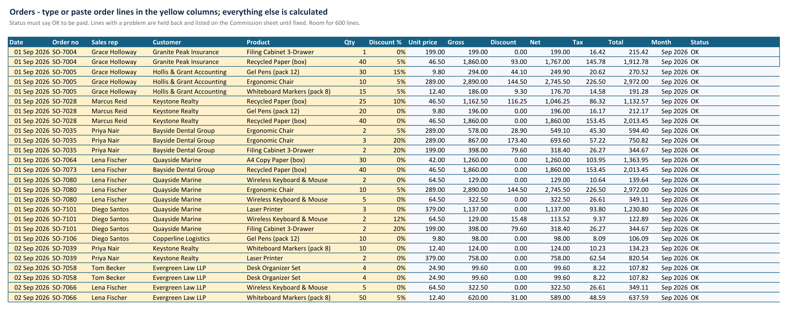

# E3 · Sales & commission calculator in Excel: tiered bands, target bonus, rep statements

**The sales team types order lines → price, discount, tax and total are calculated and locked → pick a month and every
rep's commission, bonus and total pay is ready, with a printable statement per rep.**
Mistyped lines are caught and held back instead of being paid. No macros.

▶ **[Demo video (48 s, MP4)](docs/demo.mp4)**: switch the commission method, type a bad order line and watch it get held back. Real screen recording, captions added.

## The problem this solves

A small company (here the fictional *Harborview Office Supplies*) pays its six sales reps a monthly commission on
tiered bands plus a bonus for reaching target. Today it is a hand-made spreadsheet: prices typed by hand, discounts
nobody checks, a rate looked up by eye, and an argument every month about how the number was worked out.

## What the workbook does

| Sheet | What it does |
|---|---|
| **Orders** | The only place to type (yellow): date, order no, rep and product from drop-downs, quantity, discount. Price, gross, discount, net, tax and total are locked formulas. A **Status** column checks every line: missing date, unknown rep, unknown product, quantity below 1, discount above the product's own maximum. Room for 600 lines. |
| **Commission** | Pick a month: KPI cards, a table per rep (lines, net sales, target, achieved, band rate, commission, bonus, total pay), net sales vs target chart, the plan in words, the **lines held back** with the reason, and four PASS/FAIL data checks |
| **Statement** | Pick a rep and a month: a one-page statement for the rep with the commission **worked out line by line** and every order line it was paid on, ready to print or save as PDF |
| **Plan** | Prices and max discounts, reps and monthly targets, commission bands, tax rate, target bonus, and the method: **Whole amount** (all sales at the band reached) or **Stepped** (each slice at its own band rate) |
| **Test cases** | 17 cases worked out by hand (band edges, one cent under a step, exactly on target, stepped vs whole, half-cent tax, each kind of bad line) run through the very same formulas. All must say PASS. |
| **How to use** | Daily steps for the sales team, month-end steps for the manager |

Formula sheets are protected (no password, so the client stays in control); only the yellow cells can be typed in.
Pasted data skips Excel's validation, which is why the Status column re-checks every line.

## Result for October 2026

| | Whole amount | Stepped |
|---|---|---|
| Net sales paid on (220 lines) | 177,248.68 | 177,248.68 |
| Commission | 10,057.25 | 5,857.25 |
| Target bonus (3 of 6 reps on target) | 900.00 | 900.00 |
| **Total pay** | **10,957.25** | **6,757.25** |
| Lines held back | 3 | 3 |

The three October lines held back were planted on purpose: a 25% discount on copy paper (maximum 10%), a quantity of 0,
and a product that is not on the price list. September has a fourth: a rep's name typed wrong.

## Proof the numbers are right

[`test/verify.py`](test/verify.py) recomputes every order line and every rep's pay in plain Python from
`data/orders.csv` and `data/plan.json`, then opens the workbook in Excel and compares, for **both months and both
methods**: the rep table, totals, held-back list, data checks and the statement of every rep. It also checks that the
held-back lines are exactly the planted mistakes, all 17 test cases pass, inputs are unlocked and validated, formula
sheets are protected, there are no error values and no formula needs Microsoft 365. Result: **36/36 checks pass**.

## Use it for your own team

1. **Plan**: type your products, reps, targets, bands, tax rate, bonus, and pick the method.
2. Update the expected values on **Test cases** so they describe your plan, and check that they say PASS.
3. **Orders**: delete the sample lines, then type or paste your own.
4. Month end: **Commission** → pick the month, fix the lines held back, print a **Statement** per rep.

Built and tested in Excel for Windows, using only Excel 2016 formulas (no Power Query). No macros, so no security warning when the file is opened.

## Files

| Path | What |
|---|---|
| `Sales-Commission-Calculator.xlsx` | The workbook (no macros) |
| `data/orders.csv`, `data/plan.json` | Fictional order lines and plan |
| `scripts/make_data.py` | Generates the fictional data, with four bad lines planted on purpose |
| `scripts/build_workbook.py` | Builds the workbook with real Excel (every formula is readable in the script) |
| `test/verify.py`, `test/planted.json` | Independent check |
| `scripts/shots.ps1`, `scripts/make_thumb.py` | Screenshots in `docs/` |

All names, companies and amounts are fictional.
