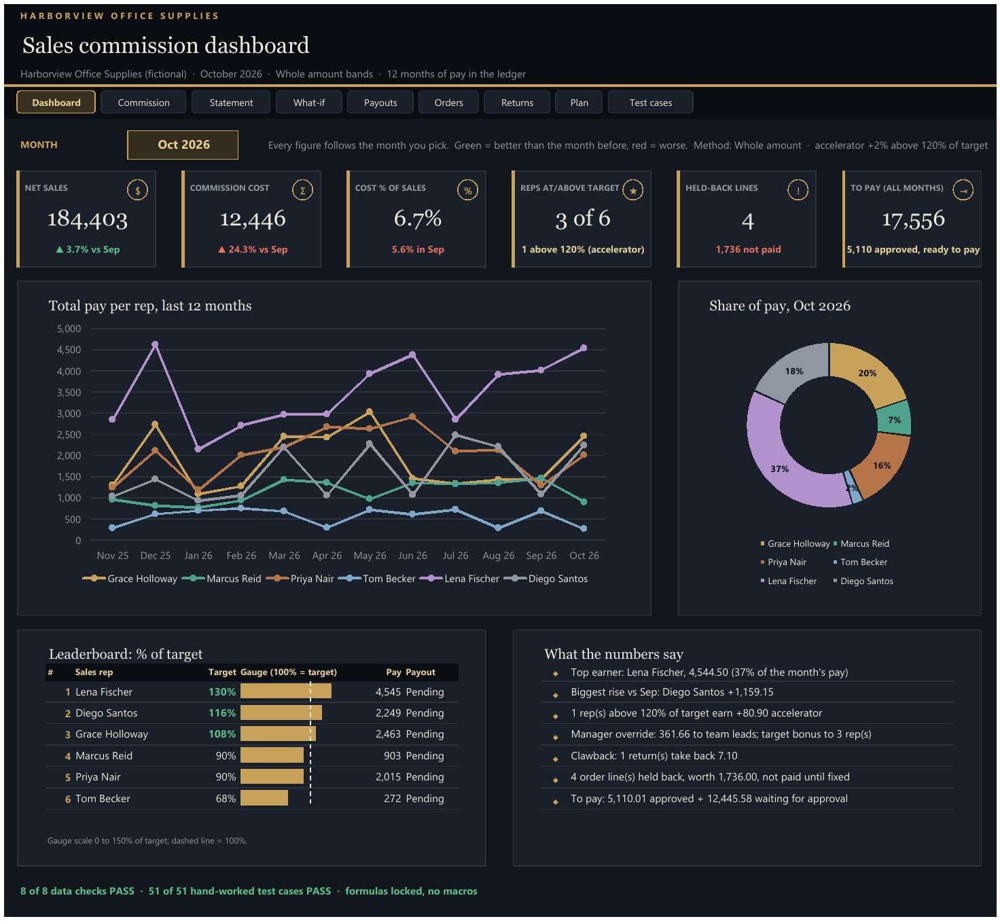
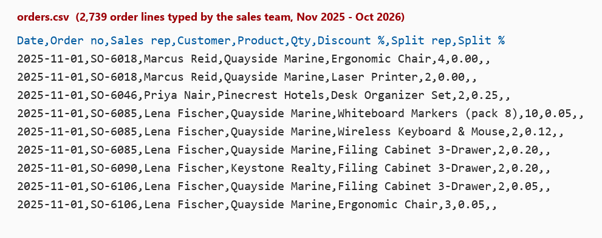
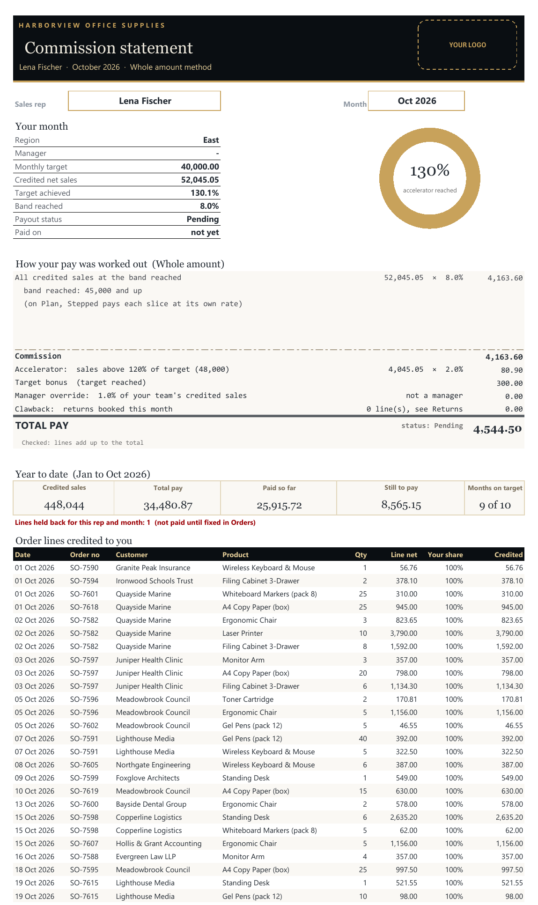
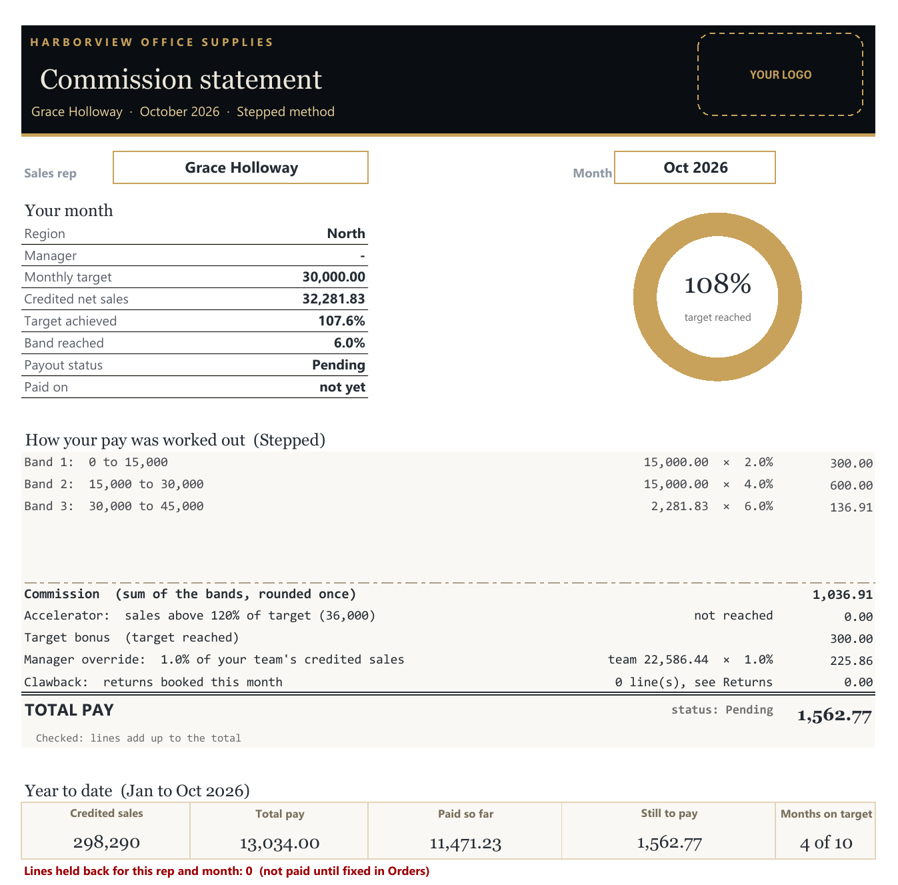
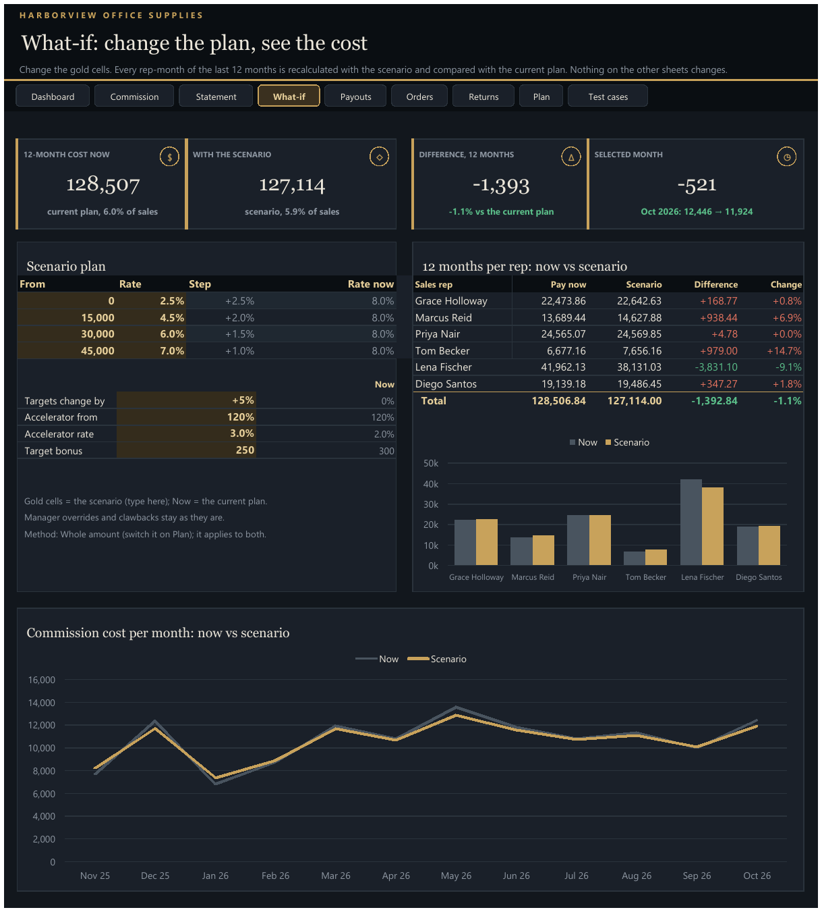
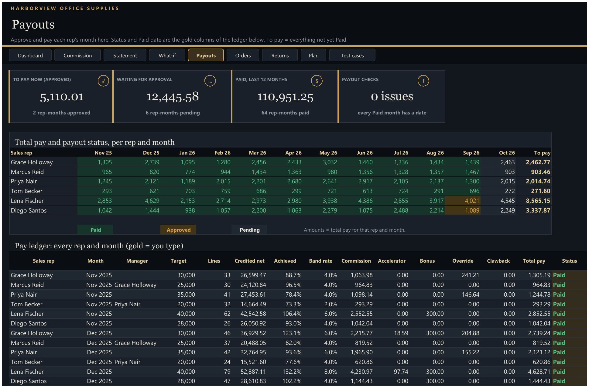
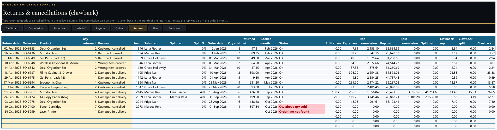

# E3 · Sales commission calculator in Excel: tiered bands, accelerator, override, split deals, clawback, payouts

**The sales team types order lines → every rep's pay for every month is worked out, checked and tracked to payment:
tiered commission bands (whole or stepped), an accelerator above 120% of target, a target bonus, a manager override,
deals split between two reps, and clawback when goods come back.** A dark-gold dashboard, a what-if simulator, a
premium statement per rep and a payout tracker sit on top. Bad lines are held back instead of paid. No macros.

▶ **[Demo video (83 s, MP4)](docs/demo.mp4)**: pick a month, mark a payout Paid, change a band rate in What-if, switch the
statement to a team lead, type a bad split line and watch it get held back. Real screen recording, captions added.

## Before → after

| Before | After |
|---|---|
| 2,739 order lines in a CSV, prices and discounts typed by hand | Orders with drop-downs; price, discount, tax, split credit and status are locked formulas |
| A rate looked up by eye, an argument every month | Bands, accelerator, bonus, override and clawback worked out the same way every time, 51 hand-worked test cases |
| "Was March paid?" | Payout status per rep and month (Pending / Approved / Paid + date) and one "to pay" total |
| A plan change is a guess | What-if: change rates, targets, accelerator, bonus and see the 12-month cost against the current plan |
| A typed note to each rep | A statement per rep with an attainment gauge, receipt-style working and year to date; all reps to PDF in one go |

## What the workbook does

| Sheet | What it does |
|---|---|
| **Dashboard** | Pick a month. Six icon cards (net sales, commission cost, cost % of sales, reps at/above target, held-back lines, to pay) with green/red notes vs the month before, a 12-month pay trend per rep, a donut of each rep's share of pay, a leaderboard with % of target gauges and payout status, insights written by formulas, and a footer with the data checks and test cases. Navigation buttons on every sheet. |
| **Commission** | The month in detail: per rep lines, credited net, target, achieved, band, commission, accelerator, bonus, override, clawback, total pay and payout status; credited net vs target chart; the plan in words; lines held back with the reason; returns booked this month; 8 PASS/FAIL data checks |
| **Statement** | Pick a rep and a month: logo slot, attainment gauge, receipt-style working (each band slice for Stepped), accelerator, bonus, override, clawback, total pay and payout status, year to date (sales, pay, paid, still to pay, months on target), then every order line credited with the rep's share |
| **What-if** | Gold cells: scenario band rates, target change, accelerator start and rate, bonus. Cards and a per-rep table show the 12-month cost now vs the scenario; a monthly line chart compares both |
| **Payouts** | Approved / pending / paid totals, a rep × month matrix coloured by payout status, and the pay ledger (72 rep-months) where Status and Paid date are typed |
| **Orders** | The only place to type order lines (yellow): drop-downs and validation, optional Split rep + Split %. Status checks every line: missing date, unknown rep or product, qty below 1, discount above the product's max, unknown split rep, split with oneself, split % outside 1–99%, split % without a split rep. Room for 3,000 lines |
| **Returns** | Returned goods / cancelled lines: the commission paid on them is taken back in the month of the return, at the rate the rep was paid in the order's month (split deals: each rep their own share and rate). Bad returns (more than sold, order not found, before the order, a line never paid) are held back |
| **Plan** | Prices and max discounts, reps, managers and monthly targets, bands, tax, bonus, override rate, accelerator, method (Whole amount / Stepped), months, payout statuses |
| **Test cases** | 51 cases worked out by hand for every rule (band edges, one cent under a step, accelerator at exactly 120%, half-cent override, clawback on a split deal with an odd cent, total pay, a fixed what-if scenario, payout checks, 14 order lines incl. split errors, 8 returns) run through the same formulas. All PASS |

Formula sheets are protected (no password); only the yellow / gold cells can be typed in. Pasted data skips Excel's
validation, which is why the Status columns re-check every line.

## Rules, worked out once

- **Commission** on credited net sales (after discount, before tax). Whole amount = all sales at the band reached;
  Stepped = each slice at its own rate. Bands 0 / 15,000 / 30,000 / 45,000 at 2 / 4 / 6 / 8%.
- **Accelerator**: +2% on the credited sales above 120% of the monthly target.
- **Target bonus** 300 when credited sales reach the target.
- **Manager override**: 1% of the credited sales of the reps a manager leads (Grace leads Marcus, Priya leads Tom).
- **Split deals**: the split rep gets Split % of the line (rounded to the cent), the sales rep the rest.
- **Clawback**: returned share × (commission ÷ credited net) of the rep in the order's month, booked in the month of the return.
- **Total pay** = commission + accelerator + bonus + override − clawback. **To pay** = every rep-month not yet Paid.

## Result for October 2026

| | Whole amount | Stepped |
|---|---|---|
| Credited net sales (238 credited lines) | 184,402.53 | 184,402.53 |
| Commission | 11,110.12 | 6,310.12 |
| Accelerator (Lena at 130% of target) | 80.90 | 80.90 |
| Target bonus (3 of 6 reps) | 900.00 | 900.00 |
| Manager override | 361.66 | 361.66 |
| Clawback (1 return) | −7.10 | −3.89 |
| **Total pay** | **12,445.58** | **7,648.79** |
| 12-month commission cost | 128,506.84 | 84,149.95 |
| What-if scenario, 12 months | 127,114.00 | 90,107.11 |

Payouts (Whole amount): 110,951.25 paid in 64 rep-months, 5,110.01 approved and ready to pay (September), 12,445.58
waiting for approval (October). October holds back 4 order lines and 2 returns, all planted on purpose: a 25% discount on
copy paper (max 10%), a quantity of 0, a product not on the price list, a deal split with the rep himself, a return of
more than was sold and a return of an order that does not exist. September has two more: a rep's name typed wrong and a
split with 0%.

## Bulk PDF statements

The workbook stays macro-free. [`scripts/export_statements.py`](scripts/export_statements.py) drives Excel from outside
and writes one PDF per rep plus one combined file: [`docs/statements/all-reps-2026-10.pdf`](docs/statements/all-reps-2026-10.pdf).
For clients who prefer a button inside Excel there is an optional macro, [`scripts/ExportStatements.bas`](scripts/ExportStatements.bas),
to import into a copy saved as .xlsm.

## Proof the numbers are right

[`test/verify.py`](test/verify.py) recomputes everything in plain Python from the CSVs and `plan.json` (every order line,
every split, every return, the 72-row pay ledger for both methods, the what-if scenario) and then opens the workbook in
Excel and compares: the whole ledger column by column, the Commission sheet, Dashboard cards, leaderboard, donut, trend
and insights, every rep's statement (receipt lines, total, year to date, every credited line) for two months and both
methods, Payouts, What-if (including a scenario equal to the current plan → difference 0.00, and one with every rate +1
point). It also checks the held-back lines and returns are exactly the planted mistakes, all 51 test cases and 8 data
checks pass, inputs are unlocked and validated, formula sheets are protected, there are no error values, no implicit
`@` and no Microsoft 365-only function. Result: **96/96 checks pass**.

## Use it for your own team

1. **Plan**: type your products, reps, managers, targets, bands, tax, bonus, override, accelerator, and pick the method.
2. Update the expected values on **Test cases** so they describe your plan, and check that they say PASS.
3. **Orders** / **Returns**: delete the sample lines, then type or paste your own. **Payouts**: reset the statuses.
4. Month end: **Dashboard** → pick the month, fix the lines held back, approve and pay on **Payouts**, send each rep a **Statement**.

Built and tested in Excel for Windows, Excel 2016 formulas only (no FILTER, XLOOKUP or LET, no Power Query). No macros, so
no security warning when the file is opened.

## Files

| Path | What |
|---|---|
| `Sales-Commission-Calculator.xlsx` | The workbook (no macros) |
| `data/orders.csv`, `data/returns.csv`, `data/payouts.csv`, `data/plan.json` | Fictional order lines, returns, payout statuses and plan |
| `scripts/make_data.py` | Generates the fictional data, with the mistakes planted on purpose |
| `scripts/build_workbook.py` | Builds the workbook with real Excel (every formula and every hand-worked case is readable in the script) |
| `scripts/export_statements.py`, `scripts/ExportStatements.bas` | Bulk PDF statements (script, or optional macro) |
| `test/verify.py`, `test/planted.json` | Independent check |
| `scripts/shots.ps1`, `scripts/make_thumb.py` | Screenshots and thumbnail in `docs/` |

All names, companies and amounts are fictional.
