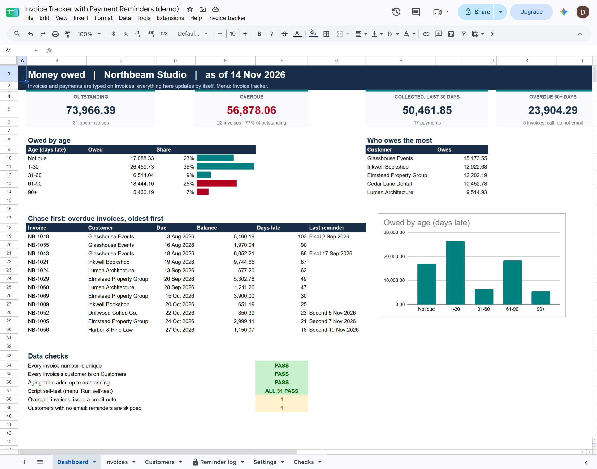
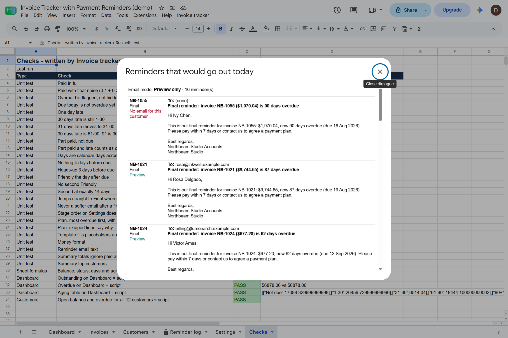
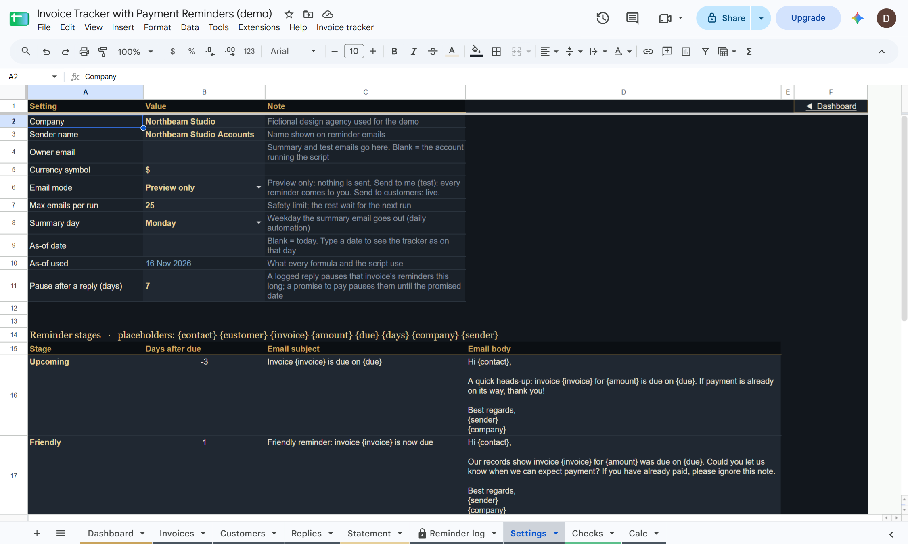

# E4 · Invoice tracker with automatic payment reminders: Google Sheets + Apps Script

**Type invoices and payments in one sheet → balance, status, days overdue and aging are calculated → every morning the
script emails the right reminder to each late customer (never the same one twice), logs it, and sends the owner a
weekly summary.** Nothing is emailed until you switch it on; until then you get a preview of every email.

▶ **[Demo video (60 s, MP4)](docs/demo.mp4)**: record a payment, the dashboard and the reminder preview update; nothing is emailed. Real screen recording, captions added.

## The problem this solves

A small business (here the fictional design studio *Northbeam Studio*) sends invoices to a dozen regular customers and
gets paid late. Chasing is done from memory: someone scrolls the invoice list now and then, writes a reminder by hand,
forgets who was already reminded, and either never follows up or sends the same polite note three times. Nobody can
say at a glance how much is owed and how old it is.

## What the spreadsheet does

| Sheet | What it does |
|---|---|
| **Invoices** | The only place to type (yellow): invoice no, customer (drop-down), issue and due date, amount, paid, paid date. Balance, status (Not due / Part paid / Overdue / Paid / Overpaid), days overdue, aging bucket and the last reminder are calculated with one `ARRAYFORMULA` per column, so new rows need no copying. |
| **Customers** | Contact name and email per customer, with each one's open and overdue balance. A missing email is highlighted red: reminders to that customer are skipped and say why. |
| **Dashboard** | Outstanding, overdue, collected in the last 30 days and overdue 60+ days; money owed by age with in-cell bars (`SPARKLINE`); the five customers who owe the most and the 12 invoices to chase first (`QUERY`); a chart; data checks. Updates by itself. |
| **Settings** | Company and sender name, owner email, currency, **email mode**, max emails per run, summary weekday, an optional *as-of date* to see the tracker as on any day, and the four reminder stages with their own subject and body text. |
| **Reminder log** | Every reminder ever sent: when, invoice, customer, address, stage, mode, result. Protected (warning only), because the script reads it to know what was already sent. |
| **Checks** | Written by *Run self-test*: unit tests + a check that the sheet formulas and the script agree on every invoice, the dashboard and every customer. |

### The reminders

| Stage | When | Tone |
|---|---|---|
| Upcoming | 3 days before the due date | heads-up |
| Friendly | 1 day after | "could you let us know when…" |
| Second | 14 days after | "please arrange payment this week" |
| Final | 30 days after | "pay within 7 days or agree a payment plan" |

Rules: each stage goes out **at most once** per invoice; never a softer email after a firmer one; an invoice that was
missed for a while jumps straight to the stage it has reached; most overdue first; at most 25 emails per run (the rest
wait for tomorrow); customers with no email are skipped and listed. Day counts, placeholders (`{contact}`, `{amount}`,
`{due}`, `{days}`…) and texts are all on Settings, so the owner changes them without touching code.

**Email mode** (Settings): *Preview only* (default: nothing is sent, the menu shows every email) → *Send to me (test)*
(every reminder comes to the owner, subject marked `[TEST to …]`) → *Send to customers* (live).

### Menu *Invoice tracker*

Preview reminders · Send reminders now (asks first) · Email me the summary · Turn on / off daily automation · Run
self-test · Rebuild demo data.

Daily automation is one time-driven trigger (about 08:00): reminders in the chosen email mode, plus the summary email on
the chosen weekday (outstanding, overdue, aging, the invoices to chase, how many reminders went out this week). A
script lock stops two runs from overlapping, and the daily email quota is checked before each send.

## Result for the demo (as of the day it is built)

| | |
|---|---|
| Invoices | 69 (12 customers, about 5 months) |
| Outstanding | 73,966.39 on 31 open invoices |
| Overdue | 56,878.06 on 22 invoices (77%) |
| Reminders due today | 16: 14 to send (5 Final, 4 Second, 3 Friendly, 2 Upcoming), 2 skipped (customer has no email) |
| Also flagged | 1 overpaid invoice (issue a credit note), 1 customer with no email |

The demo dates are stored as days relative to the build day, so the tracker always looks current.

## Proof the numbers are right

- **In Google Sheets**: *Invoice tracker → Run self-test* runs 26 unit tests (aging edges at 30/31 and 90/91 days,
  due today is not late, float noise, overpaid, part paid, stage order, "never softer after firmer", the per-run limit,
  template text…) and compares the sheet formulas with the script on all 69 invoices, the dashboard totals, the aging
  table and every customer's balance. Result: **ALL 31 PASS** ([screenshot](docs/checks.png)).
- **Offline, without Google**: `node test/run-tests.js` runs the same unit tests on the same code, then runs the whole
  demo through the script logic and compares it with [`test/expected.json`](test/expected.json), which
  [`scripts/make_data.py`](scripts/make_data.py) works out separately in Python: the state of all 69 invoices, the
  16-line reminder plan, outstanding, overdue and aging. Result: **30/30 checks pass**.

## Use it for your own business

1. Create a Google Sheet → *Extensions → Apps Script* → paste the files from `src/` (`Code.gs`, `Setup.gs`,
   `Tests.gs`, `DemoData.gs`; one file or four, both work) → run `buildDemo` once and allow access (Google warns about
   any script that is not published; it is your own script in your own account).
2. On **Settings**: your company, sender name, owner email, currency; check the reminder texts.
3. On **Customers** and **Invoices**: delete the demo rows, type or paste your own.
4. *Invoice tracker → Preview reminders* and read them. Then set Email mode to *Send to me (test)*, run once, and check
   your inbox. When happy: *Send to customers* and *Turn on daily automation*.

Permissions the script asks for: this spreadsheet only, send email as you, run on a timer, show menus and dialogs, and
your email address (as the default owner email).

## Files

| Path | What |
|---|---|
| `src/Code.gs` | Pure logic (no Google calls, testable anywhere), then the sheet / email / trigger layer and the self-test |
| `src/Setup.gs` | `buildDemo`: builds every sheet, formula, validation, colour rule, chart and named range |
| `src/Tests.gs` | 26 unit tests, shared by Google and Node |
| `src/DemoData.gs` | Fictional customers, invoices and past reminders (generated) |
| `src/appsscript.json` | Runtime V8 and the exact permissions |
| `scripts/make_data.py` | Generates the demo data and the expected results |
| `test/run-tests.js`, `test/expected.json` | Offline check |
| `scripts/make_thumb.py`, `docs/` | Screenshots and thumbnail |

All names, companies, email addresses (`example.com`) and amounts are fictional.
