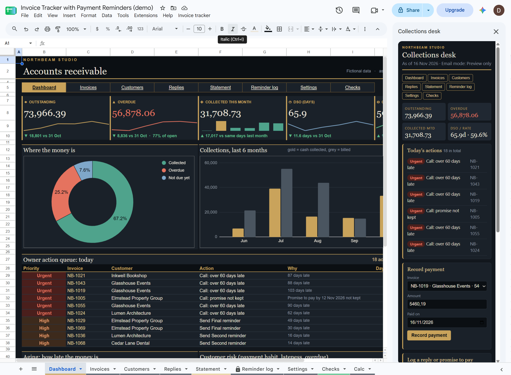
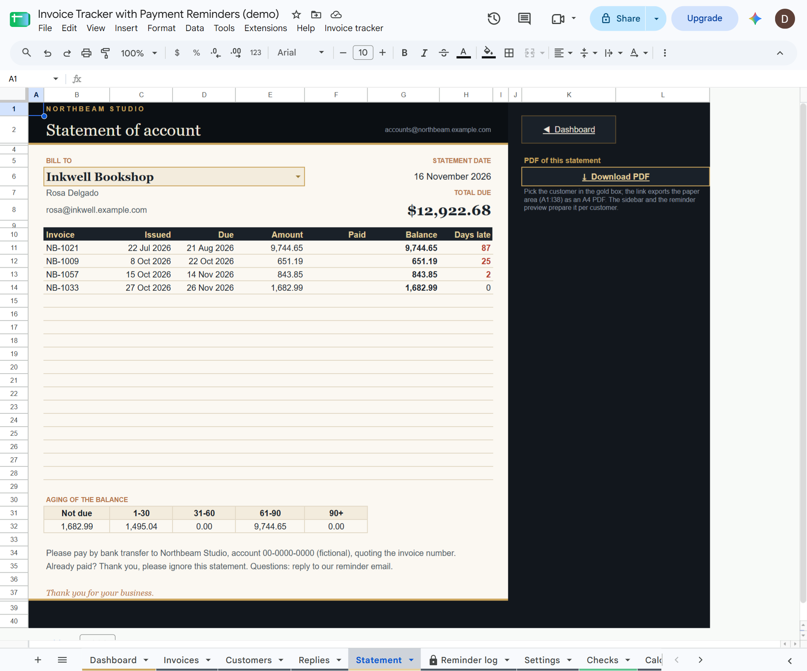
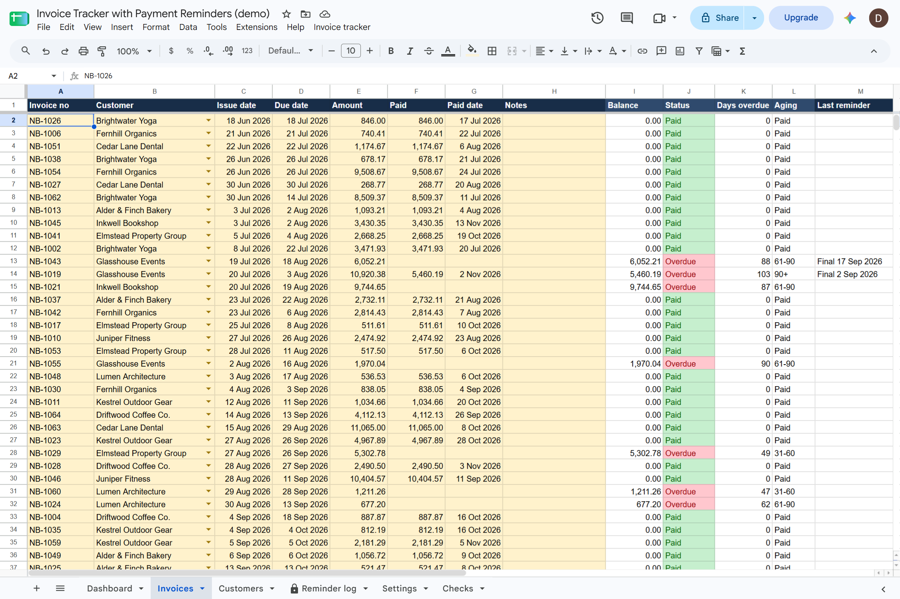
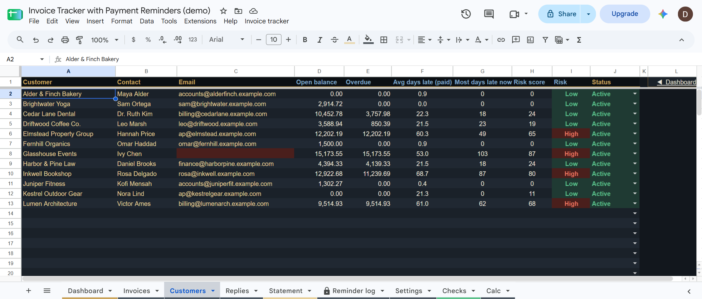
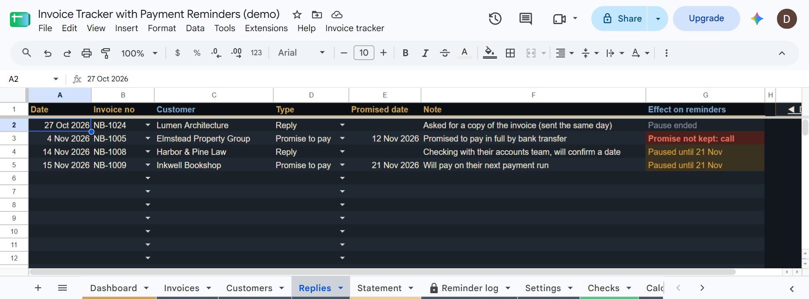

# E4 · Invoice tracker & collections desk: Google Sheets + Apps Script

**Type invoices and payments in one sheet → balance, status, days overdue, aging, DSO and each customer's risk score
are calculated → the owner gets a ranked to-do list for today (call, send a reminder, record a promise) → every
morning the script emails the right reminder to each late customer (never the same one twice), pauses reminders for
customers who replied or promised to pay, logs every email, and sends the owner a weekly summary.**
Nothing is emailed until you switch it on; until then you get a preview of every email.

▶ **[Demo video (2 min, MP4)](docs/demo.mp4)**: the dashboard, the collections desk sidebar, a payment is typed and the
KPIs and action queue update, the pause rule, the reminder preview (nothing is emailed), the statement, risk scores and
the self-test. Real screen recording, captions added.

## The problem this solves

A small business (here the fictional design studio *Northbeam Studio*) sends invoices to a dozen regular customers and
gets paid late. Chasing is done from memory: someone scrolls the invoice list now and then, writes a reminder by hand,
forgets who was already reminded or who already promised to pay, and either never follows up or sends the same polite
note three times. Nobody can say at a glance how much is owed, how old it is, which customers are risky, or what to do
first today.

## What the spreadsheet does

| Sheet | What it does |
|---|---|
| **Dashboard** | Dark-gold dashboard. Navigation buttons to every sheet. Five KPI cards with a 6-month `SPARKLINE` trend and a green/red note against last month: **outstanding, overdue, collected this month, DSO, collection rate**. Donut chart *where the money is* (collected / overdue / not due yet) and a 6-month *cash collected vs billed* chart. **Owner action queue**: today's actions ranked Urgent > High > Medium > Low with priority chips. **Aging** 1-30 / 31-60 / 61-90 / over 90 with heat colours and in-cell bars. **Customer risk** top 6 with risk chips. Data checks. |
| **Invoices** | The only place to type invoices and payments. Balance, status, days overdue, aging bucket and days paid late are one `ARRAYFORMULA` per column; status and aging show as coloured chips. |
| **Customers** | Contact and email per customer, open and overdue balance, average days late on paid invoices, most days late now, **risk score 0-100 and level** (`MAP`/`LAMBDA` formulas), and a **status drop-down** (Active / On hold / Collections: the last two stop automatic reminders). |
| **Replies** | Log of customer replies and promises to pay, with the effect on reminders worked out per line (paused until..., promise not kept: call, pause ended). |
| **Statement** | Printable statement of account per customer (pick the customer in the gold box): open invoices, total due, aging. A **Download PDF** link exports it as an A4 PDF. |
| **Reminder log** | Every reminder ever sent. Protected (warning only), because the script reads it to know what was already sent. |
| **Settings** | Company, sender, owner email, currency, **email mode**, max emails per run, summary weekday, *as-of date*, **pause after a reply (days)**, and the four reminder stages with their own subject and body text. |
| **Checks** | Written by *Run self-test*: unit tests + formulas compared with the script. |
| **Calc** | Helper for the trends and charts: one formula per number (month-end outstanding, overdue, collected, billed, DSO, collection rate). |

### The numbers

- **DSO** = outstanding ÷ sales of the last 90 days × 90.
- **Collection rate** = share of the amount that fell due in the last 90 days that has been paid.
- **Trends**: the value at the end of each of the last 5 months, then today. *Collected this month* is compared with the same days of last month.
- **Risk score** = payment habit (average days late on paid invoices × 0.5, max 40) + how late now (most days overdue × 0.3, max 30) + overdue money (1 point per 500, max 20) + no email on file (10). 60+ High, 30+ Medium, else Low.

### Owner action queue

One action per open invoice, ranked by priority, then the biggest balance:

| Priority | When |
|---|---|
| Urgent | a promise to pay was not kept, or the invoice is over 60 days late (call, do not email) |
| High | a Final or Second reminder is due, or a reminder is due but there is no email (call instead) |
| Medium | a Friendly reminder is due, or the customer replied: record a promise to pay |
| Low | an Upcoming heads-up, a held reminder, or a promised payment due within 2 days: check it came in |

The queue refreshes when you edit Invoices, Customers, Replies or Settings (simple `onEdit` trigger), on the daily
run, and from the menu.

### The reminders

| Stage | When | Tone |
|---|---|---|
| Upcoming | 3 days before the due date | heads-up |
| Friendly | 1 day after | "could you let us know when…" |
| Second | 14 days after | "please arrange payment this week" |
| Final | 30 days after | "pay within 7 days or agree a payment plan" |

Rules: each stage goes out **at most once** per invoice; never a softer email after a firmer one; an invoice that was
missed for a while jumps straight to the stage it has reached; most overdue first; at most 25 emails per run; customers
with no email are skipped and listed. **Pause rule**: a logged reply pauses that invoice's reminders for 7 days (set on
Settings); a promise to pay pauses them until the promised date; once the promised date has passed and the invoice is
still open, the pause ends and the queue shows an Urgent *promise not kept: call*. Customers on hold or in collections
get no automatic reminders.

**Email mode** (Settings): *Preview only* (default: nothing is sent) → *Send to me (test)* (every reminder comes to the
owner, subject marked `[TEST to …]`) → *Send to customers* (live).

### Collections desk (sidebar)

*Invoice tracker → Open collections desk* opens an `HtmlService` sidebar in the same dark-gold style: navigation
buttons, KPI tiles, today's top actions, **Record payment** (the most overdue invoice and its full balance are filled
in), **Log a reply or promise to pay**, **Preview reminders**, **Send due reminders** (in *Preview only* mode it only
says what would go out), and **Statement PDF** per customer.

### Statement PDF

The statement is a sheet, and its PDF is the sheet's own export link (Google's `export?format=pdf` for that range).
The script does not save PDF files to Drive or attach them to emails: that would need extra Google permissions
(Drive and external requests) on top of the five this script asks for. In the reminder preview each line has a
*prepare PDF* link that puts the customer on the Statement sheet and returns the export link.

### Menu *Invoice tracker*

Open collections desk · Preview reminders · Send reminders now (asks first) · Email me the summary · Refresh action
queue · Turn on / off daily automation · Run self-test · Rebuild demo data.

Daily automation is one time-driven trigger (about 08:00): reminders in the chosen email mode, the action queue, plus
the summary email on the chosen weekday. A script lock stops two runs from overlapping, and the daily email quota is
checked before each send.

## Result for the demo (as of the day it is built; screenshots: 16 Nov 2026)

| | |
|---|---|
| Invoices | 89 (12 customers, March to November) |
| Outstanding | 73,966.39 on 31 open invoices |
| Overdue | 56,878.06 on 22 invoices (77%) |
| Collected this month | 31,708.73 (17,017 more than the same days last month) |
| DSO / collection rate | 65.9 days / 59.6% |
| Action queue | 18 actions: 6 Urgent (5 over 60 days late, 1 promise not kept), 7 High, 3 Medium, 2 Low |
| Reminders due today | 16 lines: 12 to send, 2 paused (a reply and a promise to pay), 2 skipped (no email) |
| Customer risk | 4 High (Glasshouse Events 87, Inkwell Bookshop 80, Lumen Architecture 68, Elmstead Property Group 65) |
| Also flagged | 1 overpaid invoice (issue a credit note), 1 customer with no email |

The demo dates are stored as days relative to the build day, so the tracker always looks current (the month-based
numbers move a little with the day).

## Proof the numbers are right

- **In Google Sheets**: *Invoice tracker → Run self-test* runs 46 unit tests (aging edges, due today, float noise,
  overpaid, stage order, "never softer after firmer", the per-run limit, the pause rule, DSO, collection rate, trends,
  risk score, action queue ranking…) and compares the sheet with the script: all 89 invoices, the dashboard totals and
  aging, collected this month, DSO, collection rate, the 6-month trends on Calc, every customer's balance, risk score
  and level, the action queue on the dashboard, and that no paused invoice is in today's emails.
  Result: **ALL 58 PASS** ([screenshot](docs/checks.png)).
- **Offline, without Google**: `node test/run-tests.js` runs the same 46 unit tests on the same code, then runs the whole
  demo through the script logic and compares it with [`test/expected.json`](test/expected.json), which
  [`scripts/make_data.py`](scripts/make_data.py) works out separately in Python: the state of all 89 invoices, the pause
  rule, the reminder plan, outstanding / overdue / aging, the 6-month trends, the KPI cards, DSO, every customer's risk
  score and the action queue. Result: **58/58 checks pass**.

## Use it for your own business

1. Create a Google Sheet → *Extensions → Apps Script* → paste the files from `src/` (`Code.gs`, `Setup.gs`,
   `Tests.gs`, `DemoData.gs`; one file or four, both work) → run `buildDemo` once and allow access (Google warns about
   any script that is not published; it is your own script in your own account).
2. On **Settings**: your company, sender name, owner email, currency; check the reminder texts.
3. On **Customers**, **Invoices** and **Replies**: delete the demo rows, type or paste your own.
4. *Invoice tracker → Preview reminders* and read them. Then set Email mode to *Send to me (test)*, run once, and check
   your inbox. When happy: *Send to customers* and *Turn on daily automation*.

Permissions the script asks for: this spreadsheet only, send email as you, run on a timer, show menus, dialogs and the
sidebar, and your email address (as the default owner email).

## Files

| Path | What |
|---|---|
| `src/Code.gs` | Pure logic (no Google calls, testable anywhere): states, reminder plan, pause rule, DSO, trends, risk, action queue; then the sheet / email / trigger layer, the sidebar and the self-test |
| `src/Setup.gs` | `buildDemo`: builds every sheet, formula, validation, colour rule, chart, navigation button and named range |
| `src/Tests.gs` | 46 unit tests, shared by Google and Node |
| `src/DemoData.gs` | Fictional customers, invoices, past reminders and replies (generated) |
| `src/appsscript.json` | Runtime V8 and the exact permissions |
| `scripts/make_data.py` | Generates the demo data and the expected results |
| `test/run-tests.js`, `test/expected.json` | Offline check |
| `scripts/shots.py`, `scripts/make_thumb.py`, `docs/` | Screenshots, thumbnail, demo video |

All names, companies, email addresses (`example.com`) and amounts are fictional.
