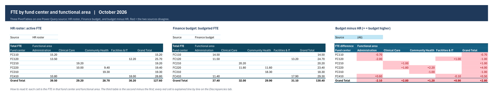
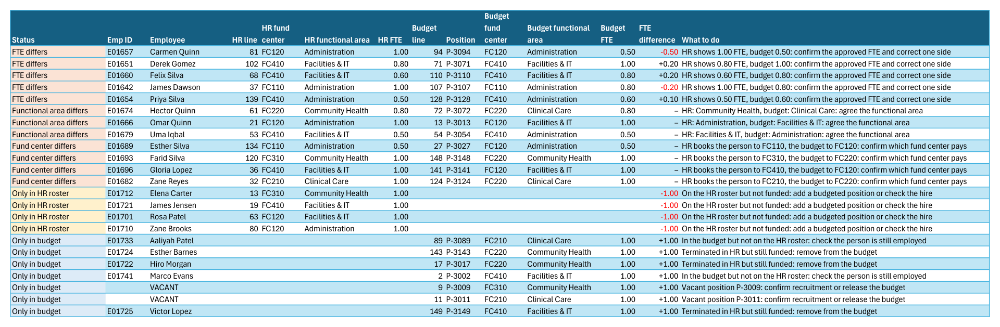
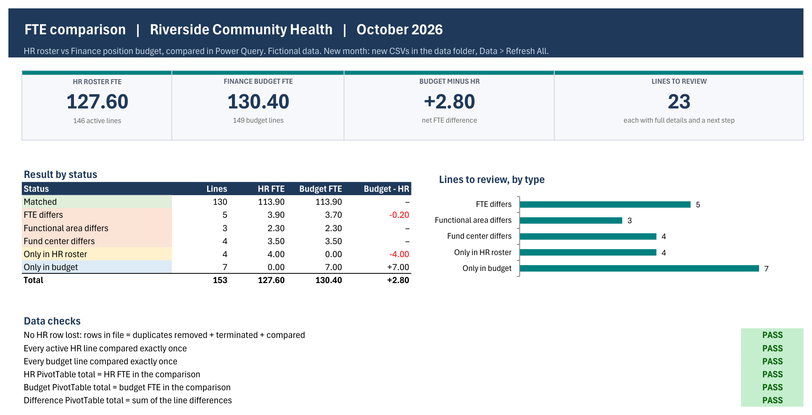

# E5 · FTE comparison in Excel: two sources, three PivotTables, every discrepancy explained

**HR roster export + Finance position budget → Power Query cleans and lines them up person by person → PivotTables
summarise FTE by fund center and functional area for each source and for the difference → a Discrepancies tab lists
every line that disagrees, with full details from both sides and a next step.**
No macros. Next month: drop in the new files, press **Refresh All**.

▶ **[Demo video (54 s, MP4)](docs/demo.mp4)**: raw HR export → Refresh All → pivots, discrepancies, data checks. Real screen recording, captions added.

## The problem this solves

An organisation (here the fictional *Riverside Community Health*) has two answers to "how many FTE do we have?":
the HR roster says one number, the Finance position budget another. Someone has to rebuild both into the same
pivot by fund center and functional area, then find out *why* they differ. The exports never line up neatly:

- HR writes the employee ID as `E01042`, Finance as `1042`
- HR types the fund center as `FC-210`, `fc210`, `FC 210 `; Finance just writes `210`
- HR stores FTE as `80%`, Finance as `0.8`; functional areas come in any case, with stray spaces
- terminated people are still in the HR export; vacant positions are in the budget with no employee
- the HR export repeats a row now and then; some people are split 50/50 across two fund centers

## What the workbook does

| Step | Where | What happens |
|---|---|---|
| 1 | Power Query `HR_Raw`, `Budget_Raw` | Reads both CSVs **as text** from the folder on the Settings sheet (nothing is lost on import) |
| 2 | `HR_Clean`, `Budget_Clean` | Drops repeated export rows, builds one employee key, normalises fund centers to `FC210`, FTE to decimals, functional areas to HR's spelling; terminated people are kept aside |
| 3 | `Compare` | Full outer join on employee + fund center → **Matched · FTE differs · Functional area differs · Fund center differs · Only in HR roster · Only in budget**, the FTE difference and a plain-English **What to do** for every line |
| 4 | `FTE_Long` → 3 PivotTables | One long table feeds all three pivots (HR, budget, budget minus HR), so they can never disagree with each other |
| 5 | Summary, Cleaning log | KPI cards, result by status, chart, six PASS/FAIL data checks; every cleaning step counted |

## Result for October 2026

| | |
|---|---|
| HR roster (active and on leave) | **127.60 FTE** on 146 lines |
| Finance budget | **130.40 FTE** on 149 lines |
| Budget minus HR | **+2.80 FTE**, explained by **23 lines** |
| Of which | 5 FTE differs · 3 functional area differs · 4 fund center differs · 4 only in HR · 7 only in budget (2 vacant, 3 terminated but still funded, 2 unknown to HR) |

## Proof the numbers are right

[`test/verify.py`](test/verify.py) does the whole comparison again in plain Python, straight from the two CSV files,
and compares it with **(a)** the answer planted when the data was generated, **(b)** every status, count and FTE total
in the workbook and **(c)** every cell of the three PivotTables. It then copies the workbook to another folder,
refreshes it there and checks again. Result: **51/51 checks pass**.

Inside the workbook, six checks say PASS or FAIL after every refresh: no HR row lost, every HR line and every
budget line compared exactly once, and each PivotTable total equal to the line-by-line totals.

## Use it with your own data

1. Export the HR roster and the position budget (or payroll) as CSV into the `data` folder next to the workbook.
2. On **Settings**, type the two file names.
3. **Data → Refresh All**. Check that the six data checks say PASS; work through the **Discrepancies** tab.

Different column names: only `HR_Clean` and `Budget_Clean` change; the comparison, pivots and Summary stay the same.
Works in Excel 2016+ / Microsoft 365 for Windows (Power Query is built in).

## Files

| Path | What |
|---|---|
| `FTE-Comparison.xlsx` | The workbook (no macros) |
| `data/` | The two fictional CSV exports |
| `scripts/make_data.py` | Generates the fictional data with every discrepancy planted on purpose |
| `scripts/build_workbook.py` | Builds the workbook with real Excel (Power Query M code is readable in the script) |
| `test/verify.py`, `test/expected.json` | Independent check |
| `scripts/shots.ps1`, `scripts/make_thumb.py` | Screenshots in `docs/` |

All names, organisations and numbers are fictional.
