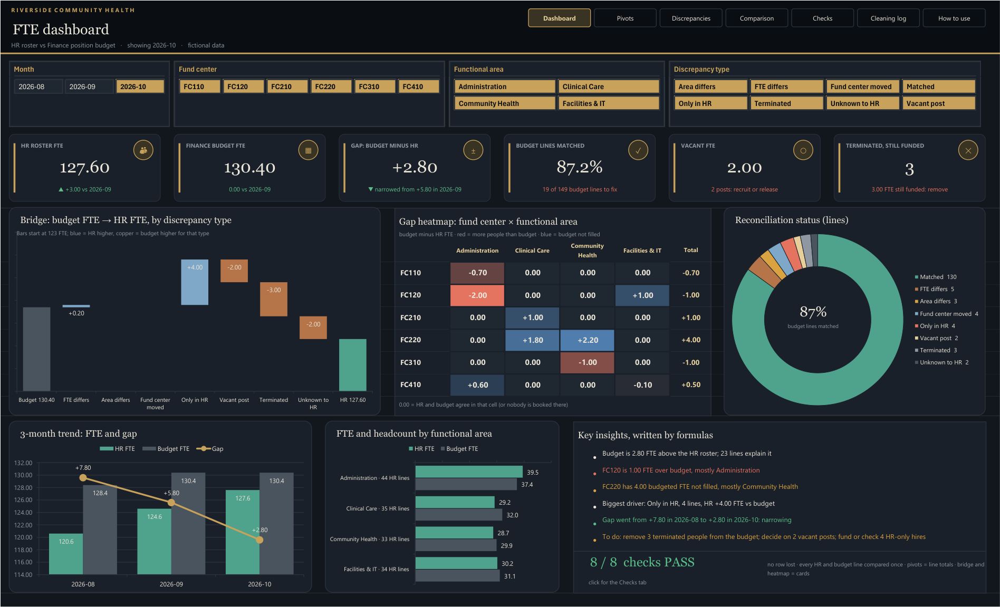
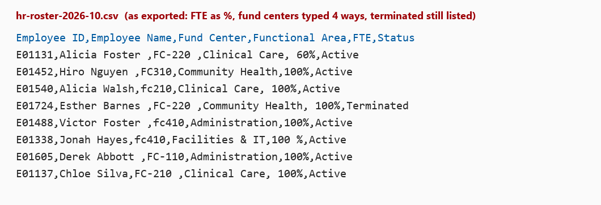
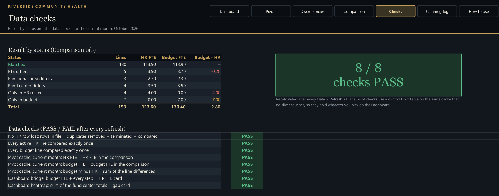

# E5 · FTE dashboard in Excel: HR roster vs Finance budget, every gap explained

**HR roster export + Finance position budget → Power Query cleans and lines them up person by person (three months)
→ one dark-gold Dashboard with KPI cards, a Budget → HR bridge, a gap heatmap, a status donut, a 3-month trend and
insight sentences written by formulas → four slicers that drive the dashboard AND three PivotTables → a Discrepancies
tab that lists every line that disagrees, with both sides and a next step.**
No macros. Next month: drop in the new files, press **Refresh All**.

▶ **[Demo video (MP4)](docs/demo.mp4)**: raw HR export → Refresh All → dashboard → slicer picks (one fund center,
the month before) → pivots, discrepancies, data checks. Real screen recording, captions added.

## The problem this solves

An organisation (here the fictional *Riverside Community Health*) has two answers to "how many FTE do we have?":
the HR roster says one number, the Finance position budget another. Someone has to rebuild both into the same
view by fund center and functional area, then find out *why* they differ, every month. The exports never line up:

- HR writes the employee ID as `E01042`, Finance as `1042`
- HR types the fund center as `FC-210`, `fc210`, `FC 210 `; Finance just writes `210`
- HR stores FTE as `80%`, Finance as `0.8`; functional areas come in any case, with stray spaces
- terminated people are still in the HR export; vacant positions are in the budget with no employee
- the HR export repeats a row now and then; some people are split 50/50 across two fund centers

## What the workbook does

| Step | Where | What happens |
|---|---|---|
| 1 | Power Query `HR_Raw`, `Budget_Raw` | Reads both CSVs **as text** from the folder on the Settings sheet (nothing is lost on import) |
| 2 | `fnHRClean`, `fnBudgetClean` | Drops repeated export rows, builds one employee key, normalises fund centers to `FC210`, FTE to decimals, functional areas to HR's spelling; terminated people are kept aside |
| 3 | `fnCompare` → `Compare` | Full outer join on employee + fund center → 6 statuses (**Matched · FTE differs · Functional area differs · Fund center differs · Only in HR roster · Only in budget**), 8 discrepancy types (Only in budget split into vacant post / terminated / unknown to HR), the FTE difference and a plain-English **What to do** for every line |
| 4 | `History` → `FTE_Long` | The same three functions run on every monthly pair in the folder (Aug, Sep, Oct 2026); one long table feeds every PivotTable, so nothing can disagree |
| 5 | Dashboard + Pivots | One pivot cache: three PivotTables (HR, budget, budget minus HR) and the dashboard pivots, all driven by the same four slicers |
| 6 | Checks, Cleaning log | Eight PASS/FAIL data checks; every cleaning step counted |

## The Dashboard

- **Six KPI cards** with icons: HR FTE, budget FTE, gap, % budget lines matched, vacant FTE, terminated people still
  funded. Each has a green/red note (vs the month before, or what to do).
- **Slicers**: Month, Fund center, Functional area, Discrepancy type. They drive every card, chart and sentence on the
  dashboard and the three PivotTables on the Pivots tab (the same slicers sit there too). The trend follows every
  slicer except Month.
- **Bridge (waterfall)** from budget FTE to HR FTE, one bar per discrepancy type.
- **Gap heatmap** fund center × functional area (red = more people than budget, blue = budget not filled).
- **Donut** of reconciliation status by line, **3-month trend** (HR, budget, gap line), **FTE and headcount by
  functional area**.
- **Insight sentences written by formulas**, e.g. *"FC120 is 1.00 FTE over budget, mostly Administration"*,
  *"Gap went from +7.80 in 2026-08 to +2.80 in 2026-10: narrowing"*. They change with the slicers.
- Navigation buttons on every sheet; the **8 / 8 checks PASS** badge links to the Checks tab.

## Result for October 2026

| | |
|---|---|
| HR roster (active and on leave) | **127.60 FTE** on 146 lines |
| Finance budget | **130.40 FTE** on 149 lines (87.2% matched) |
| Budget minus HR | **+2.80 FTE**, explained by **23 lines** |
| Of which | 5 FTE differs · 3 functional area differs · 4 fund center differs · 4 only in HR · 7 only in budget (2 vacant, 3 terminated but still funded, 2 unknown to HR) |
| Trend | gap +7.80 (Aug) → +5.80 (Sep) → +2.80 (Oct) |

## Proof the numbers are right

[`test/verify.py`](test/verify.py) does the whole comparison again in plain Python, straight from the six CSV files,
and compares it with **(a)** the answer planted when the data was generated, **(b)** every status, count and FTE total
in the workbook, **(c)** every cell of the three PivotTables and **(d)** everything on the dashboard: the six cards and
their green/red notes, every bridge bar, all heatmap cells, the donut, the trend, the functional-area chart and every
insight sentence, for the default view **and** for five slicer picks (one fund center, the month before, two
discrepancy types, one functional area, two months at once). It also checks which pivots each slicer drives, then
copies the workbook to another folder, refreshes it there and checks again. Result: **150/150 checks pass**.

Inside the workbook, eight checks say PASS or FAIL after every refresh: no HR row lost, every HR line and every
budget line compared exactly once, the pivot cache equal to the line-by-line totals (on a control PivotTable no
slicer touches), and the bridge and heatmap equal to the cards.

## Use it with your own data

1. Export the HR roster and the position budget (or payroll) as CSV into the `data` folder next to the workbook,
   named `hr-roster-YYYY-MM.csv` and `finance-budget-YYYY-MM.csv`. Keep earlier months there for the trend.
2. On **Settings**, type the two file names of the current month.
3. **Data → Refresh All**. Check the PASS badge; pick the month in the slicer; work through the **Discrepancies** tab.

Different column names: only `fnHRClean` and `fnBudgetClean` change; the comparison, pivots and dashboard stay the
same. Works in Excel 2016+ / Microsoft 365 for Windows (Power Query and slicers are built in).

## Files

| Path | What |
|---|---|
| `FTE-Comparison.xlsx` | The workbook (no macros) |
| `data/` | The fictional CSV exports, three months |
| `scripts/make_data.py` | Generates the fictional data with every discrepancy planted on purpose |
| `scripts/build_workbook.py` | Builds the workbook with real Excel (Power Query M code and every dashboard formula are readable in the script) |
| `test/verify.py`, `test/expected.json` | Independent check |
| `scripts/shots.ps1`, `scripts/make_thumb.py` | Screenshots and thumbnail in `docs/` |

All names, organisations and numbers are fictional.
