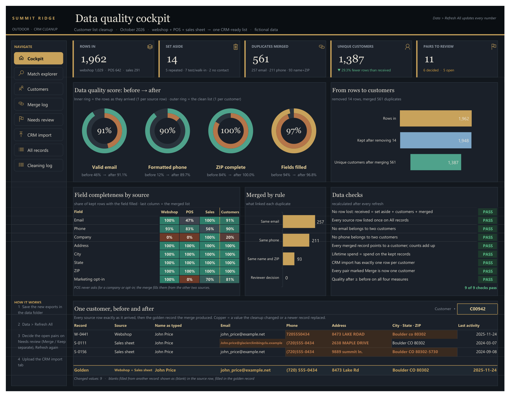
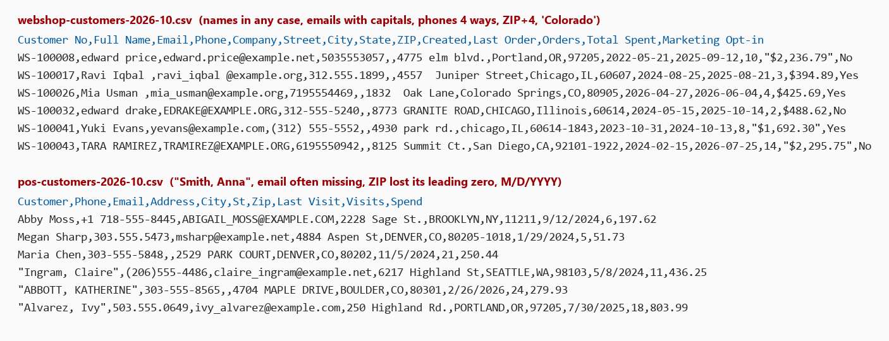
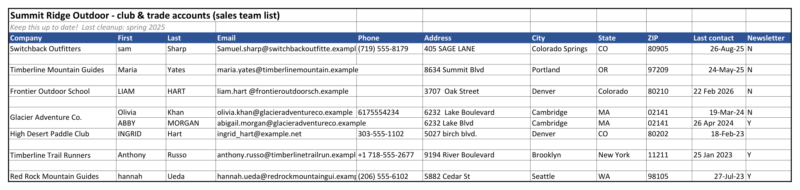
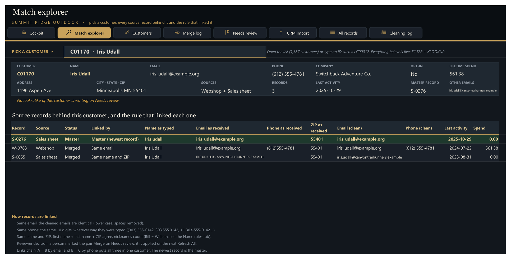
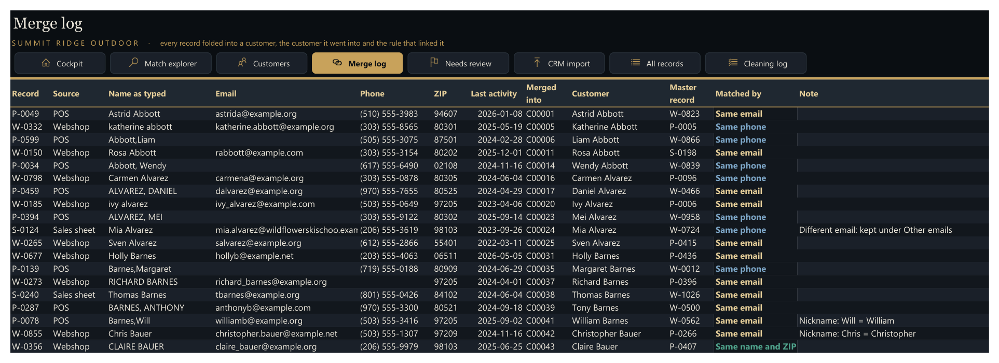
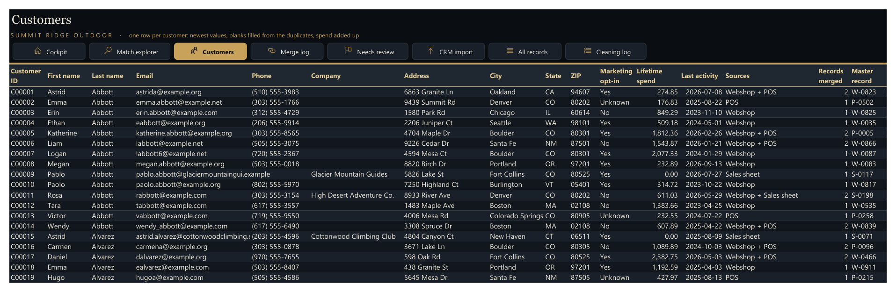
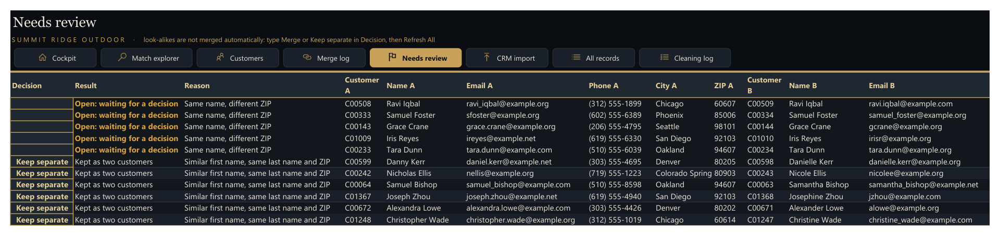

# E6 · Customer list cleanup in Excel: three sources, duplicates merged, CRM-ready import file

**Webshop export + in-store till (POS) export + the sales team's old spreadsheet → Power Query cleans every field,
finds the same customer across all three (same email, same phone, or same name + ZIP, nicknames included), keeps the
newest record and fills its blanks from the duplicates → one row per customer, a Merge log that says what was merged
and why, a Needs review tab where a person decides look-alikes (Merge / Keep separate), a Match explorer, and an
import tab with CRM column names. All of it on a dark-gold data quality cockpit.**
No macros. Next export: drop in the new files, press **Refresh All**.

▶ **[Demo video (87 s, MP4)](docs/demo.mp4)**: the raw exports → Refresh All → cockpit → Match explorer → a Merge decision on
Needs review applied by the next refresh → merge log, CRM import. Real screen recording, captions added.

## The problem this solves

A shop (here the fictional *Summit Ridge Outdoor*) has customers in three places, and none of them agree:

- the webshop has names in capitals or lower case with double spaces, emails with capitals and stray spaces, phones
  typed four ways (`(303) 555-0142`, `303.555.0142`, `+1 303-555-0142`, `3035550142`), `Colorado` instead of `CO`, ZIP+4
- some people registered twice with a different email; the export also repeats a row now and then and has test accounts
- the till writes names as `Smith, Anna`, uses nicknames (`Bill`, `Kate`), often has no email, and Excel ate the
  leading zero of Boston ZIPs (`2116`); walk-in sales have no customer at all
- the sales team's list of clubs and trade accounts has two title rows above the header, the company in **merged cells**
  over its contacts, first and last name in separate columns, work emails, and dates typed as text or as real dates

Importing that into a CRM as it is means the same person three times, emails to people who unsubscribed, and
lifetime spend split over several records.

## What the workbook does

| Step | Where | What happens |
|---|---|---|
| 1 | Power Query `Webshop_Raw`, `POS_Raw`, `Sales_Raw` | Reads the two CSVs and the .xlsx from the folder on the Settings sheet; title rows skipped, blank lines dropped |
| 2 | `Webshop_In`, `POS_In`, `Sales_In` | Each source mapped to one layout; merged company cells filled down; dates read the way each system writes them |
| 3 | `Records` | Every field cleaned: names turned around and proper-cased, emails lower case, phones as `(303) 555-0142`, ZIPs to 5 digits with the zero back, states to codes, `Street → St`. Exact repeated rows, test accounts and walk-ins set aside, never silently deleted |
| 4 | `Keyed` | Records that share an **email**, a **phone**, or **first name + last name + ZIP** (nicknames from the editable *Name rules* tab: Bill = William) become one customer. Links chain: A = B by email and B = C by phone puts all three together |
| 5 | `CustomersAll` | The newest record is the master; **every field comes from the most recent record that has it**; other emails kept; lifetime spend added up; an **opt-out anywhere wins** |
| 6 | Customers, Merge log, Needs review, CRM import | One row per customer · every merged record with its customer and rule · look-alikes for a person to decide · the same customers with CRM column names |
| 7 | Summary (cockpit), Match explorer, All records, Cleaning log | The cockpit below; pick any customer and see every source record behind it with the rule that linked it; every source row with its fate; every cleaning step counted |
| 8 | Needs review → `Decisions` → `Keyed` | The **Decision** column (drop-down Merge / Keep separate) is read back on every refresh: a Merge joins the two customers and is logged as *Reviewer decision*; the decision stays on the sheet |

## The data quality cockpit

| Part | What it shows (live, recalculated on Refresh All) |
|---|---|
| Side menu + top bar | Icon buttons on every tab (shapes with hyperlinks), the current tab in gold |
| KPI cards | Rows in · set aside · duplicates merged (per rule) · unique customers · review pairs decided / open |
| Data quality score | Four gauges, inner ring = rows as they arrived, outer ring = the clean list: valid email **46% → 91%**, formatted phone **12% → 90%**, 5-digit ZIP **84% → 100%**, contact fields filled **94% → 97%** |
| Funnel | 1,962 rows in → 1,948 kept after removing 14 → 1,387 unique customers after merging 561 |
| Field completeness heatmap | Which source fills which field (POS never has company or opt-in; the sales sheet always has the company) and the merged list next to it |
| Merged by rule | 257 same email · 211 same phone · 93 same name + ZIP · reviewer decisions |
| One customer, before and after | Every source row exactly as it arrived next to the golden record; values the cleanup changed or a newer record replaced are copper (pick any customer ID) |
| Data checks | Nine PASS/FAIL checks |

## Result for October 2026

| | |
|---|---|
| Rows received | **1,962** (webshop 1,029 · POS 642 · sales sheet 291) |
| Set aside | **14** (5 rows the export repeated, 7 test or walk-in rows, 2 with no name or contact) |
| Unique customers | **1,387**, one row each |
| Duplicates merged | **561**: 257 by the same email, 211 by the same phone, 93 by the same name + ZIP |
| Needs review | **11** pairs: 6 with a similar first name at the same ZIP (Christopher / Christine Wade, decided *Keep separate*), 5 with the same name in two cities (left open for the client) |
| Data quality | valid email 46% → 91%, formatted phone 12% → 90%, ZIP 84% → 100%, contact fields filled 94% → 97% |
| Opt-in | 636 Yes · 488 No · 263 Unknown, and nobody who said No anywhere is Yes |

## Proof the numbers are right

The data was generated with a hidden person behind every row, so the right answer is known.
[`test/verify.py`](test/verify.py) does the whole cleanup again in plain Python, straight from the three files, and
checks **(a)** against that answer: every merged group is one real person (no false merge), every person is exactly one
customer (no missed duplicate), and the 11 planted look-alikes are flagged, not merged; **(b)** against the workbook:
every field of every customer, every line of the Merge log, every review pair, the status of every source row and the
CRM import; **(c)** every number of the cockpit: the KPI cards, the four before/after gauges (same email / phone / ZIP
tests written again in Python on the raw files), the funnel and rule chart series, all 32 heatmap cells, the
before/after card (each value as received, the golden record, and exactly which cells are copper) and the Match
explorer for seven picked customers. It then copies the workbook to another folder, refreshes it there, checks
again, marks one open look-alike pair **Merge**, refreshes, and checks that the two customers became one exactly as
Python predicts (1,386 customers, the records logged as *Reviewer decision*, the decision still on the sheet after a
further refresh).
Result: **74/74 checks pass**.

Inside the workbook, nine checks say PASS or FAIL after every refresh: no row lost (received = set aside + customers
+ merged), every source row listed once, no email or phone on two customers, every merged record points to a
customer, lifetime spend equals the spend on the kept records, the CRM import has one row per customer, every pair
marked Merge is one customer, and data quality after is at least as good as before on all four measures.

## Use it with your own data

1. Save your exports into the `data` folder next to the workbook (CSV or .xlsx).
2. On **Settings**, type the file names. On **Name rules**, add nicknames your customers use.
3. **Data → Refresh All**. Check the nine data checks on the cockpit say PASS.
   On **Needs review**, choose Merge or Keep separate in the Decision column, then Refresh All again.
4. **CRM import** tab: *File → Save a Copy → CSV UTF-8* and upload to HubSpot, Pipedrive or Mailchimp
   ([`output/crm-import-2026-10.csv`](output/crm-import-2026-10.csv) is that file for the sample data).

Different columns: only the three `_In` queries change; the cleaning, matching and the tabs stay the same.
Works in Excel 2016+ / Microsoft 365 for Windows (Power Query is built in).

## Files

| Path | What |
|---|---|
| `Customer-Cleanup.xlsx` | The workbook (no macros) |
| `data/` | The three fictional sources: two CSV exports and the sales team's .xlsx |
| `output/crm-import-2026-10.csv` | The CRM import file the workbook produces |
| `scripts/make_data.py` | Generates the fictional data, every duplicate and look-alike planted on purpose |
| `scripts/build_workbook.py` | Builds the workbook with real Excel (Power Query M code is readable in the script); `--layout` rebuilds only the cockpit and Match explorer |
| `test/verify.py`, `test/expected.json` | Independent check |
| `scripts/shots.ps1`, `scripts/make_thumb.py` | Screenshots and thumbnail in `docs/` |

All names, companies, emails (`example.com`) and phone numbers (555) are fictional.
