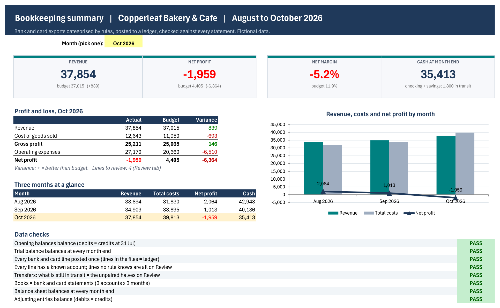
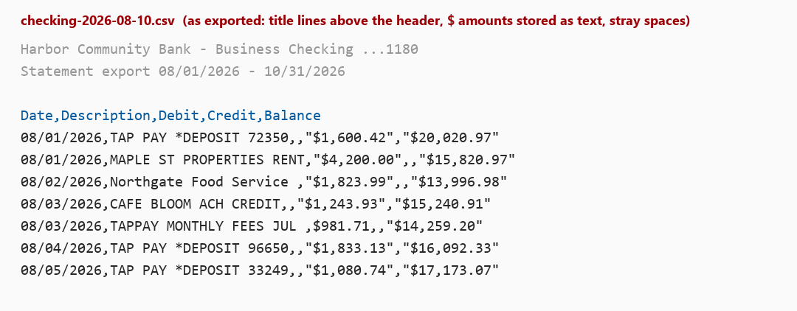

# E7 · Small business bookkeeping in Excel: bank and card recaps to a balanced trial balance and monthly P&L

**Checking, savings and credit card exports → Power Query cleans them → a Rules tab gives every line an account →
transfers and card payments are paired so nothing counts twice → a general ledger → trial balance at every month end,
P&L vs budget, a simple balance sheet and books-vs-statement reconciliation, all checked on one Summary.**
No macros. Next month: drop in the new exports, press **Refresh All**.

▶ **[Demo video (57 s, MP4)](docs/demo.mp4)**: raw bank export → Refresh All → summary, P&L, trial balance, bank rec, review list. Real screen recording, captions added.

## The problem this solves

A small business (here the fictional *Copperleaf Bakery & Cafe*) keeps its books from bank "recaps": every month
someone downloads the checking, savings and card transactions, sorts each line into an account and adds them up.
Done by hand it goes wrong in the same places every time:

- each bank exports differently: title lines above the header, `$1,250.00` as text, Debit/Credit columns vs one signed amount, US dates
- the same supplier arrives as `TapPay Inc. Deposit`, `TAP PAY *DEPOSIT 72350`, `TAPPAY DEPOSIT 0804`
- a transfer from checking to savings, or a card payment, appears in **two** registers and is easily counted twice
- a card purchase on 31 Aug posts on 1 Sep, so the month never agrees with the card statement
- nobody can prove the totals: does the trial balance balance, does each account agree with its statement?

## What the workbook does

| Step | Where | What happens |
|---|---|---|
| 1 | Power Query `Checking_Clean`, `Savings_Clean`, `Card_Clean` | Read each export as text, skip the title lines, turn every amount into one signed number (money in +, out −), parse the dates; card lines are booked by **post** date like the statement |
| 2 | `Transactions` + the **Rules** tab | Descriptions are cleaned (upper case, punctuation removed); the first keyword on the Rules tab that appears decides the account. No match → *6990 Uncategorized* and the **Review** tab |
| 3 | `Transfers` | Both halves of a transfer or card payment go to *1090 Transfers in transit*; pairs are matched on amount and date (within 5 days). What is left is money still on its way |
| 4 | `Ledger` | Each bank line becomes two ledger lines (its register + the chosen account), plus the entries typed on **Adjustments** (depreciation). Debits always equal credits |
| 5 | Formulas | **Trial balance** at each month end, **P&L vs budget** (Aug, Sep, Oct, quarter), **Balance sheet**, **Bank rec** (books vs statement, 3 accounts × 3 months) |
| 6 | **Summary** | Month picker, KPI cards (revenue, net profit, margin, cash), chart, eight PASS/FAIL checks |

The client's own set-up lives on four yellow input tabs: **Accounts** (chart of accounts + opening balances),
**Rules** (keyword → account), **Budget** (per month) and **Adjustments**.

## Result for August to October 2026

| | Aug | Sep | Oct | Quarter |
|---|---:|---:|---:|---:|
| Revenue | 33,894 | 34,909 | 37,854 | 106,657 |
| Net profit | 2,064 | 1,013 | **−1,959** | 1,119 |
| Budgeted net profit | 1,655 | 3,055 | 4,405 | 9,115 |
| Trial balance (debits = credits) | 125,778.20 | 161,861.11 | 199,751.65 | |
| Difference | **0.00** | **0.00** | **0.00** | |

- **186 lines** (141 checking, 6 savings, 39 card) categorised; **183** by a rule, **3** listed on Review (120.00, 350.00, 64.18)
- **6 transfer pairs** found, including a 30 Sep transfer that reached savings on 1 Oct (2,000 in transit at 30 Sep);
  a 30 Oct card payment of 1,800 has not reached the card yet: it shows as *Transfers in transit* and on Review
- books = statement for all **9** account-months, to the cent
- the story the P&L tells: September lost 1,672 on ingredients and 337 on an oven repair; October has **three pay
  dates** (payroll −6,699 vs budget), which turns a budgeted profit of 4,405 into a loss of 1,959

## Proof the numbers are right

[`test/verify.py`](test/verify.py) does the bookkeeping again in plain Python, straight from the four CSV files, and
compares it with **(a)** the answer planted when the data was generated (every line's true account, every account's
movement per month, the P&L, cash, in-transit money, the statement balances), **(b)** the workbook: every line's
account and amount, the P&L, the trial balance totals, the bank rec, the Review tab, the month picker and the eight
in-workbook checks. It then copies the workbook to another folder, refreshes it there and checks everything again.
Result: **65/65 checks pass**.

Inside the workbook, eight checks say PASS or FAIL after every refresh: opening balances balance, the trial balance
balances every month, every bank line is posted exactly once, every line has a known account (or is on Review),
what is in transit equals the unpaired halves, books = every statement, the balance sheet balances, and the
adjusting entries balance.

## Use it with your own data

1. Put your bank and card CSV exports in the `data` folder next to the workbook and type the file names on **Settings**;
   copy each statement's closing balance into the statements file.
2. Replace the **Accounts** tab with your chart of accounts and opening balances, set your **Budget**.
3. **Data → Refresh All**. For every line on **Review**, add a keyword on **Rules** and refresh again.

A different bank layout only changes its `*_Clean` query; the rules, ledger and reports stay the same.
Works in Excel 2016+ / Microsoft 365 for Windows (Power Query is built in).

**This is a bookkeeping aid, not accounting or tax advice.** It organises and checks the numbers; your accountant
still prepares the tax return and year-end accounts.

## Files

| Path | What |
|---|---|
| `Bookkeeping-Trial-Balance.xlsx` | The workbook (no macros) |
| `data/` | The four fictional CSV files (checking, savings, card, statement balances) |
| `scripts/coa.py` | Chart of accounts, opening balances, rules, budget and adjusting entries used to build the workbook |
| `scripts/make_data.py` | Generates the fictional data with every special case planted on purpose |
| `scripts/build_workbook.py` | Builds the workbook with real Excel (Power Query M code is readable in the script) |
| `test/verify.py`, `test/expected.json` | Independent check |
| `scripts/shots.ps1`, `scripts/make_thumb.py` | Screenshots and thumbnail in `docs/` |

All names, businesses and amounts are fictional.
