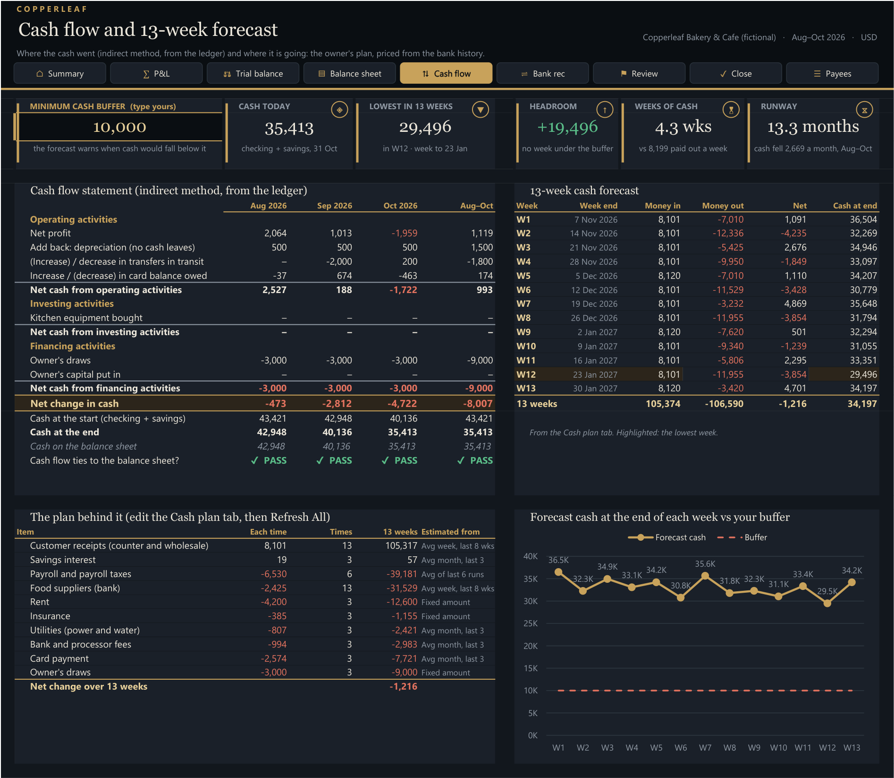
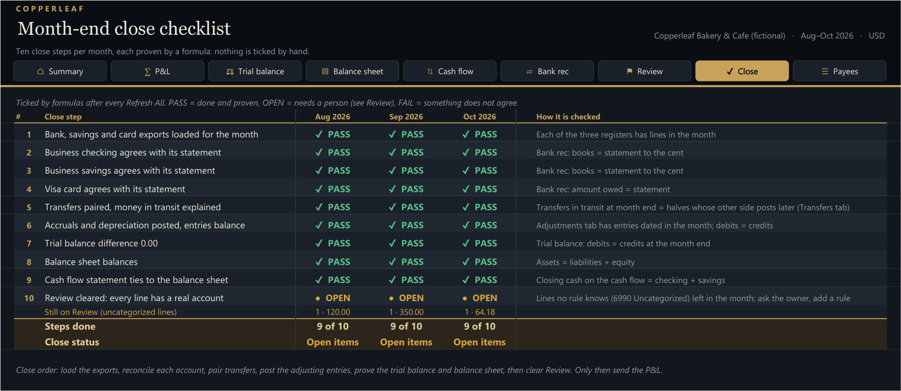
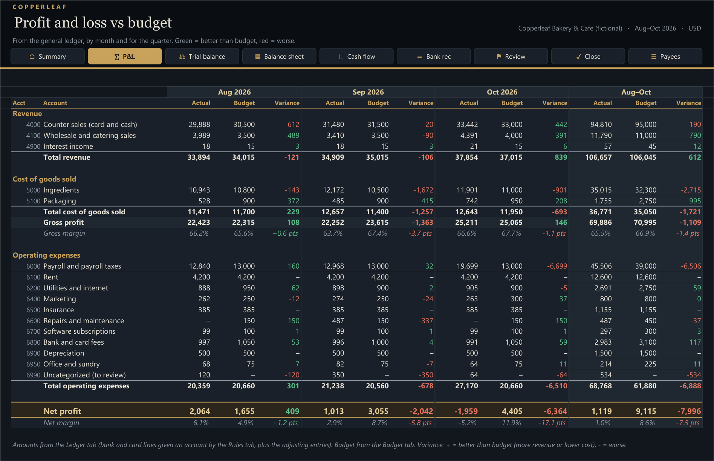
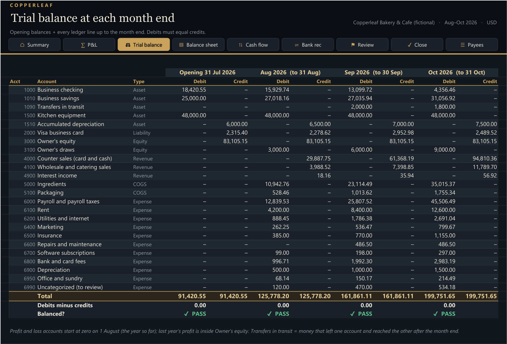
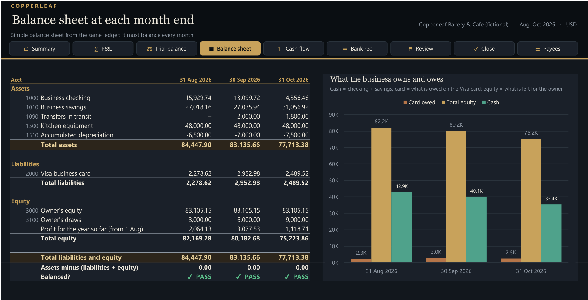
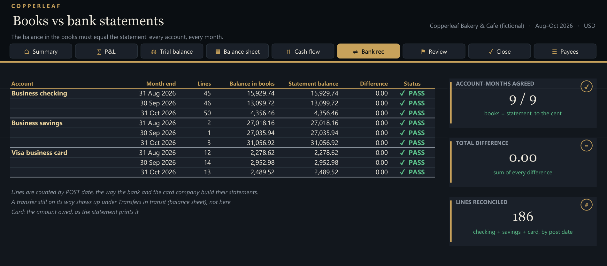
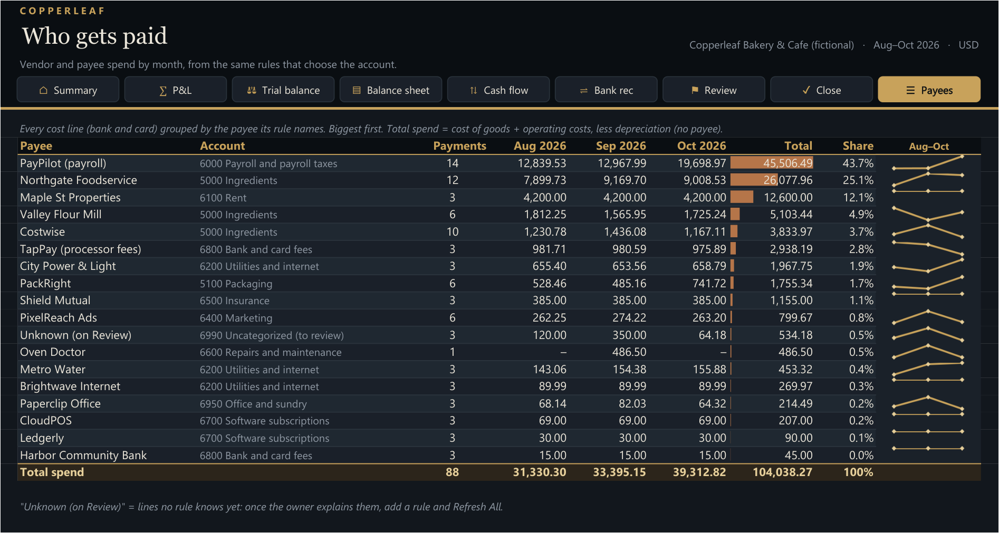
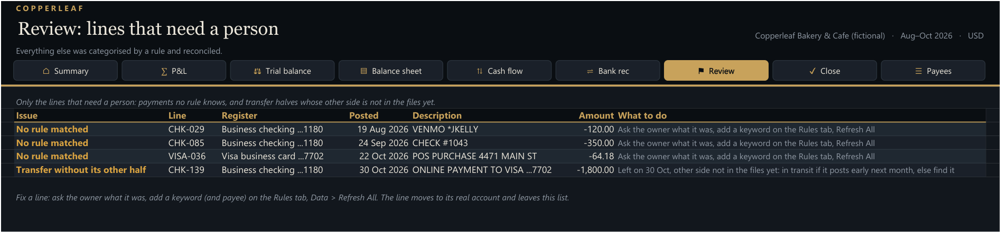

# E7 · Small business bookkeeping in Excel: bank and card recaps to a balanced trial balance, P&L, cash flow and a 13-week forecast

**Checking, savings and credit card exports → Power Query cleans them → a Rules tab gives every line an account and a
payee → transfers and card payments are paired so nothing counts twice → a general ledger → trial balance at every
month end, P&L vs budget, balance sheet, cash flow statement, 13-week cash forecast, books-vs-statement reconciliation
and a month-end close checklist, all on a dark-gold dashboard with slicers and a menu on every sheet.**
No macros. Next month: drop in the new exports, press **Refresh All**.

▶ **[Demo video (82 s, MP4)](docs/demo.mp4)**: raw bank export → Refresh All → slicers → cash flow and forecast → month-end close → P&L, trial balance, bank rec, review, payees. Real screen recording, captions added.

## The problem this solves

A small business (here the fictional *Copperleaf Bakery & Cafe*) keeps its books from bank "recaps": every month
someone downloads the checking, savings and card transactions, sorts each line into an account and adds them up.
Done by hand it goes wrong in the same places every time:

- each bank exports differently: title lines above the header, `$1,250.00` as text, Debit/Credit columns vs one signed amount, US dates
- the same supplier arrives as `TapPay Inc. Deposit`, `TAP PAY *DEPOSIT 72350`, `TAPPAY DEPOSIT 0804`
- a transfer from checking to savings, or a card payment, appears in **two** registers and is easily counted twice
- a card purchase on 31 Aug posts on 1 Sep, so the month never agrees with the card statement
- nobody can prove the totals: does the trial balance balance, does each account agree with its statement?
- and the owner's real questions stay open: where did the cash go, how many weeks can we pay the bills, who are we paying, is the month closed?

## What the workbook does

| Step | Where | What happens |
|---|---|---|
| 1 | Power Query `Checking_Clean`, `Savings_Clean`, `Card_Clean` | Read each export as text, skip the title lines, turn every amount into one signed number (money in +, out −), parse the dates; card lines are booked by **post** date like the statement |
| 2 | `Transactions` + the **Rules** tab | Descriptions are cleaned (upper case, punctuation removed); the first keyword on the Rules tab that appears decides the account **and the payee**. No match → *6990 Uncategorized* and the **Review** tab |
| 3 | `Transfers` | Both halves of a transfer or card payment go to *1090 Transfers in transit*; pairs are matched on amount and date (within 5 days). What is left is money still on its way |
| 4 | `Ledger` | Each bank line becomes two ledger lines (its register + the chosen account), plus the entries typed on **Adjustments** (depreciation). Debits always equal credits |
| 5 | Formulas | **Trial balance** at each month end, **P&L vs budget** (Aug, Sep, Oct, quarter), **Balance sheet**, **Bank rec** (books vs statement, 3 accounts × 3 months) |
| 6 | **Cash flow** | Cash flow statement by the **indirect method** straight from the ledger (net profit, + depreciation, ± money in transit, ± card balance owed, − owner's draws) that must tie to the balance sheet, and a **13-week cash forecast** from the **Cash plan** tab (each amount fixed or averaged from the bank history) with a buffer you type, the lowest week, **weeks of cash** and runway |
| 7 | **Payees** | Every cost line grouped by payee: spend per month, number of payments, share, trend line |
| 8 | **Month-end close** | Ten close steps per month (exports loaded, 3 reconciliations, transfers explained, accruals posted, trial balance 0.00, balance sheet, cash flow ties, Review cleared), each ticked PASS / OPEN / FAIL by a formula |
| 9 | **Summary** | A month slicer and a *vs Budget / vs Last month* slicer drive 8 KPI cards, a profit waterfall, costs by account (sorted, data bars, sparklines), the top payees, five key insights written by formulas, the eight data checks and the close status |

Every report sheet has the same gold menu (Summary, P&L, Trial balance, Balance sheet, Cash flow, Bank rec, Review,
Close, Payees), the current sheet highlighted. The client's own set-up lives on five yellow input tabs: **Accounts**
(chart of accounts + opening balances), **Rules** (keyword → account + payee), **Budget**, **Adjustments** and **Cash plan**.

## Result for August to October 2026

| | Aug | Sep | Oct | Quarter |
|---|---:|---:|---:|---:|
| Revenue | 33,894 | 34,909 | 37,854 | 106,657 |
| Gross margin | 66.2% | 63.7% | 66.6% | 65.5% |
| Operating costs % of revenue | 60.1% | 60.8% | 71.8% | |
| Net profit | 2,064 | 1,013 | **−1,959** | 1,119 |
| Budgeted net profit | 1,655 | 3,055 | 4,405 | 9,115 |
| Net cash from operating activities | 2,527 | 188 | −1,722 | 993 |
| Owner's draws | −3,000 | −3,000 | −3,000 | −9,000 |
| Cash at month end (checking + savings) | 42,948 | 40,136 | **35,413** | |
| Trial balance (debits = credits) | 125,778.20 | 161,861.11 | 199,751.65 | |
| Difference | **0.00** | **0.00** | **0.00** | |

- **186 lines** (141 checking, 6 savings, 39 card) categorised; **183** by a rule, **3** listed on Review (120.00, 350.00, 64.18)
- **6 transfer pairs** found, including a 30 Sep transfer that reached savings on 1 Oct (2,000 in transit at 30 Sep);
  a 30 Oct card payment of 1,800 has not reached the card yet: it shows as *Cash in transit* and on Review
- books = statement for all **9** account-months, to the cent; the cash flow statement ties to the balance sheet every month
- **13-week forecast** from 35,413 today: lowest **29,496 in week 12** (week to 23 Jan), 19,496 above a 10,000 buffer;
  **4.3 weeks of cash** (8,199 paid out a week); at the Aug–Oct fall of 2,669 a month, a runway of 13.3 months
- **18 payees** paid 104,038 (PayPilot payroll 44%, Northgate Foodservice 25%, Maple St rent 12%)
- month-end close: **9 of 10** steps PASS every month; the open one is Review (one unexplained payment a month)
- the story the P&L tells: September lost 1,672 on ingredients and 337 on an oven repair; October has **three pay
  dates** (payroll −6,699 vs budget), which turns a budgeted profit of 4,405 into a loss of 1,959

## Proof the numbers are right

[`test/model.py`](test/model.py) does the bookkeeping again in plain Python, straight from the four CSV files: rules,
transfer pairing, ledger, P&L, trial balance, statements, the cash flow statement, the 13-week forecast, the payees,
every dashboard number for each month and both comparisons, and the close checklist.
[`test/verify.py`](test/verify.py) compares it with **(a)** the answer planted when the data was generated (every line's
true account, every account's movement per month, the P&L, cash, in-transit money, the statement balances) and **(b)** the
workbook: every line's account, payee and amount, the P&L, trial balance, balance sheet, bank rec, Review, all 18
payees, all 13 cash flow lines × 4 periods, all 13 forecast weeks, the forecast cards, the cash plan, the 30 close
ticks, and, by driving the two slicers, the 8 KPI cards, their notes, the waterfall, the sorted costs and sparkline
data, the top payees and the five insights for **every month × both comparisons**. It also checks the menu links on
all nine report sheets and that no error value shows anywhere. Then it copies the workbook to another folder, refreshes
it there and checks everything again. Result: **174/174 checks pass**.

Inside the workbook, eight checks say PASS or FAIL after every refresh: opening balances balance, the trial balance
balances every month, every bank line is posted exactly once, every line has a known account (or is on Review),
what is in transit equals the unpaired halves, books = every statement, the balance sheet balances, and the
adjusting entries balance.

## Use it with your own data

1. Put your bank and card CSV exports in the `data` folder next to the workbook and type the file names on **Settings**;
   copy each statement's closing balance into the statements file.
2. Replace the **Accounts** tab with your chart of accounts and opening balances, set your **Budget** and your **Cash plan**.
3. **Data → Refresh All**. For every line on **Review**, add a keyword (and payee) on **Rules** and refresh again.
4. Pick the month on the Summary slicer and work down the **Month-end close** tab.

A different bank layout only changes its `*_Clean` query; the rules, ledger and reports stay the same.
Works in Excel 2016+ / Microsoft 365 for Windows (Power Query and table slicers are built in).

**This is a bookkeeping aid, not accounting or tax advice.** It organises and checks the numbers; your accountant
still prepares the tax return and year-end accounts.

## Files

| Path | What |
|---|---|
| `Bookkeeping-Trial-Balance.xlsx` | The workbook (no macros) |
| `data/` | The four fictional CSV files (checking, savings, card, statement balances) |
| `scripts/coa.py` | Chart of accounts, opening balances, rules with payees, budget, adjusting entries and the cash plan |
| `scripts/make_data.py` | Generates the fictional data with every special case planted on purpose |
| `scripts/build_workbook.py` | Builds the workbook with real Excel (Power Query M code is readable in the script) |
| `test/model.py`, `test/verify.py`, `test/expected.json` | Independent check |
| `scripts/shots.ps1`, `scripts/make_thumb.py` | Screenshots and thumbnail in `docs/` |

The same fictional books feed the Power BI version of this report ([E9](../09-powerbi-finance/)); the numbers agree.
All names, businesses and amounts are fictional.
