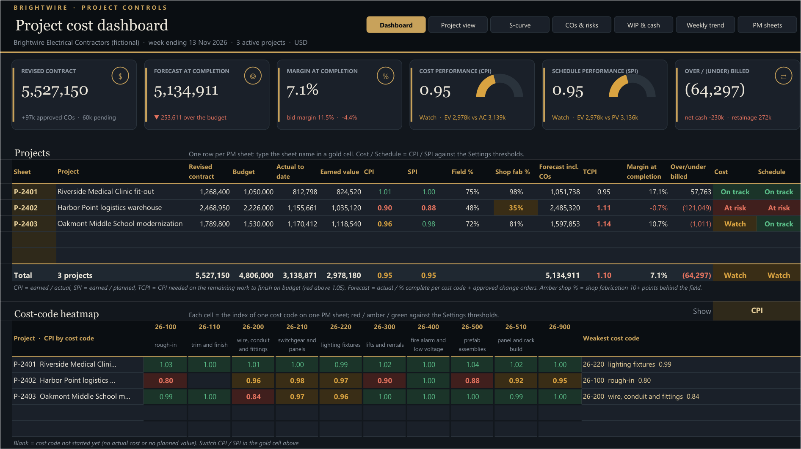
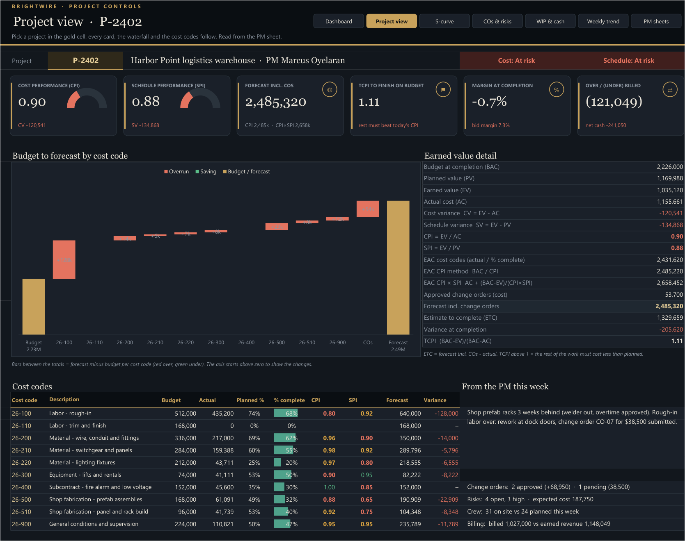
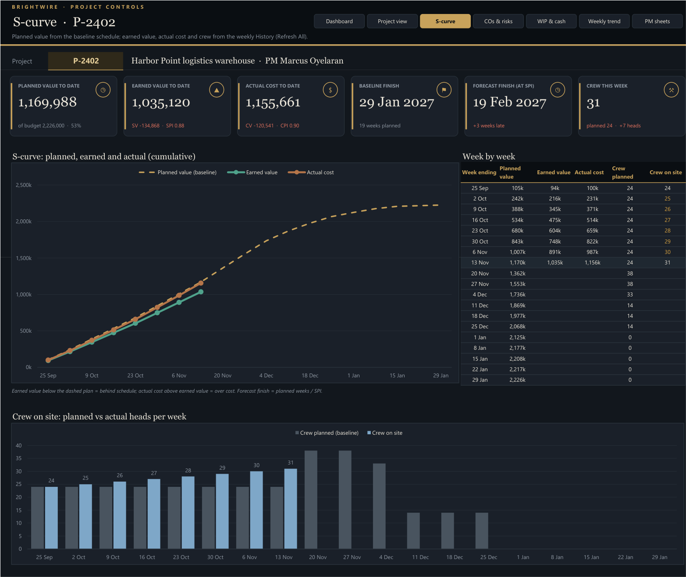
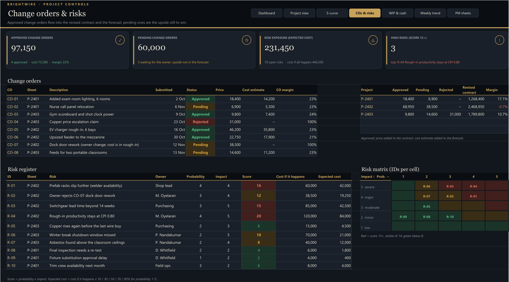
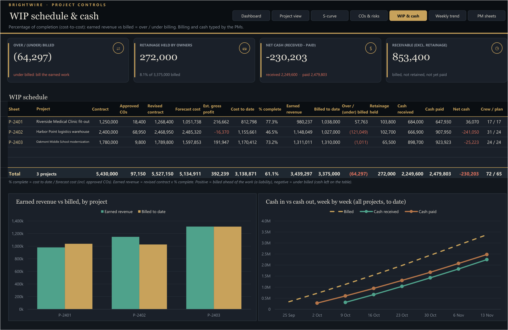
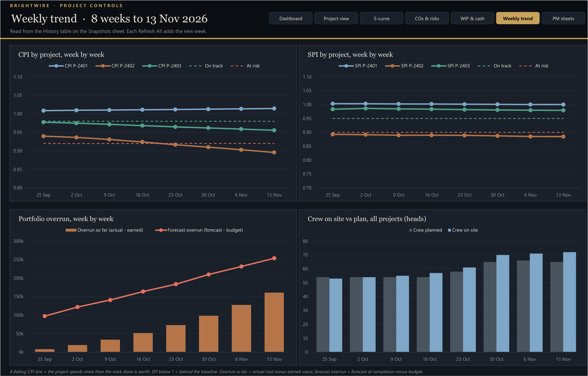

# E8 · Project cost tracker in Excel: PM sheets roll up to a VP dashboard, with earned value, S-curve, change orders, risks and WIP

**One sheet per project, filled in by its project manager → a dark-gold VP dashboard that adds them all up: cost and
schedule performance (CPI, SPI, TCPI, three forecast methods), red/amber/green status per project and per cost code,
a drill-down per project with a budget-to-forecast waterfall, an S-curve against the baseline schedule, change orders
and a 5×5 risk matrix, a WIP schedule with over/under billing and cash → every Friday, Data → Refresh All saves the
week in a History table and the trend charts move on.** No macros. Navigation buttons on every sheet. Add a project:
copy the Template sheet and type its name on the Dashboard.

▶ **[Demo video (100 s, MP4)](docs/demo.mp4)**: dashboard → heatmap switched to SPI → a PM updates a line → project
drill-down → S-curve → a change order is approved and the margin moves → WIP & cash → new week → Refresh All → the week
lands in History and on the trend charts. Real screen recording, captions added.

## The problem this solves

A contractor (here the fictional *Brightwire Electrical Contractors*) runs several jobs at once. Each project manager
keeps their own cost spreadsheet, every one a little different, and the VP gets a weekly e-mail of numbers that cannot
be added up or compared. Typical questions nobody can answer quickly:

- which job is spending more than the work done is worth, and which one is behind the schedule?
- where will each job finish against its budget, its contract and its planned finish date?
- which change orders are approved (and in the forecast) and which are still money on the table?
- are we billing what we have earned, and is the cash coming in faster than it goes out?
- what did last week look like? (the PM sheets only show today, so the history is lost)

## What the workbook does

| Sheet | What it shows |
|---|---|
| **PM sheets** `P-2401`, `P-2402`, `P-2403` | Identical layout. Per cost code the PM types budget, committed, actual to date and % complete (gold cells); planned % comes from the baseline schedule by itself. The sheet works out planned and earned value, CV, SV, CPI, SPI, forecast at completion per line, field % and shop fabrication % (tracked apart). Also billed to date, retainage %, cash received and paid, crew on site. Drop-down of valid cost codes, % limited to 0-100%, formulas locked |
| **Dashboard** | Six KPI cards (revised contract, forecast, margin, **CPI and SPI gauges**, over/under billing), one row per project with CPI, SPI, TCPI, margin and two status pills (cost, schedule), a **project × cost-code heatmap** (switch CPI / SPI in a gold cell; the weakest code per project is named), budget/actual/forecast and field-vs-shop charts, the PMs' notes and **11 PASS/FAIL checks** |
| **Project view** | Pick a project: gauges, forecast with **three methods** (cost codes, BAC/CPI, AC + (BAC−EV)/(CPI×SPI)), TCPI, margin vs bid, billing; a **waterfall from budget to forecast by cost code** (+ approved change orders); 16-line earned value detail; the cost codes with RAG colours; the PM's note, change orders, risks, crew |
| **S-curve** | Pick a project: planned value from the **cost-loaded baseline** to the end of the project against earned value and actual cost from History; baseline finish vs **forecast finish at today's SPI**; **crew planned vs on site** week by week |
| **COs & risks** | Change orders (Approved / Pending / Rejected): approved ones add their price to the contract and their cost to the forecast, pending ones are shown as upside. **Risk register + 5×5 matrix** that lists the risk IDs in each cell; expected cost = cost × probability |
| **WIP & cash** | Percentage-of-completion **WIP schedule** (cost-to-cost): earned revenue, billed, **over/(under) billing**, retainage, cash received vs paid, receivable; earned-vs-billed chart and cash in vs out week by week |
| **Weekly trend** | CPI and SPI per project week by week (with the On track / At risk lines), portfolio overrun, crew on site vs plan |
| **Snapshots** | Power Query copies *This week* into **History** on Data → Refresh All. The query appends to its own output table, so the history is kept inside the workbook without macros; running it again in the same week replaces that week instead of adding it twice |
| Rollup, Baseline, Settings | Rollup = every figure the report sheets show (one row per project, totals, the picked projects); Baseline = the cost-loaded schedule (planned %, planned value, planned crew per project, cost code and week); Settings = week ending and the CPI / SPI thresholds |

## Result for the week ending 13 November 2026

| Project | CPI | SPI | Forecast incl. COs | Margin at completion | Over/(under) billed | Cost / schedule |
|---|---:|---:|---:|---:|---:|---|
| P-2401 Riverside Medical Clinic fit-out | **1.01** | 1.00 | 1,051,738 | 17.1% | 57,763 | On track / On track |
| P-2402 Harbor Point logistics warehouse | **0.90** | **0.88** | **2,485,320** (above the 2.47M revised contract) | **−0.7%** | **(121,049)** | **At risk / At risk** |
| P-2403 Oakmont Middle School modernization | **0.96** | 0.98 | 1,597,853 | 10.7% | (1,011) | Watch / On track |
| **Portfolio** | **0.95** | **0.95** | **5,134,911** (−253,611 vs budget) | **7.1%** | **(64,297)** | Watch / Watch |

The story the numbers tell (and the PMs' notes confirm): the warehouse's rough-in labor runs at CPI 0.80 (rework at
the dock doors) and its shop prefab racks at SPI 0.65; it has 31 people on site against 24 planned and is still
behind, so the S-curve puts its finish at 19 Feb 2027 instead of 29 Jan (3 weeks late), and TCPI 1.11 says the rest
of the work would have to beat today's performance by 11% to finish on budget. It is also under billed by 121,049 with
net cash −241,050, and its dock-door change order (CO-07, 38,500) is still pending. The school is losing margin on
copper wire (CPI 0.84 on that code) but is on schedule. Risk exposure across the jobs: 231,450 expected, three high
risks, all on the warehouse.

## Proof the numbers are right

[`test/verify.py`](test/verify.py) recomputes everything in plain Python from what the PMs typed and the baseline
([`data/`](data/)), with no Excel involved: earned and planned value, CPI, SPI, CV, SV, the three forecast methods,
TCPI, change orders, margin, the WIP schedule, crew, risk exposure, the 5×5 matrix and the forecast finish. It compares
that with **(a)** the answer planted when the data was generated and **(b)** the workbook: all 30 PM sheet lines, every
Rollup figure (50 per project + totals), the Dashboard table, heatmap and KPI cards, the gauges, the Project view
(earned value detail, cost codes, waterfall), the S-curve grid and finish dates, the change orders and risk matrix, the
WIP schedule, the History table and the trend grid, and that every navigation button points at a real sheet. Then, on a
copy, it plays a few weeks of real use: Refresh All twice in the same week (History does not grow), next week with a
PM update (3 new rows, planned value follows the baseline by itself, the earlier 24 rows unchanged), a pending change
order approved (contract and margin move), both pickers and the heatmap switch, and bad input that must make the right
check FAIL (risk score 6, a change order for an unknown project, billing above the contract, a copied project sheet not
on the Dashboard or without a baseline, an unknown cost code). Result: **72/72 checks pass**.

Inside the workbook, 11 checks say PASS or FAIL: every sheet between the bookends is on the Dashboard, Dashboard
budget and actual = the 3D sum of all PM sheets, no unknown cost codes, % within 0-100%, every project has a baseline
for this week, every change order belongs to a project and has a valid status, risk scores 1-5, nobody billed above
the contract, this week's snapshot saved once per project, and no project saved twice for the same week.

## Use it every week

1. Each PM updates the gold cells on their sheet: committed, actual to date, % complete per cost code, billing, cash,
   crew, notes. Planned % comes from the Baseline sheet.
2. Change orders and risks: type them in the two tables on *COs & risks* (status from a drop-down).
3. **Settings**: set *Week ending* to this Friday.
4. **Data → Refresh All**: the week is saved in History and the trend charts move on. All checks must say PASS.

**Add a project**: right-click *Template* → Move or Copy → Create a copy → place it before *PM end*, rename it to the
project ID, fill in the gold cells, type the sheet name in the next empty row of the Dashboard's Projects table, and
add its schedule to the Baseline table. **New cost code**: add a row to the table on *Cost codes*.
Works in Excel 2016+ / Microsoft 365 for Windows. Formulas on the PM sheets are locked without a password.

## How the numbers are defined

- Planned value (PV) = budget × planned %; earned value (EV) = budget × % complete; actual cost (AC) as booked
- CPI = EV / AC, SPI = EV / PV (1.00 = on plan; CPI 0.90 = each $1 of work costs $1.11); CV = EV − AC, SV = EV − PV
- Forecast at completion = actual / % complete per cost code (the budget for lines not started) + cost of approved
  change orders; shown next to it: EAC = BAC / CPI and EAC = AC + (BAC − EV) / (CPI × SPI)
- TCPI = (BAC − EV) / (BAC − AC); margin at completion = (revised contract − forecast) / revised contract
- Forecast finish = planned weeks / SPI, rounded up; status: cost On track if CPI ≥ 0.98, Watch if ≥ 0.92; schedule
  On track if SPI ≥ 0.95, Watch if ≥ 0.90 (Settings)
- WIP: % complete = actual / forecast; earned revenue = revised contract × % complete; over/(under) billed = billed −
  earned revenue; retainage held = billed × retainage %
- Risk expected cost = cost if it happens × 10 / 30 / 50 / 70 / 90% for probability 1-5; score = probability × impact

## Files

| Path | What |
|---|---|
| `Project-Cost-Tracker.xlsx` | The workbook (no macros) |
| `data/` | What the PMs typed this week, the cost codes, the baseline schedule, change orders, risks and the seven earlier weekly snapshots (all fictional) |
| `scripts/make_data.py` | Generates the fictional data with the story planted on purpose |
| `scripts/build_workbook.py` | Builds the workbook with real Excel (the Power Query M code is readable in the script) |
| `test/verify.py`, `test/expected.json` | Independent check |
| `scripts/shots.ps1`, `scripts/make_thumb.py` | Screenshots and thumbnail in `docs/` |

All names, companies and numbers are fictional.
