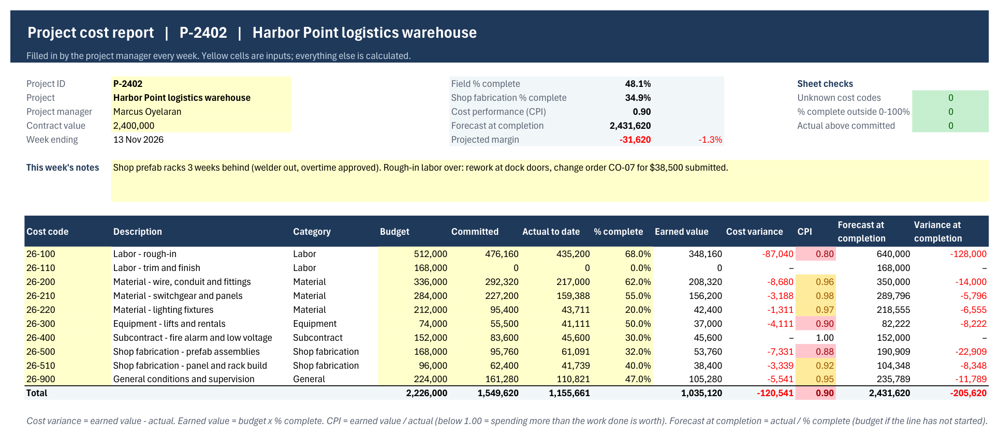

# E8 · Project cost tracker in Excel: PM sheets roll up to a VP dashboard, with weekly history

**One sheet per project, filled in by its project manager → a VP dashboard that adds them all up: budget vs actual,
earned value and CPI, forecast at completion, field vs shop fabrication progress, red/amber/green status and the PMs'
notes → every Friday, Data → Refresh All saves the week in a History table, and a trend sheet charts it.**
No macros. Add a project: copy the Template sheet and type its name on the Dashboard.

▶ **[Demo video (53 s, MP4)](docs/demo.mp4)**: a PM updates a line → the dashboard follows → new week → Refresh All →
the week lands in History and on the trend charts. Real screen recording, captions added.

## The problem this solves

A contractor (here the fictional *Brightwire Electrical Contractors*) runs several jobs at once. Each project manager
keeps their own cost spreadsheet, every one a little different, and the VP gets a weekly e-mail of numbers that cannot
be added up or compared. Typical questions nobody can answer quickly:

- which job is spending more than the work done is worth, and since when?
- where will each job finish against its budget and its contract?
- is the shop prefabrication keeping up with the field crews?
- what did last week look like? (the PM sheets only show today, so the history is lost)

## What the workbook does

| Step | Where | What happens |
|---|---|---|
| 1 | **PM sheets** `P-2401`, `P-2402`, `P-2403` | Identical layout. Per cost code (labor, material, equipment, subcontract, shop fabrication, general) the PM types budget, committed, actual to date and % complete; drop-down of valid cost codes, % limited to 0-100%, formulas locked. The sheet works out earned value, CPI, forecast at completion, field % and shop fabrication % (tracked apart) and projected margin |
| 2 | **Dashboard** | One row per PM sheet: contract, budget, committed, actual, earned value, CPI, field %, shop %, forecast at completion, variance and margin at completion, status (On track / Watch / At risk from CPI thresholds on Settings). KPI cards, two charts, the PMs' notes and seven PASS/FAIL checks |
| 3 | **Snapshots** | Power Query copies *This week* into **History** on Data → Refresh All. The query appends to its own output table, so the history is kept inside the workbook without macros; running it again in the same week replaces that week instead of adding it twice |
| 4 | **Weekly trend** | CPI per project week by week (with the On track / At risk lines) and the portfolio overrun: actual minus earned value so far, forecast minus budget to come |
| 5 | **PM start / PM end** | Bookend sheets. Every sheet between them is added up with 3D sums, so the Dashboard can prove it has not missed a project |

## Result for the week ending 13 November 2026

| Project | Budget | Actual to date | CPI | Field / shop % | Forecast at completion | Status |
|---|---:|---:|---:|---|---:|---|
| P-2401 Riverside Medical Clinic fit-out | 1,050,000 | 812,798 | **1.01** | 75% / 98% | 1,037,538 | On track |
| P-2402 Harbor Point logistics warehouse | 2,226,000 | 1,155,661 | **0.90** | 48% / **35%** | **2,431,620** (above the 2.4M contract) | **At risk** |
| P-2403 Oakmont Middle School modernization | 1,530,000 | 1,170,412 | **0.96** | 72% / 81% | 1,590,453 | Watch |
| **Portfolio** | **4,806,000** | **3,138,871** | **0.95** | | **5,059,611** (−253,611 vs budget, margin 6.8%) | Watch |

The story the numbers tell (and the PMs' notes confirm): the warehouse's rough-in labor runs at CPI 0.80 (rework at
the dock doors) and its shop prefab is 13 points behind the field; the school is losing margin on copper wire.
The trend sheet shows the warehouse crossing the At risk line in the week of 23 October: early enough to act.

## Proof the numbers are right

[`test/verify.py`](test/verify.py) recomputes every project in plain Python from what the PMs typed
([`data/`](data/)) and compares it with **(a)** the answer planted when the data was generated, **(b)** all 30 PM sheet
lines, every Dashboard figure and status, the History table and the trend grid. Then, on a copy, it plays a few weeks of
real use: Refresh All twice in the same week (History does not grow), next week with a PM update (3 new rows, the earlier
24 unchanged), a project sheet copied in but not put on the Dashboard (check says FAIL, then PASS once added) and an
unknown cost code (check says FAIL). Result: **44/44 checks pass**.

Inside the workbook, seven checks say PASS or FAIL: every sheet between the bookends is on the Dashboard, Dashboard
budget and actual = the 3D sum of all PM sheets, no unknown cost codes, % complete within 0-100%, this week's snapshot
saved once per project, and no project saved twice for the same week.

## Use it every week

1. Each PM updates the yellow cells on their sheet: committed, actual to date, % complete per cost code, notes.
2. **Settings**: set *Week ending* to this Friday.
3. **Data → Refresh All**: the week is saved in History and the trend charts move on. All checks must say PASS.

**Add a project**: right-click *Template* → Move or Copy → Create a copy → place it before *PM end*, rename it to the
project ID, fill in the yellow cells, type the sheet name in the next empty row of the Dashboard's Projects table.
**New cost code**: add a row to the table on *Cost codes*; every drop-down picks it up.
Works in Excel 2016+ / Microsoft 365 for Windows. Formulas on the PM sheets are locked without a password.

## How the numbers are defined

- Earned value = budget × % complete; CPI = earned value / actual (1.00 = on budget, 0.90 = each $1 of work costs $1.11)
- Forecast at completion = actual / % complete per cost code (the budget for lines not started yet)
- Variance at completion = budget − forecast; margin at completion = (contract − forecast) / contract
- Field % = budget-weighted over the field cost codes; shop fabrication % over the shop codes

## Files

| Path | What |
|---|---|
| `Project-Cost-Tracker.xlsx` | The workbook (no macros) |
| `data/` | What the PMs typed this week, the cost codes, and the seven earlier weekly snapshots (all fictional) |
| `scripts/make_data.py` | Generates the fictional data with the story planted on purpose |
| `scripts/build_workbook.py` | Builds the workbook with real Excel (the Power Query M code is readable in the script) |
| `test/verify.py`, `test/expected.json` | Independent check |
| `scripts/shots.ps1`, `scripts/make_thumb.py` | Screenshots and thumbnail in `docs/` |

All names, companies and numbers are fictional.
