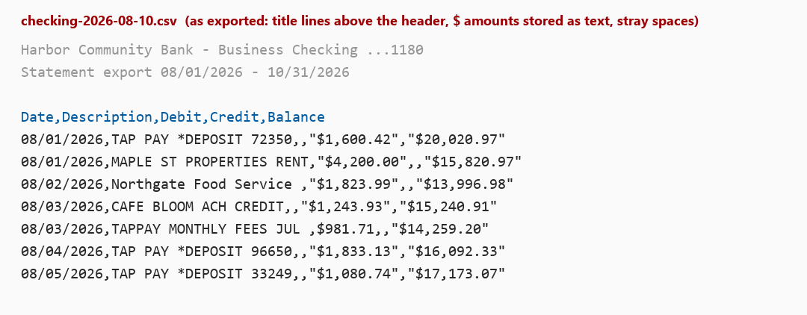
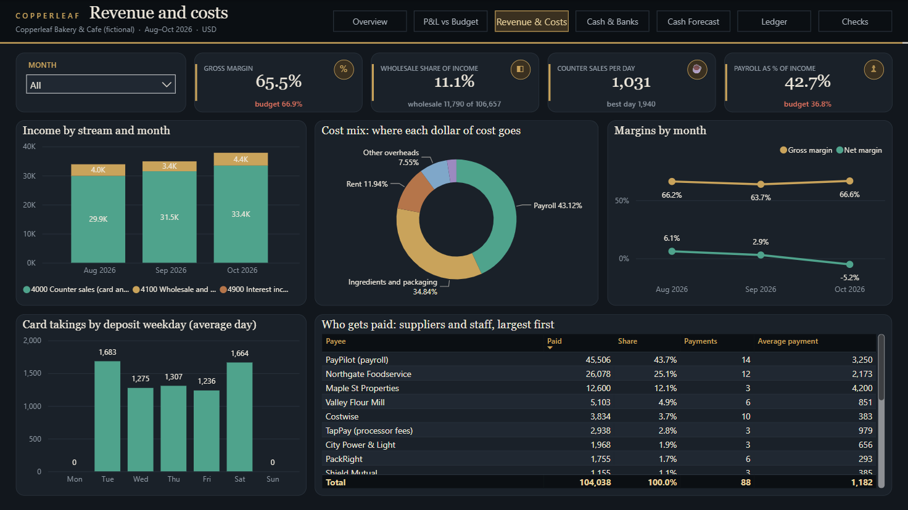
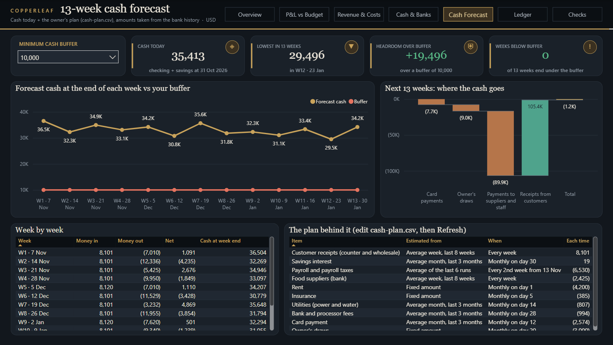
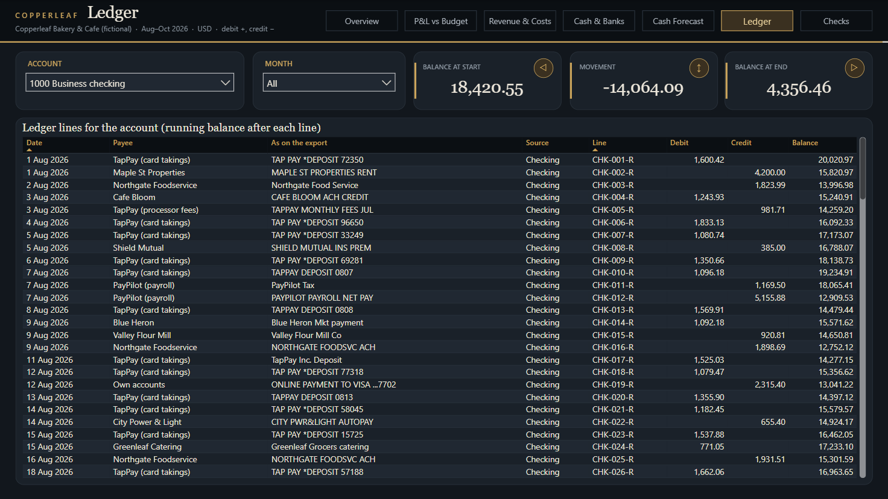
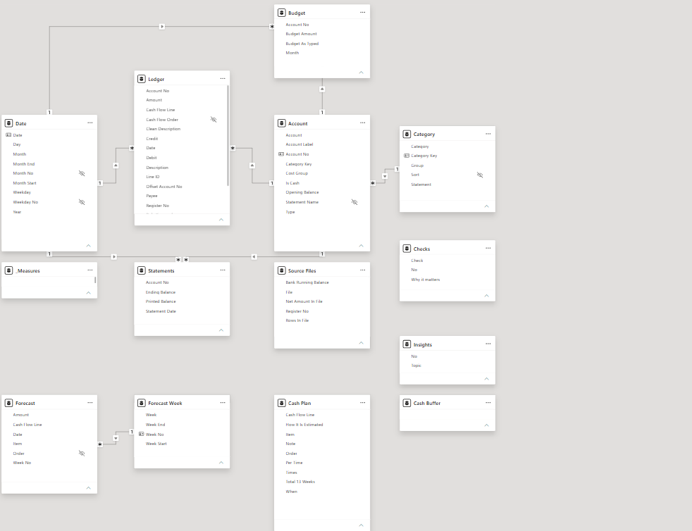
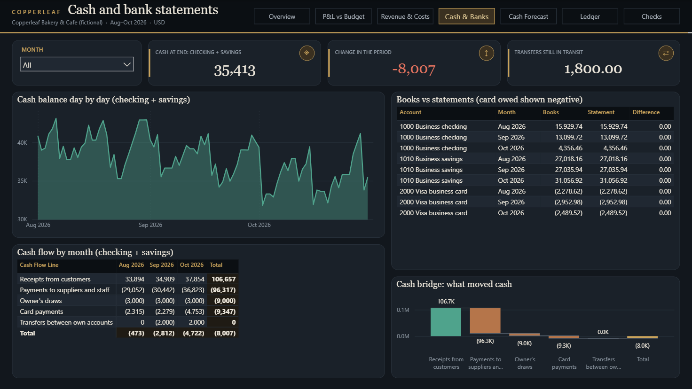
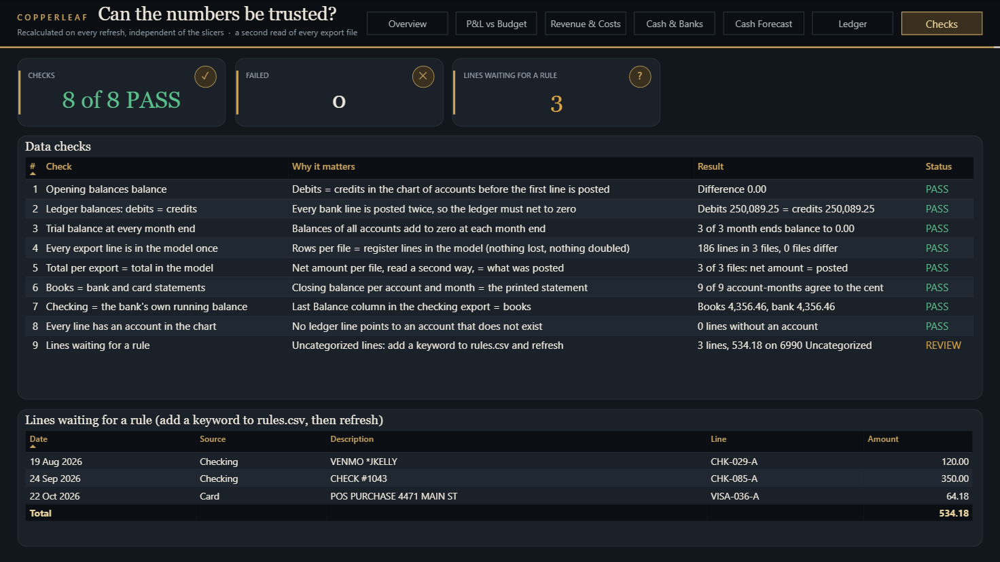

# E9 · Power BI finance report: bank and card exports to P&L vs budget, a 13-week cash forecast and checks

**Checking, savings and credit card exports → Power Query cleans them and a rules table gives every line an account →
a star-schema model (ledger fact table, Date, Account, Category, Budget, Statements, Forecast) → 105 DAX measures → seven
report pages: Overview, P&L vs Budget, Revenue & Costs, Cash & Banks, a 13-week Cash Forecast, the Ledger and a Checks
page that proves the numbers.**
Next month: drop the new exports in the data folder, press **Refresh**.


▶ **[Demo video (72 s, MP4)](docs/demo.mp4)**: the raw bank export → the report in Power BI Desktop → pick October → P&L vs
budget, revenue and costs, cash, the 13-week forecast, the ledger, checks, star schema. Real screen recording of Power BI Desktop, captions added.

## The problem this solves

A small business (here the fictional *Copperleaf Bakery & Cafe*, the same books as sample [E7](../07-bookkeeping-trial-balance/))
wants its monthly numbers in Power BI instead of a spreadsheet: profit and loss against budget, where the cash went, and
a quick way to see that nothing was missed. The raw material is what the bank and card portals export:



- three exports, three layouts: title lines above the header, `$1,250.00` as text, Debit/Credit columns vs one signed amount, US and ISO dates
- the same supplier typed several ways (`TapPay Inc. Deposit`, `TAP PAY *DEPOSIT 72350`, `TAPPAY DEPOSIT 0804`)
- transfers and card payments appear in **two** registers, a card purchase on 31 Aug posts on 1 Sep
- a dashboard is only useful if the client can trust it: does it agree with the bank statements?

## What is built

| Step | Where | What happens |
|---|---|---|
| 1 | Power Query `Checking_Clean`, `Savings_Clean`, `Card_Clean` | Read each export, skip the title lines, one signed amount (money in +, out −), parse the dates; card lines are booked by **post** date like the statement |
| 2 | `BankLines` + `rules.csv` | Descriptions cleaned (upper case, punctuation removed); the first keyword that appears decides the account. No match → *6990 Uncategorized*, listed on the Checks page |
| 3 | `Ledger` (fact table) | Double entry: every bank line posts to its register **and** to the chosen account, plus the month-end journal entries (depreciation). 378 lines, debits = credits |
| 4 | Dimensions | `Date` (calendar, marked as date table), `Account` (chart of accounts + opening balances + cost group), `Category` (Revenue / Cost of goods sold / Operating expenses / balance sheet), plus `Budget` and `Statements`; every line also gets a clean **Payee** from `rules.csv` |
| 5 | `cash-plan.csv` → `Cash Plan`, `Forecast`, `Forecast Week` | The owner's list of regular receipts and payments for the next 13 weeks. Power Query takes each amount from the bank history (average week of the last 8 weeks, average month of the last 3, average of the last 6 pay runs) unless the plan types it (rent, insurance, owner's draws), and puts it in the weeks it falls in |
| 6 | 105 DAX measures | Income, expense, net profit, margin, budget, variance, variance %, month-on-month, previous month, YTD, closing balance per account, running cash, in transit, books vs statement, gross margin, wholesale share, payroll % of income, spend per payee, forecast cash per week, lowest week, headroom over a what-if buffer, running balance per ledger line, the checks, plus the text and colour of every KPI line and of the key insights |
| 7 | Report | 7 pages with page buttons in the header and one dark theme (charcoal, gold, jade, copper; serif titles): Overview, P&L vs Budget, Revenue & Costs, Cash & Banks, Cash Forecast, Ledger, Checks |

### What the Overview page tells a busy owner

- **KPI tiles with a verdict.** Each tile shows the number and, under it, one line in green or red: income *+0.6% vs budget*,
  expenses *+8.9% over budget*, net profit *budget 9,115 · −7,996*, cash *▼ 8,007 in the period*.
- **Profit bridge.** A waterfall from income through cost of goods sold and operating expenses down to the net profit.
- **Key insights written by DAX.** Six sentences recalculated for the month and account picked in the slicers: profit
  against budget, income and costs against budget, the biggest overrun (*6000 Payroll and payroll taxes: −6,506*), the
  biggest saving (*5100 Packaging: +995*), where cash went and the lowest point of the next 13 weeks. Pick October and
  the sentences change with the numbers.
- **One look across the pages.** Dark charcoal pages, a gold rule under the header, page buttons, serif titles, jade for
  income, copper for costs, green/red only for better/worse than budget.

### The other pages

- **Revenue & Costs.** Gross margin 65.5% (budget 66.9%), wholesale share 11.1%, counter sales per day, payroll 42.7% of
  income (budget 36.8%); income by stream and month, the cost mix in a donut, gross and net margin by month, card takings
  by weekday, and *who gets paid*: every supplier and staff payee with total, share, number of payments and average.
- **Cash Forecast.** Cash today 35,413, then week by week for 13 weeks. The lowest point is 29,496 in week 12 (23 Jan),
  19,496 above a minimum buffer of 10,000; pick another buffer in the slicer (0 to 30,000) and the headroom, the weeks
  below it and the red line follow. A waterfall shows where the 13 weeks' cash goes, and the plan table shows how
  every amount was estimated, so the owner can correct `cash-plan.csv` and refresh.
- **Ledger.** Pick an account and a month: every line with payee, the text as exported, debit, credit and the running
  balance after each line (checking: 18,420.55 opening, 4,356.46 on 31 Oct = the bank's own balance).









A few of the measures (all of them are readable in [`_Measures.tmdl`](Copperleaf-Finance.SemanticModel/definition/tables/_Measures.tmdl)):

```dax
Total Income  = CALCULATE ( -SUM ( Ledger[Amount] ), KEEPFILTERS ( Category[Group] = "Income" ) )
Actual        = CALCULATE ( -SUM ( Ledger[Amount] ), KEEPFILTERS ( Category[Statement] = "P&L" ) )   -- income +, costs -
Variance      = [Actual] - [Budget]                                                                   -- + = better than budget
Income MoM %  = VAR cur = [Income Last Month] VAR prev = [Income Previous Month]
                RETURN IF ( NOT ISBLANK ( prev ), DIVIDE ( cur - prev, prev ) )
Closing Balance =                     -- opening balance + every posting up to the last date in the selection
    VAR d = MAX ( 'Date'[Date] )
    RETURN SUM ( Account[Opening Balance] ) + CALCULATE ( SUM ( Ledger[Amount] ), REMOVEFILTERS ( 'Date' ), 'Date'[Date] <= d )
Cash Balance  = CALCULATE ( [Closing Balance], KEEPFILTERS ( Account[Is Cash] = TRUE () ) )
Forecast Balance =                    -- cash today + every expected receipt and payment up to the end of the week
    VAR w = MAX ( 'Forecast Week'[Week No] )
    RETURN [Cash Today] + CALCULATE ( SUM ( Forecast[Amount] ), REMOVEFILTERS ( 'Forecast Week' ), 'Forecast Week'[Week No] <= w )
Headroom      = [Lowest Forecast Cash] - [Cash Buffer Value]          -- buffer = what-if slicer, 10,000 by default
```

## Result for August to October 2026

| | Aug | Sep | Oct | Quarter |
|---|---:|---:|---:|---:|
| Income | 33,894 | 34,909 | 37,854 | 106,657 |
| Expenses (cost of sales + operating) | 31,830 | 33,895 | 39,813 | 105,538 |
| Net profit | 2,064 | 1,013 | **−1,959** | 1,119 |
| Budgeted net profit | 1,655 | 3,055 | 4,405 | 9,115 |
| Cash at month end (checking + savings) | 42,948 | 40,136 | 35,413 | |
| Books − statements (3 accounts) | **0.00** | **0.00** | **0.00** | |

The same figures as the Excel version (E7), to the cent. The story the report tells: income grew 8.4% from September
to October, but October has **three pay dates** (payroll −6,699 against budget) and turns a budgeted profit of 4,405
into a loss of 1,959; September lost on ingredients and an oven repair.




## Proof the numbers are right

The **Checks** page recalculates nine checks on every refresh, ignoring the slicers: opening balances balance, debits =
credits, the trial balance balances at every month end, every export line is in the model exactly once, the net
amount per file (read a second, independent way) = what was posted, books = all 9 bank and card statements, checking
= the bank's own running balance, every line has an account in the chart. The ninth lists the 3 lines that still need
a rule.



[`test/verify.py`](test/verify.py) does the bookkeeping again in plain Python straight from the CSV files and compares
it with **(a)** the answer planted when the data was generated (every line's true account, the P&L, cash, statements),
**(b)** the project files: the model has the 14 tables, the 8 relationships, the measures and the time
intelligence, the 7 pages, and every field used by the 203 visuals exists in the model, **(c)** what the model inside Power BI
Desktop answered ([`test/query_model.ps1`](test/query_model.ps1) asks the open report with DAX queries): every month,
all 48 account-months of the P&L, the 9 statements, the cash flow, the check results, the KPI lines and key insights
(biggest overrun and saving), the account of all 186 bank lines, and the new pages: the 13-week forecast recomputed from
`cash-plan.csv` week by week (same averages, same month-end rules, half-to-even rounding like Power Query), lowest week,
headroom and weeks below the buffer, gross margin, wholesale share and payroll %, the spend of all 20 payees, and the
running balance after each of the 141 checking lines. Result: **41/41 checks pass**.

## Use it with your own data

1. Open **`Copperleaf-Finance.pbix`** in Power BI Desktop (free, no account needed): the data is inside.
2. The report reads its CSVs from `C:\Copperleaf\data\`: copy the `data` folder there before pressing Refresh.
3. To load your own exports: put them in a folder, then **Transform data → Edit parameters → DataFolder** = that folder.
   Replace `accounts.csv` (chart of accounts, opening balances), `rules.csv` (keyword → account, payee), `budget.csv`
   and `cash-plan.csv` (regular receipts and payments for the forecast) with yours.
4. **Refresh**. Every line on the Checks page's *Lines waiting for a rule* table needs a keyword in `rules.csv`; add it and refresh again.

A different bank layout only changes its `*_Clean` query; the model, measures and pages stay the same.
The `.pbip` folder is the same report as text files (model in TMDL, report in PBIR), so every change can be reviewed in
Git; it keeps no data, so press *Refresh now* after opening it. Built and tested with Power BI Desktop 2.159 (November 2026).

**This is a reporting aid, not accounting or tax advice.**

## Files

| Path | What |
|---|---|
| `Copperleaf-Finance.pbix` | The report with its data (open this one) |
| `Copperleaf-Finance.pbip`, `*.SemanticModel/`, `*.Report/` | The same report as a Power BI project: Power Query, tables, relationships and DAX in TMDL; pages and visuals in PBIR JSON |
| `data/` | The three fictional exports and statement balances (as in E7), the chart of accounts, rules, budget, journal entries and the cash plan |
| `scripts/build_pbip.py` | Writes the whole project (M, DAX, visuals) from one readable script |
| `scripts/make_tables.py` | Writes the input tables and the planted answer from E7's fictional data |
| `test/verify.py`, `test/expected.json`, `test/query_model.ps1`, `test/model-snapshot.json` | Independent check |
| `scripts/shots.py`, `scripts/make_thumb.py` | Screenshots taken from Power BI Desktop, thumbnail, `.pbix` copy |

All names, businesses and amounts are fictional.
