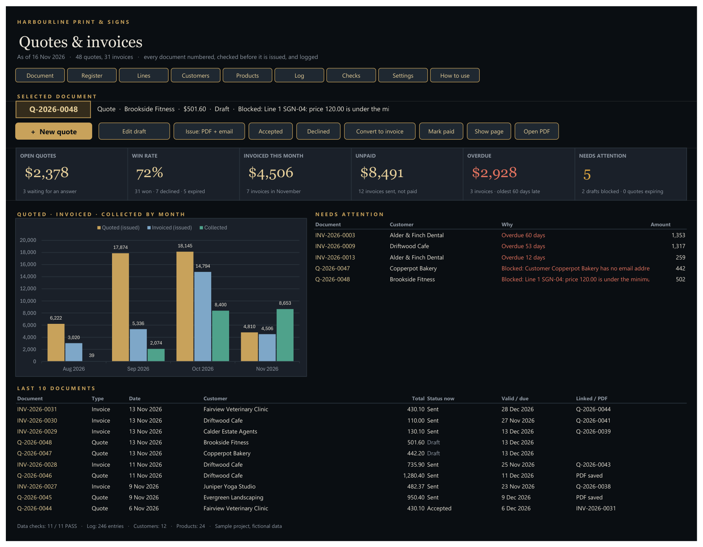
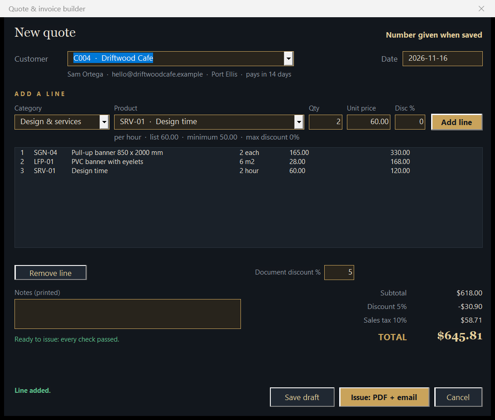
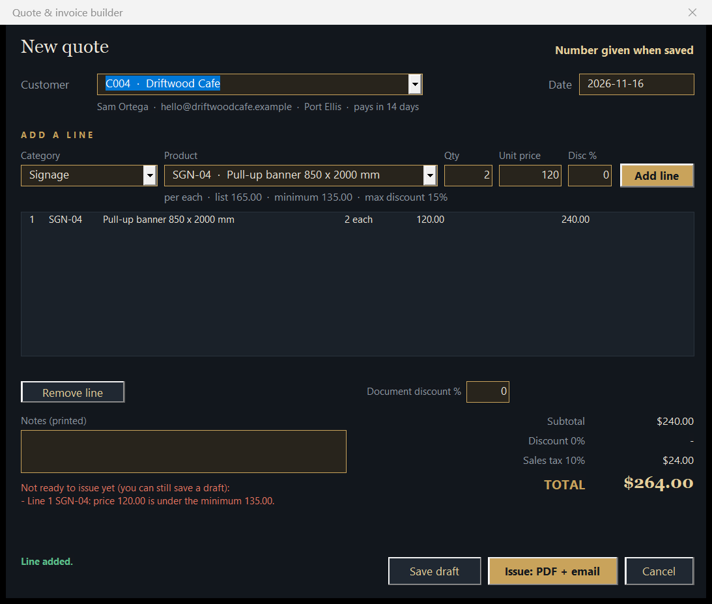
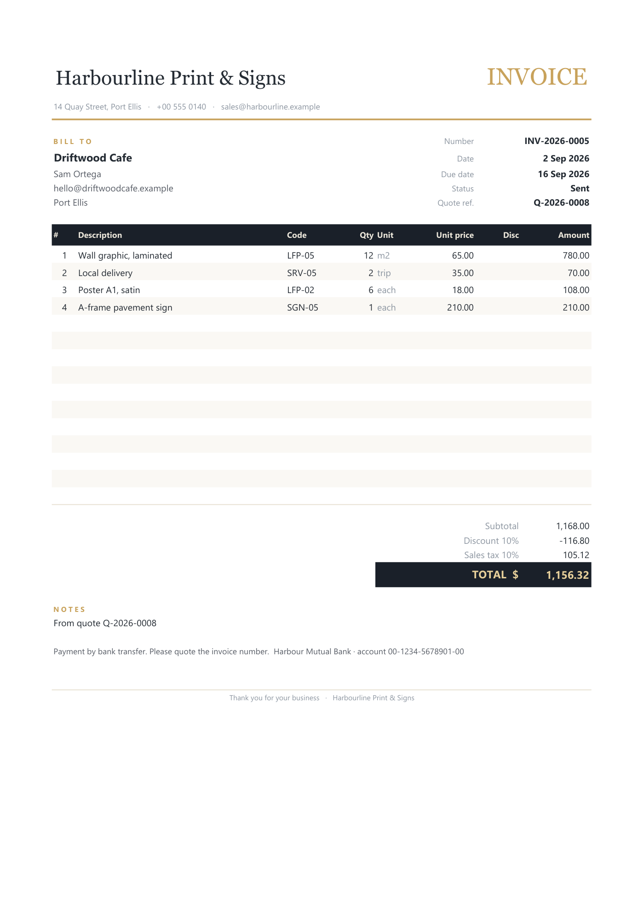
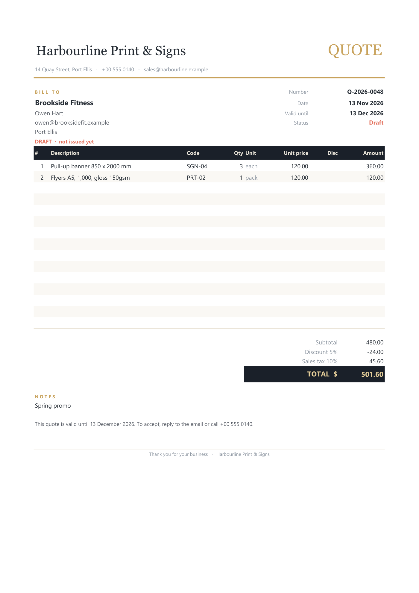
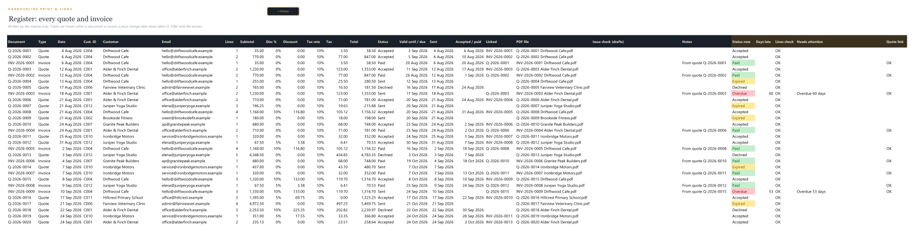
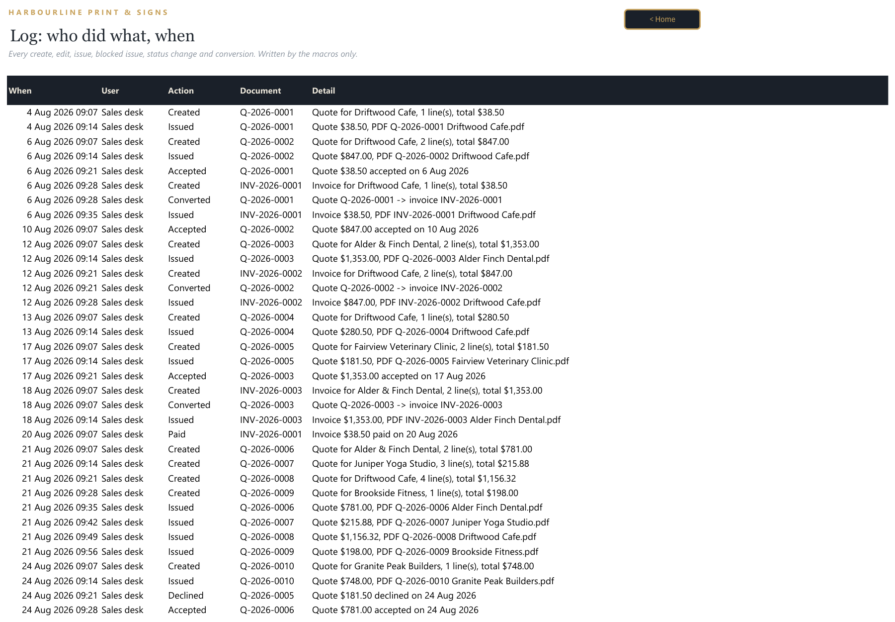
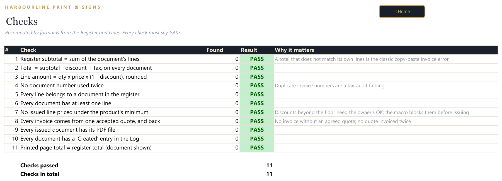

# E10 · Quote & invoice builder in Excel (VBA + UserForm): numbered PDF and email in one click, checked before it goes

**A sales desk fills in a form → the quote gets the next number, is checked against the price list, printed to PDF and
put in an email ready to send, and logged.** When the customer says yes, one click turns the quote into an invoice with
the same lines and prices; overdue invoices and quotes about to expire show up on Home. A quote that breaks a rule
(a price under the minimum, a discount above the limit, a customer without an email address) cannot be issued.

▶ **[Demo video (84 s, MP4)](docs/demo.mp4)**: New quote, pick the customer, category → product, a price under the
minimum blocked live, fixed, discount, Issue (PDF + email), then Accepted → invoice → issued, Register, Log, Checks.
Real screen recording of the workbook, captions added.

## Before → after

| Before | After |
|---|---|
| A Word or Excel template copied for every quote, the number typed by hand (and sometimes twice) | The next number is given when the draft is saved; a number used twice blocks issuing and fails a check |
| Prices looked up in an old list, a discount "just this once" | Product list with a minimum price and a max discount per product; the form shows both and blocks what breaks them |
| The PDF saved somewhere, the email written by hand | Issue = PDF in the PDF folder + an email with the PDF attached (Outlook draft or an .eml file), both named after the number |
| "Did they accept? Did we invoice it? Did they pay?" | A register with the status of every document, the quote ↔ invoice link, due dates, days late, and a Home page that lists what needs attention |
| No trace of who changed what | A log line for every create, edit, issue, blocked issue, status change and conversion |

## What the workbook does

| Sheet / part | What it does |
|---|---|
| **Home** | Selected document + buttons (New quote, Edit draft, Issue, Accepted, Declined, Convert to invoice, Mark paid, Show page, Open PDF). Six cards: open quotes, win rate, invoiced this month, unpaid, overdue (oldest days late), needs attention. Quoted / invoiced / collected by month chart, the "needs attention" list (overdue invoices, quotes expiring within 7 days, drafts and why they are blocked) and the last 10 documents |
| **The form** | Customer (contact, email, payment terms, tax exempt shown at once, in red when the email is missing), category → product (the second list follows the first), quantity, unit price (list price filled in), line discount, the lines list, document discount, notes, live subtotal / discount / tax / total and a live list of what still blocks issuing. Save draft, or Issue |
| **Document** | The printable A4 quote / invoice for any number (drop-down): bill-to block, number, date, valid until or due date, status, quote ↔ invoice reference, lines, totals, notes, quote validity or bank details. This page becomes the PDF. A draft carries a red DRAFT mark |
| **Register** | One row per document, written by the macros only: customer, totals, tax rate, status, valid until / due, sent, accepted / paid date, linked document, PDF file, issue check for drafts, notes, plus Status now (Expired / Overdue against the as-of date), days late, a lines check and a quote-link check. Filter arrows on |
| **Lines** | Every line of every document with an amount check and the product's minimum price |
| **Customers, Products** | The yellow lists you type: email, payment terms, tax exempt; category, unit, list price, minimum price, max discount |
| **Log** | When, who, action, document, detail (e.g. "Issue blocked: Line 1 SGN-04: price 120.00 is under the minimum 135.00") |
| **Checks** | 11 checks recomputed by formulas, all PASS (below) |
| **Settings** | Company, tax name and rate, quote validity, document discount limit, number prefixes, PDF folder, email mode, your name, as-of date, bank details |

## Rules, worked out once (module `modCore`)

- **Numbers**: prefix + year + 4 digits (Q-2026-0001, INV-2026-0001), the next free one, given when the draft is saved.
- **Amounts**: line = qty × price × (1 − line discount), rounded half up to the cent (not VBA's banker's rounding);
  discount = subtotal × document discount; tax = (subtotal − discount) × tax rate, 0% for tax-exempt customers.
- **Issue is blocked** (reason shown, document stays a draft, no PDF, a log line) when: the customer has no email,
  a price is under the product's minimum, a line discount is above the product's max, the document discount is above
  the limit, the number is used twice, there are no lines. Hard input errors (unknown product, quantity 0, 16+ lines)
  stop even the draft.
- **Issued documents are frozen**: totals are stored at issue, so a later price-list change never alters them; to change
  one, create a new document.
- **Status**: quote Draft → Sent → Accepted / Declined (an expired quote cannot be accepted); Accepted → Convert to
  invoice (once, with the quote's own lines and prices; due date = date + the customer's terms) → Sent → Paid
  (not dated before the invoice). Anything else is refused with the reason.
- **Email**: "Outlook draft" opens the mail in Outlook with the PDF attached; ".eml file" writes an unsent email
  (`X-Unsent: 1`) to the Outbox folder that opens ready to send; "Off" = PDF only. The sample and the automated test
  use the .eml mode, so nothing lands in a real mailbox.
- Number and date text is built by the code itself, so a quote reads the same on a PC set to decimal commas or
  another language.

## Result for the sample (as of 16 Nov 2026)

48 quotes and 31 invoices (August-November 2026), every one created, issued, accepted or declined, converted and paid
**by these macros**: the build script replays the history through the same functions the form uses (email Off),
so the register, the 77 PDFs and the 246 log lines are the tool's own output.

| | |
|---|---|
| Open quotes | $2,378 (3 waiting for an answer) |
| Win rate | 72% (31 won · 7 declined · 5 expired) |
| Invoiced in November | $4,506 (7 invoices) |
| Unpaid | $8,491 (12 invoices), of which overdue $2,928 (3 invoices, oldest 60 days late) |
| Needs attention | 5: 3 overdue invoices and 2 drafts blocked on purpose (a customer without email, a price under the minimum) |

## Proof the numbers are right

[`test/verify.py`](test/verify.py) recomputes every document in plain Python from the history (lines, rounding, discount,
tax, exempt customer) and compares it with the Register, the Lines, the printed page of all 79 documents and the text
read back from all 77 PDFs; it checks numbering without gaps, statuses, dates, links, the log, the Home cards, chart
table and lists, protection and Excel 2016 functions. Then, on a throw-away copy, it drives the macros like a user:
a new quote, six hard input errors, the four blocking rules one by one (no PDF written), a number typed twice caught by
the Checks sheet, fix and issue (the .eml attachment is byte-for-byte the PDF), an issued document refused for editing,
illegal status changes refused, convert (prices kept after a price-list change, twice refused), paid, amounts typed over
caught, the UserForm itself (cascading lists, validation, live totals and checks, Issue refused on a bad quote) and
Reset. Result: **78/78 checks pass**. In the workbook, the **Checks** sheet re-runs 11 of them as formulas.

## Use it for your own business

1. **Settings**: your company, tax, quote validity, discount limit, prefixes, PDF folder, email mode, your name; clear
   the as-of date so Home uses today.
2. **Customers** and **Products**: type or paste your own (yellow); set the minimum price and max discount per product.
3. **Home → Reset** clears the sample documents (customers, products and settings stay); numbering starts at 0001.
4. **+ New quote** → fill in → **Issue**. When the customer answers: pick the quote, **Accepted** → **Convert to
   invoice** → **Issue**; **Mark paid** when the money arrives.

Built and tested in Excel for Windows (Excel 2016 functions only). The file has macros: Excel asks once to enable them.
Sheets are protected without a password so nobody types over the register by accident.

## Files

| Path | What |
|---|---|
| `Quote-Invoice-Builder.xlsm` | The workbook (macros) |
| `PDF/` | The 77 quotes and invoices the macros wrote for the sample |
| `src/` | The VBA as text: `modCore.bas`, `modButtons.bas`, the form code and `ThisWorkbook` |
| `data/` | Fictional customers, products, settings and the history that is replayed |
| `scripts/make_data.py`, `scripts/build_workbook.py`, `scripts/form.py` | Generate the data, build the workbook and the form with real Excel, replay the history |
| `test/verify.py` | Independent check |
| `scripts/shots.py`, `scripts/make_thumb.py` | Screenshots and thumbnail in `docs/` |

All names, companies and amounts are fictional.
