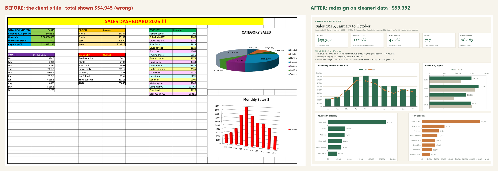
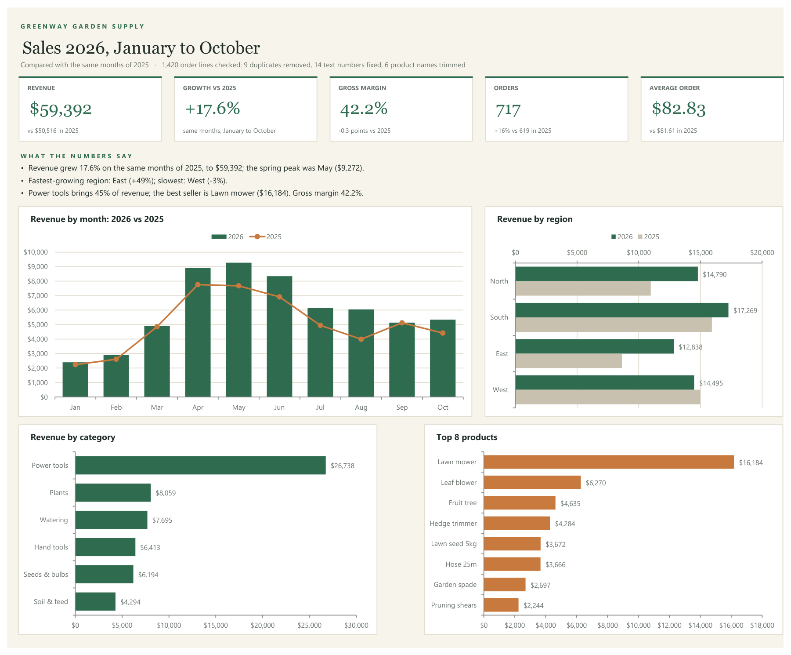
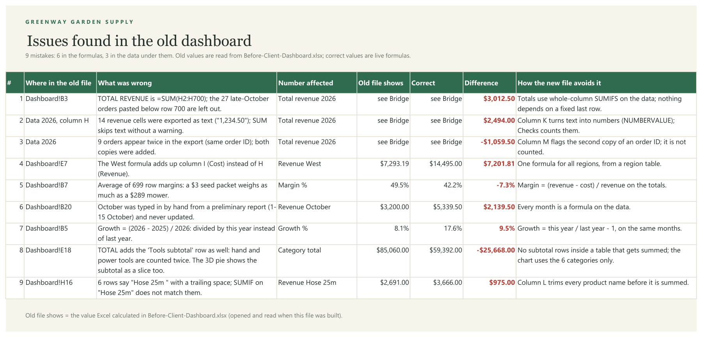
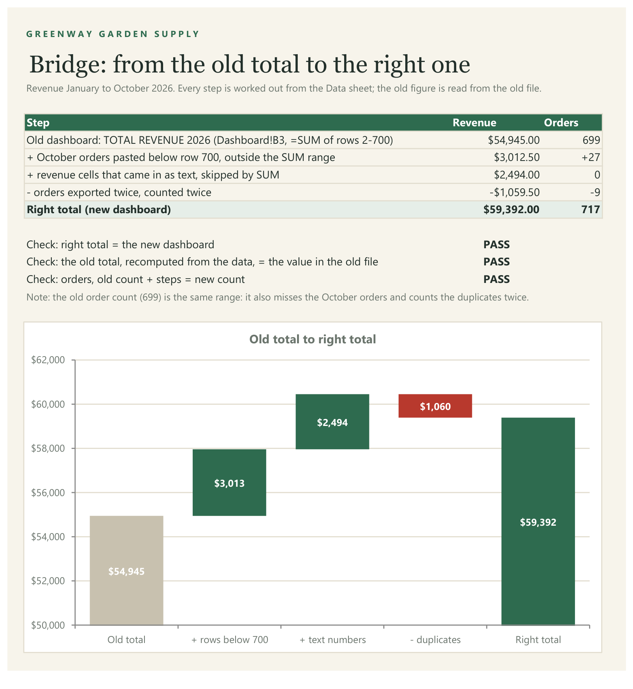

# E11 · Excel dashboard redesign, before → after: a clean brand look, and 9 wrong numbers found on the way

**A client sends the dashboard they have and asks to "make it look professional".** Before any colour is changed, every
number is checked against the data. Here the old file says revenue is **$54,945**; the right figure is **$59,392**.
The redesign shows the right numbers in a light brand theme (forest green and cream), lists each mistake with the cell
it sat in, and bridges the old total to the right one, step by step.

▶ **[Demo video (58 s, MP4)](docs/demo.mp4)**: the old dashboard, the redesign, Issues found, the Bridge, the cleaned
data and the Checks. Real screen recording of the two workbooks, captions added.

## Before → after

| Before (`Before-Client-Dashboard.xlsx`) | After (`Sales-Dashboard-Redesign.xlsx`) |
|---|---|
| 3D pie with the subtotal as a slice, 3D red columns, rainbow fills, a red underlined title with "!!!" | Light theme, one brand colour, white cards, flat charts with labels, Georgia titles |
| 0.495122117 as a margin, 0.080616981 as growth | $59,392 · +17.6% · 42.2% · 717 orders · $82.83 per order, each with the 2025 comparison |
| Revenue $54,945 | Revenue $59,392, and a bridge that explains the $4,447 difference |
| One month typed in by hand | Every number is a formula on the data; insights are written by formulas too |
| No way to tell if a number is right | 11 checks: every view adds up to the same total, the bridge closes, every planted problem found |

## The 9 mistakes found

| # | In the old file | What was wrong | Old | Right |
|---|---|---|---|---|
| 1 | Dashboard!B3 | `=SUM(H2:H700)`: the 27 late-October orders pasted below row 700 are left out | | +$3,012.50 |
| 2 | Data 2026, col. H | 14 revenue cells exported as text ("1,234.50"); SUM skips text with no warning | | +$2,494.00 |
| 3 | Data 2026 | 9 orders exported twice; both copies added | | −$1,059.50 |
| 4 | Dashboard!E7 | West adds up the **Cost** column instead of Revenue | $7,293.19 | $14,495.00 |
| 5 | Dashboard!B7 | Margin = average of 699 row margins (a $3 seed packet weighs as much as a $289 mower) | 49.5% | 42.2% |
| 6 | Dashboard!B20 | October typed in from a preliminary 1-15 October report, never updated | $3,200.00 | $5,339.50 |
| 7 | Dashboard!B5 | Growth divided by this year instead of last year | 8.1% | 17.6% |
| 8 | Dashboard!E18 | Category TOTAL adds the "Tools subtotal" row too (tools counted twice) | $85,060.00 | $59,392.00 |
| 9 | Dashboard!H16 | 6 rows say "Hose 25m " with a trailing space; SUMIF does not match them | $2,691.00 | $3,666.00 |

Mistakes 1-3 together take the old total to the right one: **$54,945.00 + $3,012.50 + $2,494.00 − $1,059.50 = $59,392.00**.
The old values are what Excel calculates in the old file (read from it when the new file is built), not typed in.

## What the new workbook does

| Sheet | What it does |
|---|---|
| **Dashboard** | Five cards vs the same months of 2025 (revenue, growth, gross margin, orders, average order), three insight sentences written by formulas (peak month, fastest and slowest region, top category and best seller), revenue by month 2026 vs 2025, by region, by category (sorted) and top 8 products; a subtitle that counts what the cleaning did |
| **Issues found** | The 9 mistakes: where, what, the number affected, the old value, the correct value (live formula), the difference and how the new file avoids it |
| **Bridge** | Old total → + rows outside the old SUM range → + text numbers → − duplicates → right total, for revenue and for orders, with a waterfall chart and three PASS checks |
| **Data** | Both exports exactly as received (columns A-I, text and spaces kept), plus formula columns: year, revenue as a number (`NUMBERVALUE`), trimmed product name, duplicate flag, counted, in the old SUM range, and a note saying what was changed on that line |
| **Checks** | 11 checks: months, regions, categories and products each add up to the total, the bridge closes, the old total recomputed from the data equals the old file, 9 duplicates / 14 text numbers / 6 names found, every line has a number, revenue = units × price on every line |
| **Before** | A picture of the old dashboard, for comparison |

No macros. Excel 2016 functions only. Summary sheets are protected (no password).

## Proof the numbers are right

[`test/verify.py`](test/verify.py) does two independent things:

1. **Re-creates the old file's mistakes in plain Python** (the cut SUM range, text skipped, duplicates added, Cost for
   West, the average of row margins, the typed October, growth over this year, the subtotal in the total, the
   trailing space) and checks that each one gives exactly the number Excel shows in the old file.
2. **Recomputes the right numbers** from the two exports (text → number, trimmed names, second copy of an order dropped)
   and checks every card, chart table, insight, issue, bridge step and check of the new file; then opens it in Excel,
   recalculates it, and checks the 5 charts read the right tables, a fixed $ format (not the PC's currency), no error
   values, Excel 2016 functions only, no macros, and the data columns identical to the export.

Result: **37/37 checks pass**.

## Use it for your own dashboard

1. Send the workbook you have. Before anything is redrawn, each number on it is traced back to the data.
2. You get the redesign in your brand colours, the **Issues found** list and the **Bridge**, so you can see exactly
   why a number changed before you show it to anyone.
3. New month: paste the export below the data and copy the formula columns down; the cards, charts and checks follow.

## Files

| Path | What |
|---|---|
| `Before-Client-Dashboard.xlsx` | The old dashboard, mistakes included (built on purpose for this sample) |
| `Sales-Dashboard-Redesign.xlsx` | The redesign (no macros) |
| `data/` | Fictional exports for 2025 and 2026, the product list and the list of planted problems |
| `scripts/make_data.py`, `scripts/build_before.py`, `scripts/build_after.py` | Generate the data and build both workbooks with real Excel |
| `test/verify.py` | Independent check |
| `scripts/shots.py`, `scripts/make_thumb.py` | Screenshots, before/after picture and thumbnail in `docs/` |

All names, companies and amounts are fictional.
