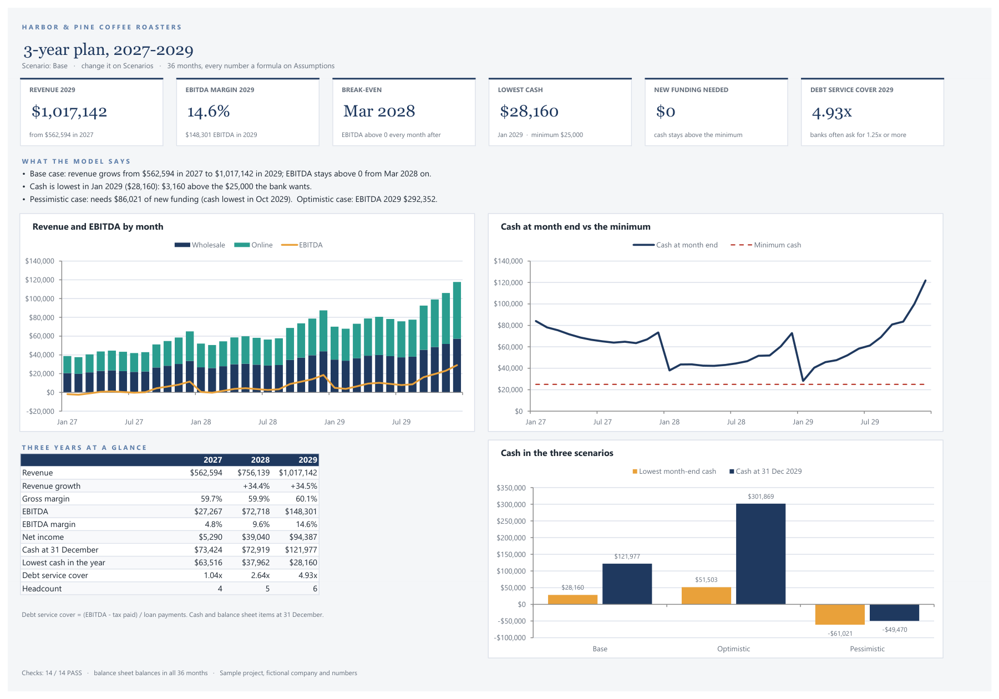
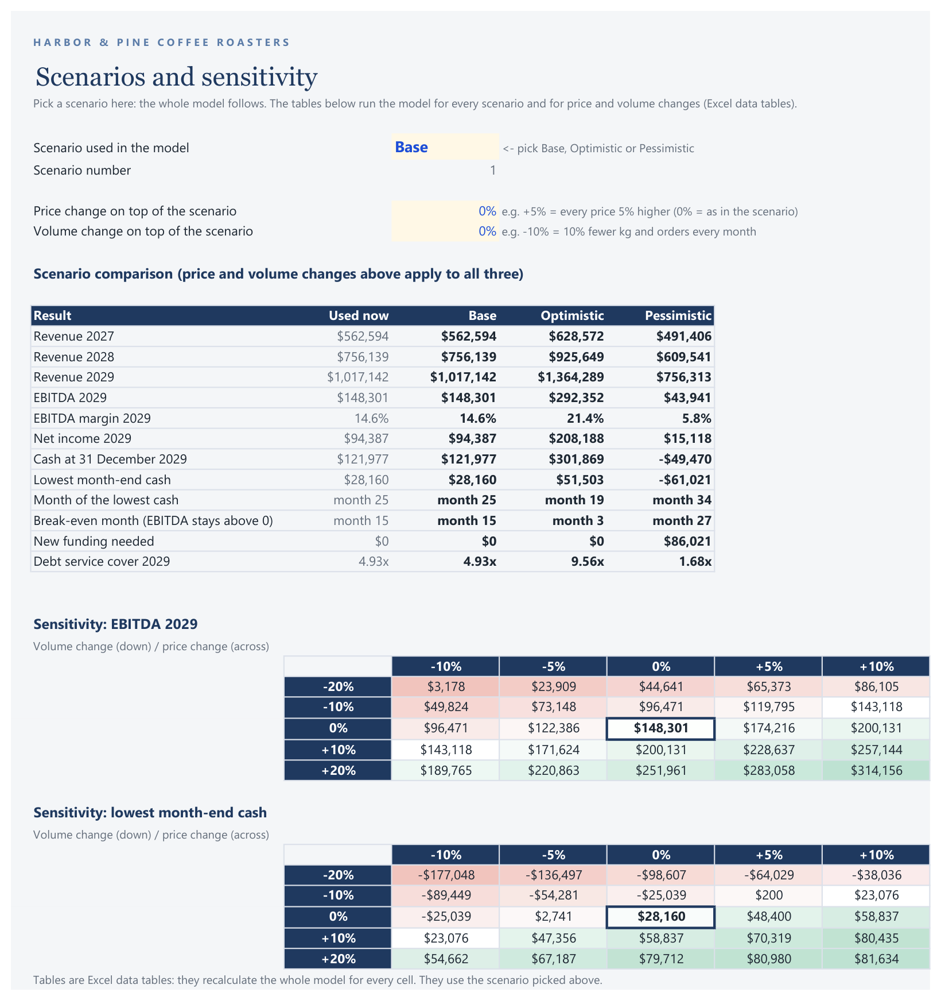
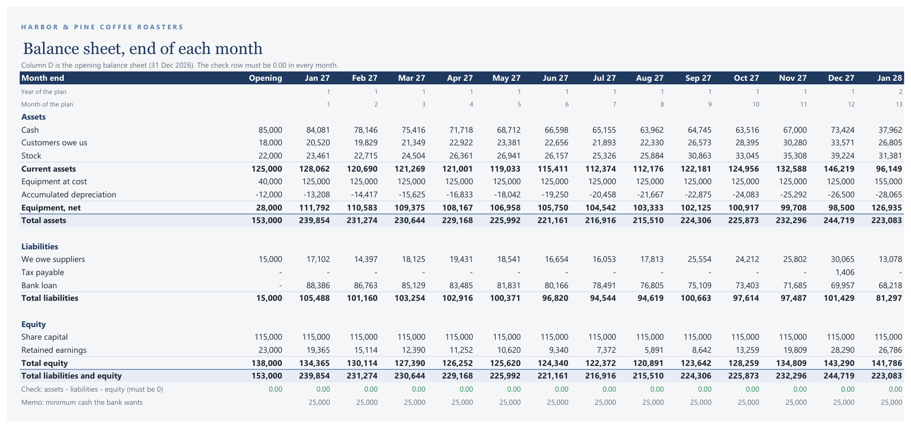

# E12 · 3-statement financial model in Excel: P&L, balance sheet and cash flow, 3 scenarios, checks that prove it

**A small business asks for "a 3-year financial model for the bank and investors".** One assumptions sheet drives a
36-month income statement, balance sheet and cash flow, with the schedules behind them (capital spending and
depreciation, the bank loan, working capital, income tax). Base, optimistic and pessimistic cases sit side by side,
price and volume sensitivity tables show how much room there is, and the dashboard answers what an investor asks first:
when does it break even, how low does cash go, and how much money is needed.

The company is fictional: **Harbor & Pine Coffee Roasters**, wholesale coffee to cafés plus an online shop, a new
roaster bought with a bank loan in January 2027.

▶ **[Demo video (77 s, MP4)](docs/demo.mp4)**: the dashboard, the assumptions, switching to the pessimistic case live,
the scenario and sensitivity tables, the three statements, the schedules and the checks. Real screen recording, captions added.

## What the model says (base case)

| | 2027 | 2028 | 2029 |
|---|---|---|---|
| Revenue | $562,594 | $756,139 | $1,017,142 |
| EBITDA | $27,267 | $72,718 | $148,301 |
| Net income | $5,290 | $39,040 | $94,387 |
| Cash at 31 December | $73,424 | $72,919 | $121,977 |
| Debt service cover | 1.04x | 2.64x | 4.93x |

- EBITDA stays above 0 from **March 2028**.
- Cash is lowest in **January 2029, $28,160**, the month the delivery van is bought: $3,160 above the $25,000 the bank wants.
- **Pessimistic case:** cash falls below the minimum for 27 months and goes down to -$61,021, so **$86,021 of new funding**
  is needed. That is the number to take to the owners before the plan goes to the bank.
- **Optimistic case:** EBITDA 2029 $292,352, lowest cash $51,503.

## What is in the workbook

| Sheet | What it does |
|---|---|
| **Dashboard** | 6 cards (revenue 2029, EBITDA margin, break-even month, lowest cash, new funding needed, debt service cover), three insight sentences written by formulas, revenue and EBITDA by month, cash against the minimum, a 3-year table, cash in all three scenarios |
| **Assumptions** | 39 drivers, each with a Base, Optimistic and Pessimistic value and the column in use; seasonality by month; the opening balance sheet (with its own balance check). Inputs are blue on yellow |
| **Scenarios** | The scenario picker, a price and a volume nudge, the comparison of all three scenarios (12 results) and two 5 x 5 sensitivity tables: EBITDA 2029 and lowest cash, price -10% to +10% against volume -20% to +20% |
| **Revenue & costs** | Wholesale kg x price per kg, online orders x average order, seasonality, price rises each January; cost of goods by channel; headcount, payroll, rent, marketing, card fees, overheads |
| **P&L**, **Balance Sheet**, **Cash Flow** | 36 months each. The cash flow uses the indirect method and its ending cash is the balance sheet's cash. The balance sheet has a check row: 0.00 in every month |
| **Schedules** | Capital spending and straight-line depreciation (3 purchases plus the equipment owned at the start); the bank loan as an annuity (PMT, interest, principal, balance); customers owe us (DSO), stock (days of cost), we owe suppliers (DPO); income tax with losses carried forward, paid after each quarter; new equity |
| **Annual** | The three statements by year, debt service cover, headcount, and the key figures the dashboard reads |
| **Checks** | 14 checks, all PASS: the balance sheet balances in every month, retained earnings move by net income, cash adds up, annual = months, equipment, loan (payment split and the balance vs PV), tax, working capital, **no typed numbers in the monthly sheets**, the scenario and sensitivity tables match the model |

No macros. Excel 2016 functions only. Calculated sheets are protected (no password).

## Proof the numbers are right

[`test/verify.py`](test/verify.py) runs the whole model again in plain Python ([`test/model.py`](test/model.py), written
from the rules above, not from the workbook's formulas), with the assumptions read back from the workbook, and then:

1. switches the workbook to each scenario and compares **54 lines x 36 months** of the statements and schedules,
   5,832 numbers in total, plus the annual sheet and the key figures;
2. compares the scenario table and **all 50 cells of the two sensitivity tables** with the Python model run for each case;
3. adds $90,000 of new equity to the pessimistic case and checks that cash follows in all 36 months;
4. **breaks the model on purpose**: a number typed over a payroll formula, then a broken link in the balance sheet.
   The Checks sheet catches both (FAIL), and is back to PASS once they are undone;
5. checks that every cell of the monthly sheets is a formula, no error values, Excel 2016 functions only, no macros,
   the charts read the right rows, a fixed $ format.

Result: **29/29 checks pass**.

## Use it for your own business

1. **Assumptions**: replace the blue cells with your own numbers: sales drivers, costs, payment days, equipment, loan,
   tax rate, the opening balance sheet (its check must say 0.00).
2. **Scenarios**: pick Base, Optimistic or Pessimistic; nudge price or volume to see how much room there is.
3. **Dashboard**: break-even month, lowest cash and the funding needed update at once; take the 3-year table to the bank.
4. **Checks** must all say PASS. If one fails, the last change broke a link: the check names where to look.
5. Not enough cash? Type an amount and a month for "New equity from owners" and watch the cash chart.

A different business (services, subscriptions, retail) changes the **Revenue & costs** sheet only; the statements,
schedules, scenarios and checks stay as they are.

## Files

| Path | What |
|---|---|
| `Three-Statement-Model.xlsx` | The model (no macros) |
| `data/assumptions.json` | The drivers, seasonality and opening balance sheet the workbook is built from |
| `scripts/build_model.py` | Builds the workbook with real Excel |
| `test/model.py`, `test/verify.py` | Independent model in Python and the checks |
| `scripts/shots.py`, `scripts/make_thumb.py` | Screenshots and thumbnail in `docs/` |

All names, companies and amounts are fictional.
