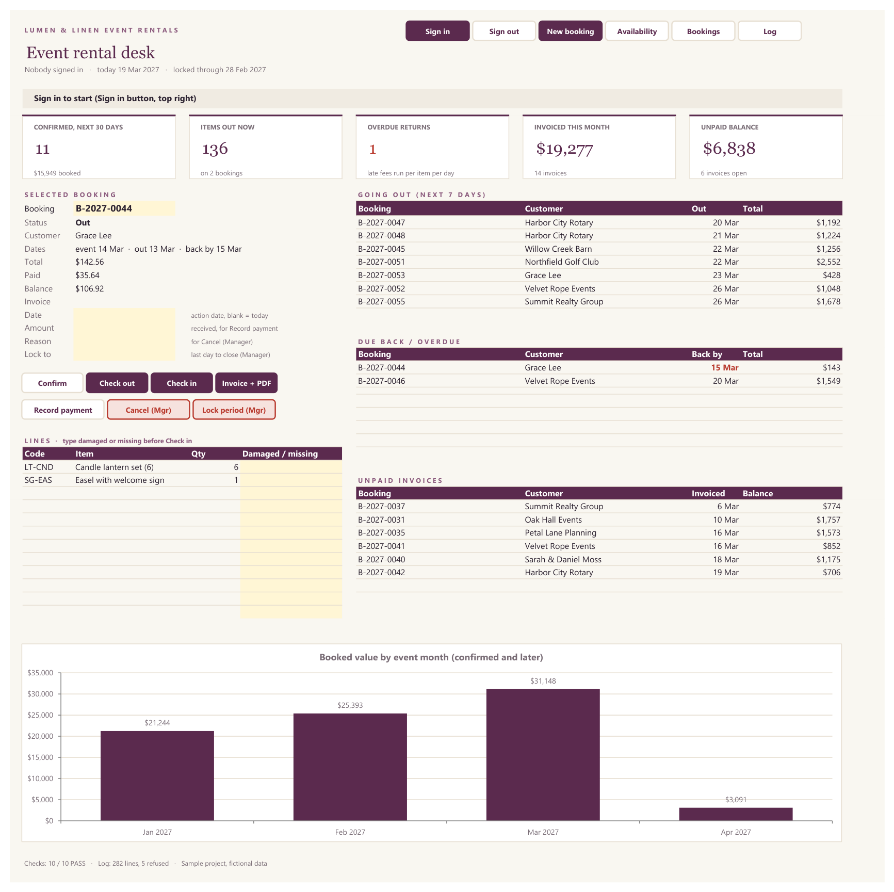
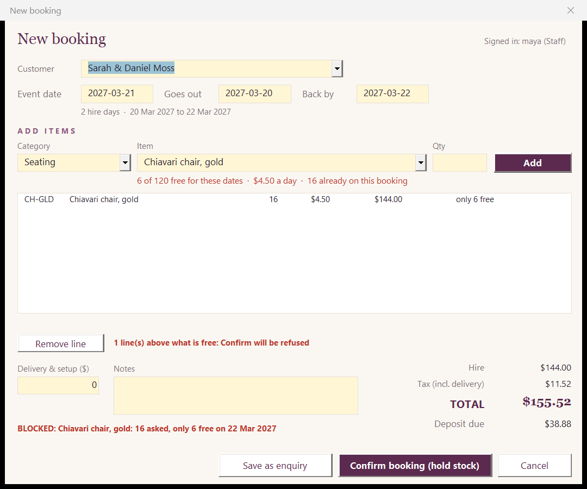
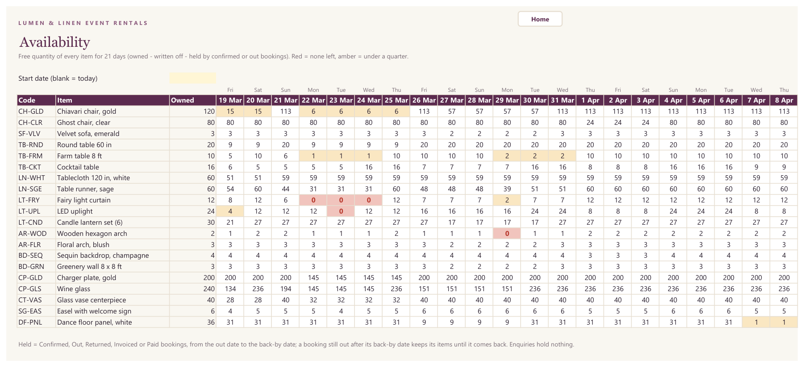
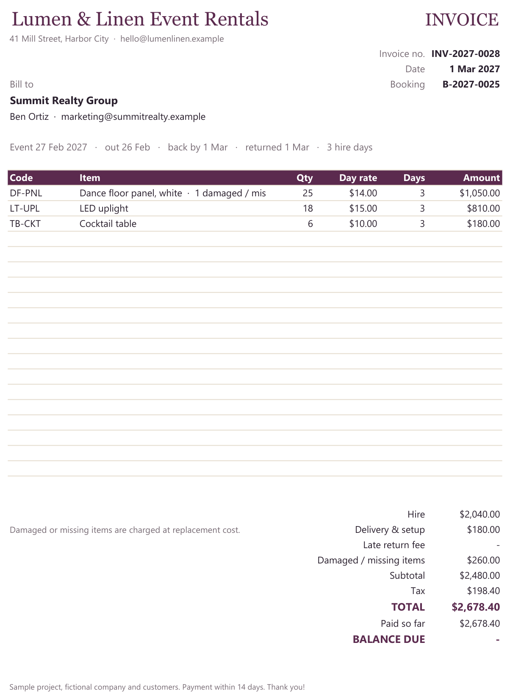

# E13 · Event rental desk in Excel VBA: no double booking, sign-in by role, late fees, damage, invoices, audit trail

**An event hire business asks for "an inventory and booking system in Excel: stop double bookings, check items out
and back in, charge for late and damaged items, invoice, and let the owner see everything".** This workbook does that
for a fictional decor rental company, **Lumen & Linen Event Rentals** (chairs, tables, linens, lighting, arches,
backdrops, tableware, dance floor), run by two staff members and a manager.

The rule at its heart: an item can go on a confirmed booking only if
**owned − written off − held by every booking whose dates overlap** covers every day of the hire. Anything that breaks
it is refused, with the reason, and the attempt is logged.

▶ **[Demo video (93 s, MP4)](docs/demo.mp4)**: sign in (a wrong PIN first), a booking refused for 16 chairs when only 6 are
free, the same booking confirmed with 6, Availability, check out, check in 3 days late with 2 lantern sets missing,
invoice + PDF, a staff member trying to lock the month, the Log and the Checks. Real screen recording, captions added.

## What it does

| | |
|---|---|
| **Sign in by role** | Each person picks their name and types a PIN; the workbook keeps only a hash of it (the sample PINs in `data/users.csv` are only for the build). Staff: book, check out, check in, invoice, take payments. Manager: also cancel and lock a period. A wrong PIN is refused and logged |
| **New booking form** | Customer, event / out / back-by dates, category then item; while you type it shows **how many are free for those dates**, the hire, tax, total and deposit. *Save as enquiry* holds no stock; *Confirm* holds it, or is refused with the item, quantity and day that do not fit |
| **Availability** | Free quantity of all 20 items for 21 days from any date: red = none left, amber = under a quarter |
| **Check out / check in** | From Home. Late returns pay a fee per item per day after one grace day; damaged or missing items are charged at replacement cost and **leave the stock** from that day. A booking still out after its back-by date keeps holding its items |
| **Invoice + PDF** | Numbered INV-2027-0001…, the A4 page becomes a PDF in the Invoices folder; deposit and payments are shown, balance due |
| **Payments** | Deposit (25% of the estimate) and balance; more than the balance is refused; balance 0 = Paid |
| **Locked period** | A manager closes a month; after that nothing can be recorded on those dates, not even by a manager |
| **Log (audit trail)** | Every attempt: when, who, role, action, booking, OK or BLOCKED, and why |
| **Checks** | 10 checks, all PASS: no item over-booked on any day (every item, 4 Jan – 3 May 2027), numbers unique, lines belong to bookings and items, totals and payments add up, status matches the money, damaged ≤ hired, nothing recorded in the locked period after locking, every refusal explained |

**Home** shows the signed-in person, a message bar (red when something is refused), 5 cards (confirmed in the next
30 days, items out now, overdue returns, invoiced this month, unpaid balance), the selected booking with its lines and
actions, and three lists: going out in the next 7 days, due back / overdue, unpaid invoices.

## The sample

10 weeks (4 January – 19 March 2027) replayed **through the workbook's own macros**, so every booking, fee, PDF and
log line was made by the tool itself: 58 bookings, 41 invoices and PDFs, 7 late returns, 10 with damaged or missing
items, 2 cancellations, 2 open enquiries, 1 booking still out after its back-by date. Five attempts in the history are
planted and refused: a wrong PIN, staff trying to lock the month and to cancel, a payment dated inside the locked
period, and 11 cocktail tables asked when only 5 are free.

## Proof it works

[`test/verify.py`](test/verify.py):

1. replays the history in plain Python with the rules above and compares **every booking**: status, days, hire,
   delivery, late fee, damage, tax, total, deposit, paid, balance, invoice number;
2. recomputes the Availability grid and proves no item is over-booked on any day, from the Lines and Bookings sheets
   (not from the workbook's own grid);
3. opens all 41 invoice PDFs: number, customer, total and balance must be in each;
4. on a throw-away copy, **tries every rule live**: nothing works before sign-in, wrong PIN, staff vs manager,
   over-booking through the form (it shows 6 free, refuses 16, confirms 6), an enquiry holds nothing, check out /
   check in from the Home buttons (3 days late, 2 sets missing: fee and damage = Python), invoice + PDF, payment above
   the balance refused, cancel releases stock, a date in the locked period refused; then types over a total to see
   the Checks catch it.

Result: **39/39 checks pass**.

## Use it for your own business

1. **Catalog**: your items, quantity owned, day rate, late fee per day, replacement cost (yellow cells).
2. **Customers** and **Users** (each person's role; PINs are set by a macro, only the hash is stored).
3. **Settings**: company, tax, deposit %, grace days, longest hire, PDF folder.
4. Daily: New booking → Check out → Check in (type damaged / missing) → Invoice + PDF → Record payment.
5. Month end: a manager locks the period.

Sheets are protected without a password: it stops mistakes, it is not security, and a PIN keeps honest people honest.
Excel for Windows with macros enabled; Excel 2016 functions only.

## Files

| Path | What |
|---|---|
| `Event-Rental-Desk.xlsm` | The workbook (macros) |
| `Invoices/` | The 41 invoice PDFs the macros wrote |
| `src/` | VBA: modCore (rules), modButtons (Home), frmSignIn, frmBooking, ThisWorkbook |
| `data/` | Catalog, customers, users, settings and the 10-week history replayed by the build |
| `scripts/make_data.py`, `scripts/build_workbook.py`, `scripts/form.py` | Make the data, build the workbook and the forms with real Excel, replay the history |
| `test/verify.py` | Independent check |
| `scripts/shots.py`, `scripts/make_thumb.py` | Screenshots and thumbnail in `docs/` |

All names, companies and amounts are fictional.
