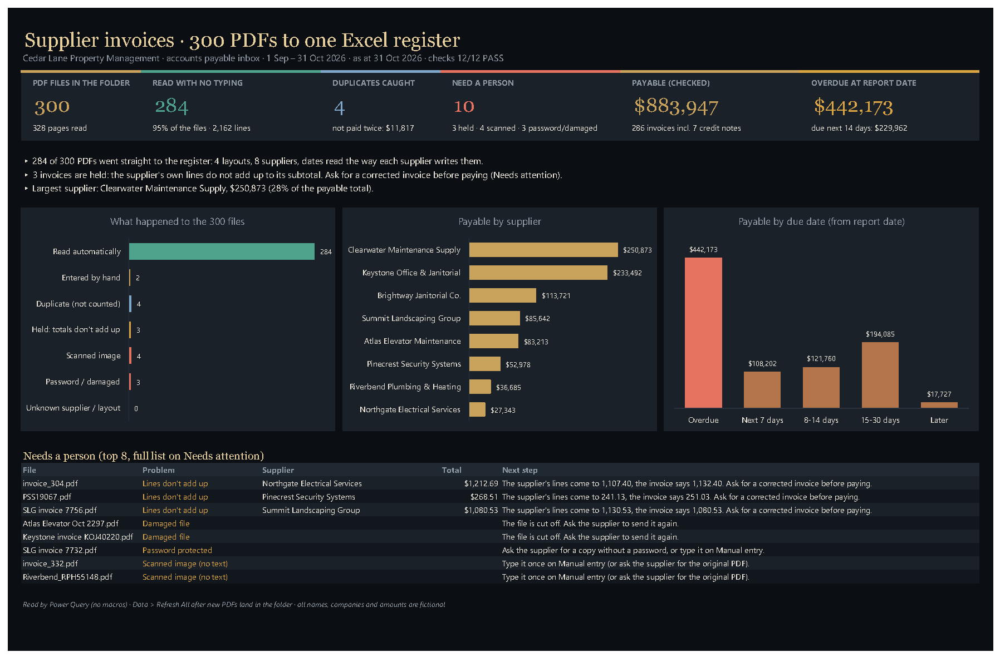
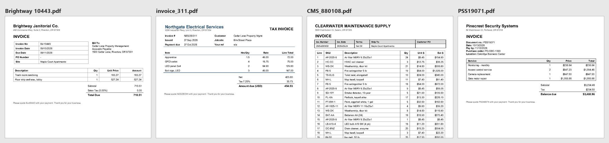
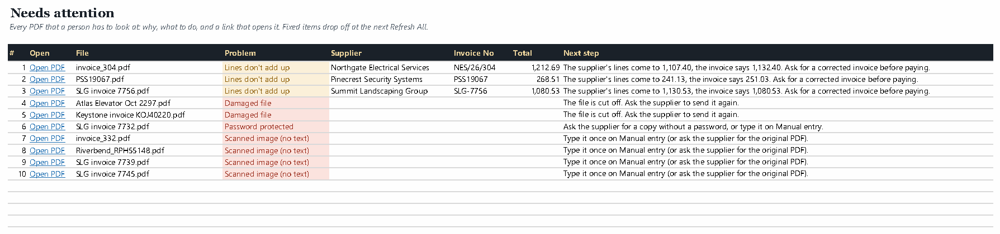
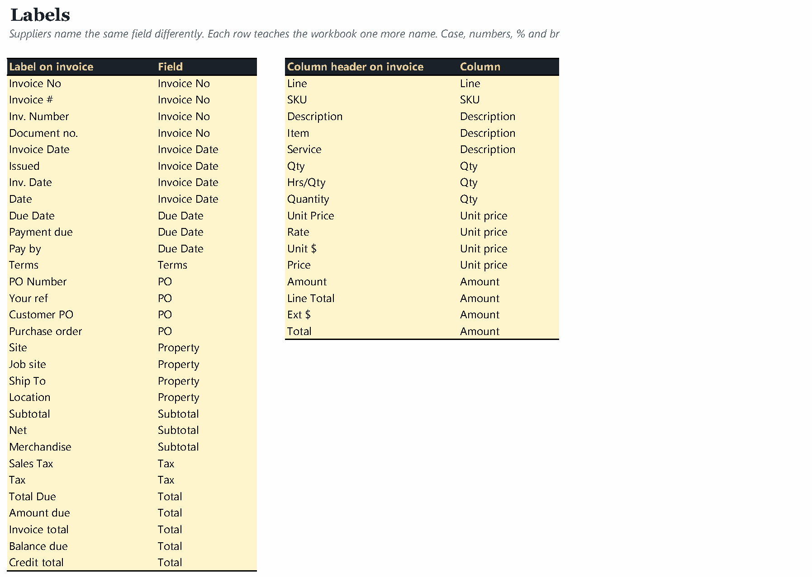

# E14 · 300 PDF invoices to one Excel register: every file accounted for, every sum checked

**An accounts payable team has a folder of supplier invoices as PDFs and asks for "all of it in Excel".** Power Query
reads every PDF in the folder (no retyping, no online converter), recognises the supplier, reads the header fields and
the line table whatever the layout, and checks each invoice: do the lines add up to the subtotal, does subtotal + tax
make the total, has the same invoice arrived twice? Files that cannot be read (scanned pictures, a password, a broken
download) are listed with the reason and the next step, and can be typed once on a Manual entry sheet. The result:
a register with one row per PDF, every invoice line, a bills import for the accounting system, and a control sheet that
proves nothing was missed or counted twice. No macros. Next month: drop the new PDFs in the folder, **Refresh All**.

The company is fictional: **Cedar Lane Property Management**, six buildings, eight suppliers, September–October 2026.

▶ **[Demo video (77 s, MP4)](docs/demo.mp4)**: the dashboard, the needs-attention list, a scanned invoice typed on
Manual entry, Refresh All reading every PDF again, the register and lines, the Labels and Suppliers sheets, the
accounting import and the checks. Real screen recording (the 4-minute refresh is cut), captions added.

## The problem this solves

The 300 PDFs look the way an AP inbox really looks:

- **8 suppliers, 4 layouts.** The same field has four names (`Invoice No`, `Invoice #`, `Inv. Number`, `Document no.:`),
  and the line table has four sets of column names (`Amount`, `Line Total`, `Ext $`, `Total`).
- **Dates written four ways.** `09/10/2026` is 9 October for one supplier, `9/10/2026` is 10 September for another,
  then `9 Oct 2026` and `2026-10-09`. One supplier gives no due date, only `Net 30`.
- **Numbers written four ways.** `1,234.50`, `1234.50`, `$1,234.50`, and credit notes as `($1,234.50)` or `$-6.30`.
- **30 invoices run over 2–3 pages**, with the table header repeated on each page.
- **The same invoice sent twice** under another name (`Fwd …`, `scan_6433.pdf`).
- **A supplier's own sums are wrong** on 3 invoices: the lines do not add up to the subtotal it printed.
- **Scanned invoices** (a picture, no text), **a password-protected file**, and **two files cut off** halfway.

## What the workbook does

| Sheet | What it does |
|---|---|
| **Dashboard** | Files, read with no typing, duplicates caught, need a person, payable total, past due; insight sentences written by formulas; what happened to every file; payable by supplier; payable by due date; the top of the needs-attention list |
| **Needs attention** | Every PDF a person must look at: the problem, the next step in plain words, an **Open PDF** link. Held invoices first. A fixed item drops off at the next refresh |
| **Register** | One row per PDF (Power Query): status, payable (Yes / Hold / No), supplier, type, invoice number, invoice date, due date, PO, property, subtotal, tax, total, lines total, number of lines, account code, duplicate of |
| **Lines** | Every invoice line (Power Query): SKU, description, quantity, unit price, amount, with the invoice fields next to it, 2,119 lines |
| **Accounting import** | Bills ready to save as CSV for Xero / QuickBooks / Sage: one row per paid line, sales tax as its own line, account code per supplier, property as tracking |
| **Manual entry** | For PDFs that cannot be read: type the invoice once (supplier from a drop-down); it is counted on every refresh after that. Two scans are already typed in to show how it works |
| **Checks** | 12 checks, all PASS: one row per PDF, every file accounted for, lines = subtotal to the cent, subtotal + tax = total, Lines sheet = Register, no invoice counted twice, import total = payable total, no missing fields, dates in the period, due after invoice date, manual entries match a PDF and add up |
| **Suppliers** | How each supplier is recognised, its date format, account code and default terms. A new supplier = one row |
| **Labels** | Every name a supplier uses for a field or a column. A new name = one row, no query editing |
| **Settings** | Invoice folder (defaults to `invoices\` next to the workbook), report date, period |

### How a PDF is read (Power Query, `Data > Queries & Connections`)

1. **`ReadPdf`** opens one PDF with the PDF connector (`Pdf.Tables`). A password or a broken file becomes a status, not
   a failed refresh. A page with no text is a scan.
2. The supplier is found from words on page 1, and its date format comes from the Suppliers sheet.
3. Header fields are found three ways: a header row over a value row, a label next to its value, `Label: value`.
   Labels are compared without case, numbers, % and brackets (`Sales Tax (7.25%)` = `Sales Tax`), and a value is taken
   only if it makes sense for the field (an amount must be a number). That stops `Net 30` being read as the `Net` amount.
4. The line table is the one with a description and an amount column. Rows above its header are skipped, and pages
   are joined. When a PDF draws its lines without borders and no table is detected, the same rows are read from the
   page text.
5. **`Parsed`** reads every PDF in the folder, catches duplicates (same supplier + invoice number; the copy received
   first is kept), and checks the sums. **`Register`** adds the Manual entry rows and writes the next step.
   **`Lines`** lists the lines of the invoices that are paid or held.

## Proof the numbers are right

[`test/verify.py`](test/verify.py) checks the workbook against the answer written when the PDFs were made
([`test/expected.json`](test/expected.json)), not against the workbook's own logic:

1. every one of the 300 files has the expected status (read, held, duplicate, scanned, password, damaged, typed by hand),
   and every duplicate points at the right original;
2. every invoice has the right supplier, number, type, invoice date, due date, PO, property, subtotal, tax and total,
   so all four date formats and all four number formats were read correctly;
3. **every line** of every invoice (description, SKU, quantity, unit price, amount), including the 2–3 page ones;
4. the held invoices are exactly the 3 with a supplier sum mistake; the 7 credit notes are negative;
5. the 12 in-workbook checks PASS; Needs attention lists exactly the files a person must handle;
   the bills import CSV adds up to the payable total and has one row per line, tax line and typed invoice;
6. **live, on a copy with real Excel**: a new invoice is dropped into the folder, an invoice is saved again under another
   name, a scanned invoice is typed on Manual entry, and a supplier is deleted from the Suppliers sheet. After one
   Refresh All: the new one is read, the copy is caught as a duplicate, the typed one is counted, that supplier's
   invoices go to Needs attention as *Unknown supplier*, the payable total moves by exactly the right amount,
   and the checks still PASS.

Result: **26/26 checks pass** (see [`test/last-result.txt`](test/last-result.txt)).

## Use it for your own invoices

1. Put the supplier PDFs in the `invoices` folder (or type another folder on Settings). Sub-folders are fine.
2. **Suppliers:** one row per supplier with a word or two from its page 1 and the way it writes dates.
3. **Data > Refresh All** (about 4–5 minutes for 300 PDFs on a normal laptop).
4. **Checks** must all say PASS. Work through **Needs attention**: type scans on Manual entry, ask suppliers for
   corrected or readable copies.
5. **Accounting import:** File > Save a Copy > CSV, then import as bills.

A supplier that names a field differently needs one row on **Labels**, not a change to the queries.
Needs Excel for Microsoft 365 or Excel 2021 (PDF connector, dynamic arrays).

## Files

| Path | What |
|---|---|
| `PDF-Invoices-to-Excel.xlsx` | The workbook (no macros) |
| `invoices/` | The 300 fictional supplier PDFs |
| `output/bills-import-2026-09-10.csv` | The accounting import as saved from the workbook |
| `scripts/make_data.py` | Makes the PDFs and `test/expected.json` |
| `scripts/build_workbook.py` | Builds the workbook with real Excel (queries, sheets, dashboard) |
| `test/verify.py` | The checks above (`--live` for the refresh tests) |
| `scripts/shots.py`, `scripts/make_thumb.py` | Screenshots and thumbnail in `docs/` |

All names, companies, addresses and amounts are fictional.
