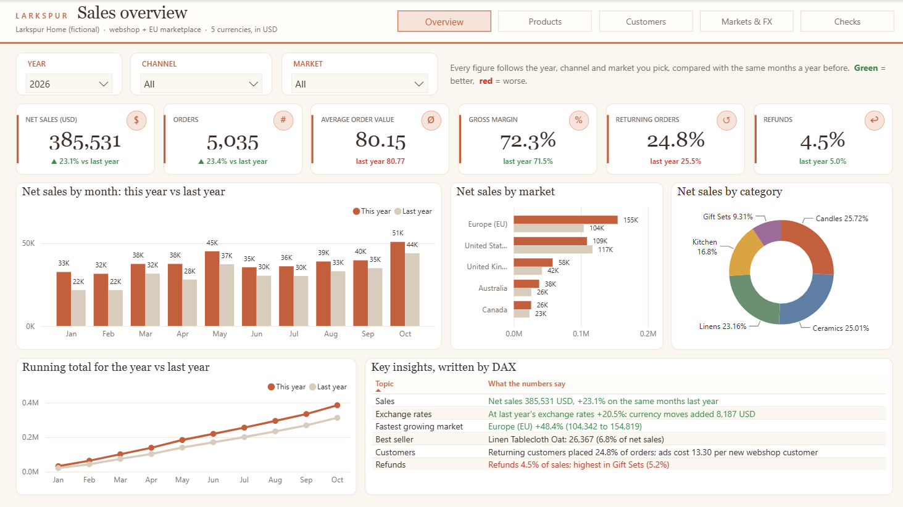
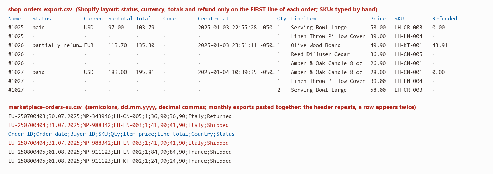
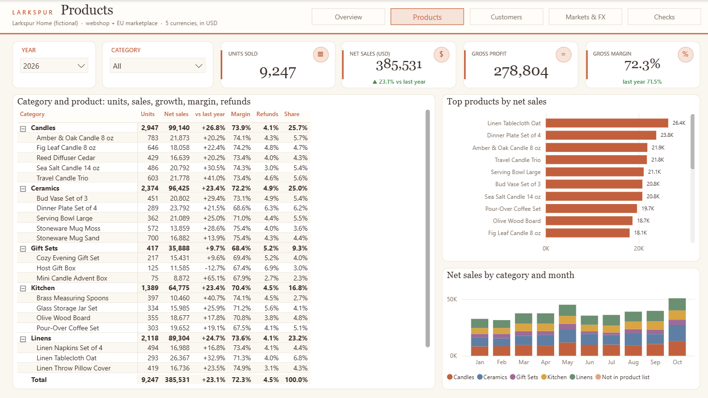
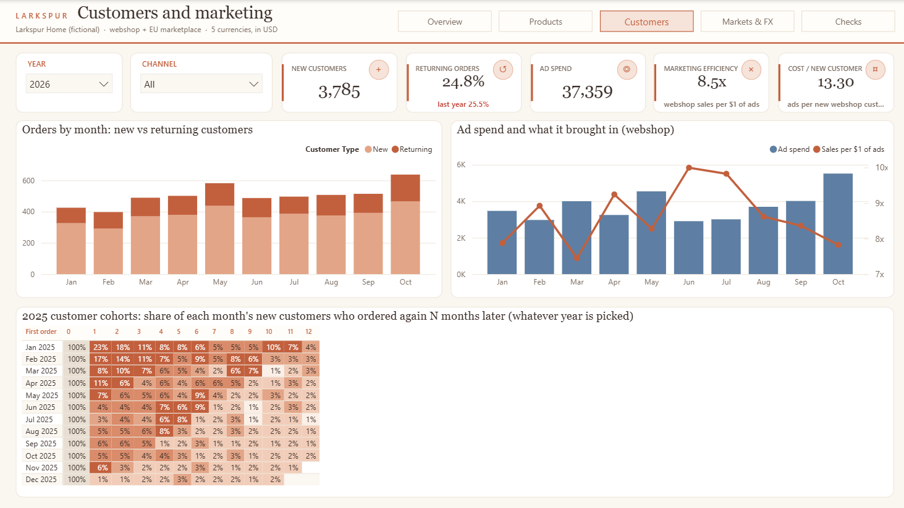
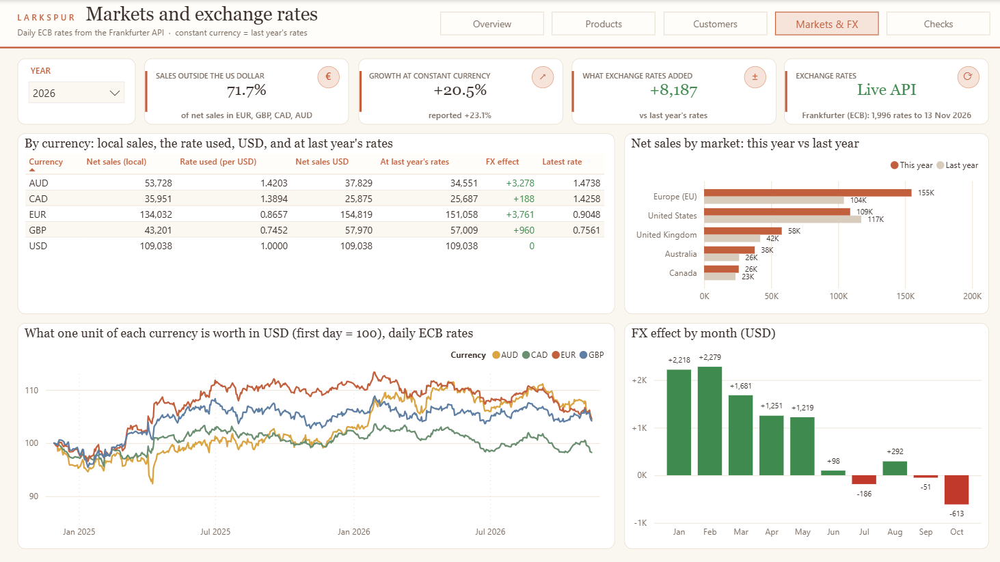
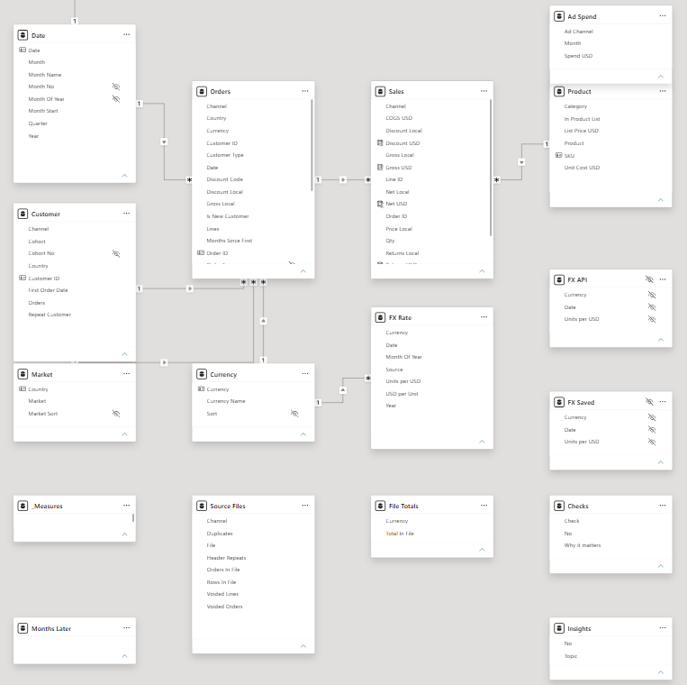
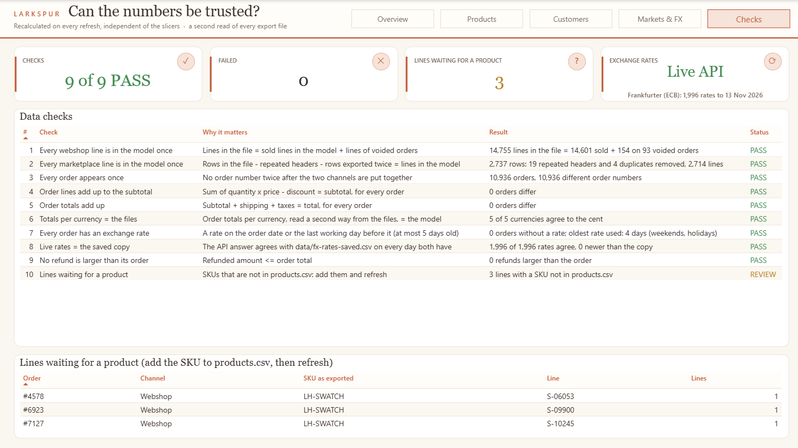

# E15 · Power BI e-commerce sales: two store exports in five currencies, live exchange rates from an API, growth at constant currency

**A webshop export (Shopify layout) and an EU marketplace export → Power Query cleans both → daily ECB exchange rates
come in from the free Frankfurter API on every refresh (a saved copy steps in if the API is down) → every order in USD
at the rate of its own date → a model with two fact tables (orders, order lines) → 97 DAX measures → five pages:
Overview, Products, Customers (new vs returning, cohorts, ad spend), Markets & FX, and a Checks page.**
Next month: drop the new exports in the data folder, press **Refresh**: the rates update themselves.



▶ **[Demo video (67 s, MP4)](docs/demo.mp4)**: the raw exports → the report in Power BI Desktop → pick Europe → products,
customers and cohorts, markets and live exchange rates, checks, the model. Real screen recording of Power BI Desktop, captions added.

## The problem this solves

An online store (here the fictional *Larkspur Home*, candles, ceramics, linens and kitchen goods) sells in US dollars,
euros, pounds, Canadian and Australian dollars, through its own webshop and an EU marketplace. The owner asks the
questions every growing store asks: *are we really growing, or is it the exchange rate? Which markets, which products?
Do customers come back? What does a new customer cost in ads?* The raw material is what the two platforms export:



- the webshop export has **one row per order line**, but status, currency, totals, discount and refund only on the **first** line of each order
- SKUs typed by hand in the admin (`lh-cn-001`, `LH-CN-001 `), three free fabric swatches with a SKU that is not in the product list
- refunds are a single amount per order (tax included for partial refunds); voided orders were never paid
- the marketplace export uses semicolons, `dd.mm.yyyy` and decimal commas (`1.024,50`), and is twelve-plus monthly exports
  pasted together: the header line repeats 19 times and 4 rows appear twice
- five currencies: adding euros to dollars is meaningless until each order is converted at **its own date's** rate

## What is built

| Step | Where | What happens |
|---|---|---|
| 1 | Power Query `ShopRaw`, `ShopLines`, `ShopOrders` | Lines keep their own fields; the order fields are read from the first line of each order. SKUs trimmed and upper-cased. A full refund takes the subtotal back, a partial refund is taken back to its amount before tax |
| 2 | `MarketLines`, `MarketOrders` | Semicolons, `dd.MM.yyyy`, decimal commas; repeated header lines dropped, rows exported twice removed (`Table.Distinct`); returned lines are refunds |
| 3 | `Orders` (one row per order) | Both channels in one table, voided orders left out; each customer's **first** order (date, then order number) marks a new customer, every later order is a returning one; months since the first order for the cohorts |
| 4 | `Sales` (one row per sold line) | Discounts and refunds of the order spread over its lines by value; cost of goods in USD from `products.csv` (returned goods go back to stock) |
| 5 | `FX API` → `FX Rate` | `Web.Contents` with a static base URL + `RelativePath` and `Query` (so it also refreshes in the Power BI service) reads ~2,000 daily ECB rates since Dec 2024 as JSON; wrapped in `try … otherwise`, so no internet = an empty table, not a failed refresh. A DAX calculated table takes the live rates and fills any gap from `fx-rates-saved.csv` |
| 6 | Calculated columns | `Orders[Rate]` = the rate on the order date or the last working day before it (no ECB rate at weekends and holidays); every line in USD = local amount ÷ that rate |
| 7 | 97 DAX measures | Net sales, orders, AOV, gross margin, refund rate, same months last year, YoY, YTD, **constant currency** (this year's local sales at last year's average rate for the same month) and the **FX effect**, new vs returning, cohort retention, ad spend, MER and cost per new customer, the checks, and the text and colour of every KPI line and of the key insights |
| 8 | Report | 5 pages with page buttons in the header and one light theme (*Sand & Terracotta* from sample [E0](../00-theme-gallery/): warm paper, white cards, terracotta, sage, slate blue; serif titles) |

### What the Overview page tells a busy owner

- **KPI tiles with a verdict.** Each tile shows the number and, under it, one line in green or red against the same
  months last year: net sales *▲ 23.1% vs last year*, orders, average order value *last year 80.77*, gross margin,
  orders from returning customers, refunds.
- **Key insights written by DAX.** Six sentences recalculated for the year, channel and market picked in the slicers:
  growth in USD; the same growth at last year's exchange rates and what currency moves added; the fastest growing
  market; the best seller and its share; how many orders came from returning customers and what a new customer cost
  in ads; the refund rate and the category with the most refunds.
- **One look across the pages.** Light pages, a terracotta line under the header, page buttons, serif titles,
  terracotta for this year and sand-grey for last year, green/red only for better/worse.

### The other pages

- **Products.** Units, net sales, gross profit and margin; a matrix by category and product with growth, margin,
  refund rate and share; top products; sales by category and month.
- **Customers.** New customers, the share of orders from returning customers, ad spend, MER (webshop sales per $1 of
  ads) and cost per new customer; new vs returning orders by month; ad spend with what it brought in; and a **cohort
  grid**: for every month of 2025, the share of that month's new customers who ordered again 1, 2 … 12 months later.
- **Markets & FX.** Share of sales outside the dollar, growth at constant currency, the FX effect, and where the rates
  came from (*Live API · Frankfurter (ECB): 1,996 rates to 13 Nov 2026*); a table per currency with local sales, the
  rate actually used, USD, the same sales at last year's rates and the FX effect; what one euro, pound, Canadian and
  Australian dollar is worth in USD over time; the FX effect month by month.









A few of the measures (all of them are readable in [`_Measures.tmdl`](Larkspur-Sales.SemanticModel/definition/tables/_Measures.tmdl)):

```dax
Net Sales       = SUM ( Sales[Net USD] )            -- gross - discounts - refunds, USD at the rate of the order date
Net Sales LY    = CALCULATE ( [Net Sales], SAMEPERIODLASTYEAR ( 'Date'[Date] ) )
Net Sales CC    =                                   -- constant currency: local sales at last year's average rate, same month
    SUMX ( SUMMARIZE ( Sales, Orders[Currency], 'Date'[Year], 'Date'[Month Of Year] ),
        VAR c = Orders[Currency]  VAR y = 'Date'[Year]  VAR m = 'Date'[Month Of Year]
        VAR r = IF ( c = "USD", 1, CALCULATE ( AVERAGE ( 'FX Rate'[Units per USD] ), REMOVEFILTERS ( 'FX Rate' ),
                     'FX Rate'[Currency] = c, 'FX Rate'[Year] = y - 1, 'FX Rate'[Month Of Year] = m ) )
        RETURN DIVIDE ( CALCULATE ( SUM ( Sales[Net Local] ) ), r ) )
FX Effect       = [Net Sales] - [Net Sales CC]      -- what exchange rates added (+) or took off (-), per month and currency
Cohort Retention % = DIVIDE ( CALCULATE ( DISTINCTCOUNT ( Orders[Customer ID] ), REMOVEFILTERS ( 'Date' ) ), [Cohort Customers] )
MER             = DIVIDE ( CALCULATE ( [Net Sales], KEEPFILTERS ( Orders[Channel] = "Webshop" ) ), [Ad Spend] )
```

```m
// FX API: the live rates, and no failed refresh when the internet is down
Response = try Json.Document(Web.Contents("https://api.frankfurter.dev",
    [RelativePath = "v1/" & FxStart & "..", Query = [base = "USD", symbols = "EUR,GBP,CAD,AUD"]])) otherwise null
```

## Result: January to October 2026 against January to October 2025

| | Jan–Oct 2025 | Jan–Oct 2026 | Change |
|---|---:|---:|---:|
| Net sales (USD) | 313,149 | 385,531 | **+23.1%** |
| … at last year's exchange rates | | 377,344 | **+20.5%** |
| FX effect (the weaker dollar) | | +8,187 | |
| Orders | 4,080 | 5,035 | +23.4% |
| Average order value (USD) | 80.77 | 80.15 | −0.8% |
| Gross margin | 71.5% | 72.3% | |
| Orders from returning customers | 25.5% | 24.8% | |
| Refunds (share of sales) | 5.0% | 4.5% | |
| Ad spend / MER / cost per new webshop customer | 32,980 / 8.2x / 13.67 | 37,359 / 8.5x / 13.30 | |

The story the report tells: sales grew 23.1% in dollars, but **2.6 points of that is the exchange rate** (the dollar
weakened against the euro, pound and Australian dollar: EUR +3,761, AUD +3,278, GBP +960, CAD +188). The growth is
outside the US: Europe +48.4%, Australia +44.7%, the UK +38.3%, Canada +10.4%, while the US fell 7.0% (fewer orders
and smaller baskets). 71.7% of sales are now in another currency (62.5% a year ago), so the exchange rate matters more
every month. Best seller: the oat linen tablecloth (26,367, 6.8% of sales); gift sets have the most refunds (5.2%).

## Proof the numbers are right

The **Checks** page recalculates ten checks on every refresh, ignoring the slicers: every line of both files is in the
model exactly once (14,755 webshop lines = sold lines + the lines of 93 voided orders; 2,737 marketplace rows minus
19 repeated headers and 4 duplicates = 2,714 lines), every order appears once, lines − discount = subtotal and
subtotal + shipping + taxes = total for every order, order totals per currency read a second way from the files =
the model, every order has a rate at most 5 days old (the oldest is 4 days old, over Easter and Christmas), the live API rates = the saved
copy on every day both have, no refund is larger than its order. The tenth lists the 3 swatch lines whose SKU is not
in `products.csv`.



[`test/verify.py`](test/verify.py) does the whole job again in plain Python straight from the files and compares it
with **(a)** the answer planted when the data was generated (22 months × 14 figures, every currency-month, all 23 SKUs,
every country, the 2025 cohorts, the file oddities), **(b)** the project files: the 17 tables, 8 relationships, the
measures and DAX functions, the API call with its fallback, the 5 pages, and every field used by the 172 visuals exists
in the model, **(c)** what the model inside Power BI Desktop answered ([`test/query_model.ps1`](test/query_model.ps1)
asks the open report with DAX queries): every month, currency, SKU, country and cohort, 16 KPIs, the six key insight
sentences word for word, the check results, and the exchange rate, new/returning flag and cohort month of all 10,936
orders. Result: **31/31 checks pass**.

## Use it with your own data

1. Open **`Larkspur-Sales.pbix`** in Power BI Desktop (free, no account needed): the data is inside.
2. The report reads its files from `C:\Larkspur\data\`: copy the `data` folder there before pressing Refresh. The first
   refresh asks how to reach `api.frankfurter.dev`: choose **Anonymous** (it is a free public API, no key).
3. Your own store: **Transform data → Edit parameters → DataFolder** = your folder. Replace the two exports, `products.csv`
   (SKU, product, category, unit cost) and `ads-spend.csv`. Another platform's layout only changes its `Shop…` or
   `Market…` query; the model, measures and pages stay the same. **FxStart** sets the first day of the rates.
4. **Refresh**. Every line on the Checks page's *Lines waiting for a product* table needs its SKU in `products.csv`.

`python scripts/fetch_rates.py` refreshes the saved copy of the rates. The `.pbip` folder is the same report as text
files (model in TMDL, report in PBIR), so every change can be reviewed in Git; it keeps no data, so press *Refresh*
after opening it. Built and tested with Power BI Desktop 2.159 (November 2026).

**Exchange rates are ECB reference rates (via Frankfurter); this is a reporting aid, not accounting or tax advice.**

## Files

| Path | What |
|---|---|
| `Larkspur-Sales.pbix` | The report with its data (open this one) |
| `Larkspur-Sales.pbip`, `*.SemanticModel/`, `*.Report/` | The same report as a Power BI project: Power Query, tables, relationships and DAX in TMDL; pages and visuals in PBIR JSON |
| `data/` | The two fictional exports, the product list, ad spend, and the saved copy of the exchange rates |
| `scripts/build_pbip.py` | Writes the whole project (M, DAX, visuals) from one readable script |
| `scripts/make_data.py`, `scripts/fetch_rates.py` | Write the fictional exports and the planted answer; save the rates from the API |
| `test/verify.py`, `test/expected.json`, `test/query_model.ps1`, `test/model-snapshot.json` | Independent check |
| `scripts/shots.py`, `scripts/make_thumb.py` | Screenshots taken from Power BI Desktop, thumbnail, before picture, `.pbix` copy |

All names, businesses, customers and amounts are fictional; the exchange rates are real ECB rates.
